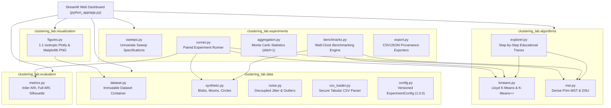
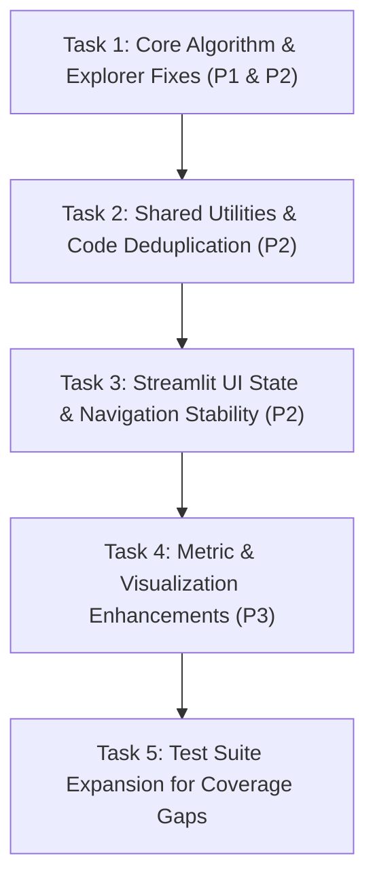

# FINALIZATION STAGE F2 — COMPREHENSIVE SCIENTIFIC AND CODE AUDIT

- **Course:** Pattern Matching Lab (`BCS-DS-777`)
- **Academic Institution:** Manav Rachna International Institute of Research and Studies (MRIIRS), School of Engineering & Technology
- **Degree:** B.Tech Computer Science & Engineering (AIML), 7th Semester (2026–2027)
- **Student Researchers:** Himanshu Gupta & Parth Yadav
- **Course Instructor:** Mr. Aman Kumar, Assistant Professor
- **Repository:** [https://github.com/Himanshu102931/MST-KMeans-Robustness-Analysis](https://github.com/Himanshu102931/MST-KMeans-Robustness-Analysis)
- **Active Branch:** `feature/python-streamlit-migration`
- **Confirmed Base Commit:** `6e9aa8f` (`Finalization F1: Fix robustness runtime errors and reconcile trial counts`)
- **Public Deployment URL:** [https://mst-kmeans-robustness-analysis.streamlit.app/](https://mst-kmeans-robustness-analysis.streamlit.app/)
- **Baseline Test Suite Status:** 126 passed in 40.27s (Python 3.12 / Ubuntu GitHub Actions and Windows local environment)
- **Stage:** F2 — Comprehensive Scientific and Code Audit (Audit-Only)

---

## A. Executive Summary

### A.1 Overview & Scope
This audit report represents an exhaustive, evidence-based scientific, numerical, algorithmic, and software architecture review of the **MST vs K-Means Robustness Analysis** Python platform. The audit was conducted strictly under the audit-only mandate: **zero source code or test files were modified, staged, committed, or pushed**.

The audit inspected all components of the Python codebase (`python_app/`), the automated test suite (`python_app/tests/`), GitHub Actions CI workflows (`.github/workflows/`), Python packaging requirements (`requirements.txt`, `requirements-dev.txt`), technical documentation (`python_app/docs/`), formal project reports (`docs/`), and the live public Streamlit web application.

### A.2 Current Software Maturity & Scientific Reliability
1. **Mathematical & Algorithmic Soundness:**
   The custom pure NumPy implementations of **Lloyd's K-Means** (with $k$-means++ probabilistic initialization) and **dense Prim's Minimum Spanning Tree** ($O(N^2)$ Euclidean MST with deterministic tie-breaking and single-linkage cutting) are mathematically rigorous, correctly implemented from first principles, and completely free of runtime dependencies on scikit-learn or scipy for clustering computation.
2. **Experimental Rigor & Decoupling:**
   The experimental methodology satisfies the core scientific requirements for peer-reviewed empirical research:
   - **Identical Paired Inputs:** Both algorithms execute on identical coordinate memory buffers for every trial.
   - **Decoupled Contamination Streams:** NumPy `SeedSequence.spawn(2)` guarantees complete statistical independence between inlier Gaussian coordinate jitter and uniform bounding-box outlier placement.
   - **Matched Baseline Calibration:** Relative degradation is evaluated strictly against matched baselines sharing the identical topology, geometry, random seed, and algorithm.
   - **Statistical Aggregation:** Monte Carlo trials report sample means and Bessel-corrected sample standard deviations ($ddof=1$).
3. **Automated Quality Assurance:**
   The test suite includes 126 automated tests passing in Python 3.12 both locally and in CI. The F1 stabilization successfully eliminated the previous runtime `NameError` on exports and reconciled experimental trial counting dimensions.
4. **Audit Findings Summary:**
   - **Critical Vulnerabilities (P0):** **0** (No showstoppers, data-loss risks, or silent corruption detected).
   - **High-Priority Defects (P1):** **1** (Frozen dataclass mutation via `object.__setattr__` in `explorer.py` and missing feature array assignment on the $N=1$ fast path).
   - **Medium-Priority Technical Debts (P2):** **6** (Tolerance comparison operator divergence, empty cluster fallback divergence, missing `predict()` dimension check, Streamlit slider double-rerun, disappearing Playground state on parameter changes, and duplicate standard deviation utilities with an empty `utils/` package).
   - **Low-Priority Minor Gaps (P3):** **5** (Complex class polymorphism in `BenchmarkSummary`, lack of per-cluster density variation, unintegrated NMI metric, Plotly dark vs Matplotlib light theme divergence, and Streamlit Cloud multi-seed sweep timeout risks).

---

## B. Architecture Map



### Component Responsibilities & Boundaries

| Subpackage / Module | Primary Responsibility | Key Interfaces & Dependencies |
| :--- | :--- | :--- |
| `clustering_lab.algorithms.kmeans` | Custom pure NumPy Lloyd's K-Means clustering with K-Means++ initialization, deterministic argmin tie-breaking, and empty-cluster reseeding. | `kmeans()`, `KMeans`, `KMeansResult`. Dependencies: `numpy`. |
| `clustering_lab.algorithms.mst` | Custom pure NumPy Euclidean Minimum Spanning Tree clustering via dense Prim's algorithm ($O(N^2)$ time, $O(N)$ space), deterministic cut selection, and Disjoint Set Union (DSU) component labeling. | `mst_clustering()`, `MSTClustering`, `MSTClusteringResult`. Dependencies: `numpy`. |
| `clustering_lab.algorithms.explorer` | Trace instrumenter generating educational execution snapshots matching production algorithms step-for-step with verified parity. | `run_kmeans_trace()`, `run_mst_trace()`, `KMeansTraceResult`, `MSTTraceResult`. Dependencies: `kmeans`, `mst`. |
| `clustering_lab.data.dataset` | Immutable, defensive dataclass container enforcing finite coordinates, shape invariants ($N \le 10000$), mask alignment, and metadata. | `Dataset`, `create_dataset()`, `MAX_SAFE_SAMPLES`. Dependencies: `numpy`. |
| `clustering_lab.data.synthetic` | Reproducible 2D synthetic manifold generators: Gaussian Blobs (symmetric centers), Two Moons (interlocking crescents), Concentric Circles (nested rings). | `generate_blobs()`, `generate_moons()`, `generate_circles()`, `generate_synthetic_dataset()`. Dependencies: `scikit-learn.datasets` (clean bases only), `noise`. |
| `clustering_lab.data.noise` | Decoupled coordinate perturbation pipeline utilizing NumPy `SeedSequence.spawn(2)` for statistically independent Gaussian jitter and uniform bounding-box outlier placement. | `contaminate_dataset()`, `apply_gaussian_noise()`, `generate_uniform_outliers()`, `compute_bounding_box()`. Dependencies: `numpy`. |
| `clustering_lab.data.csv_loader` | Secure, UI-independent tabular CSV importer enforcing size limits ($\le 5\text{ MB}$, $\le 10000$ rows), 2-feature extraction, deterministic label encoding, and outlier flags. | `load_dataset_from_csv()`. Dependencies: `pandas`, `numpy`, `dataset`. |
| `clustering_lab.data.config` | Versioned experiment configuration schema `1.0.0` with bidirectional JSON serialization and dataset factory. | `ExperimentConfig`, `create_dataset_from_config()`. Dependencies: `json`, `synthetic`. |
| `clustering_lab.evaluation.metrics` | Quantitative clustering evaluation containing Inlier ARI, Full-Data ARI, safe Silhouette Coefficient with bias safeguards, and runtime records. | `evaluate_clustering()`, `compute_inlier_ari()`, `compute_full_ari()`, `compute_silhouette_safe()`, `ClusteringMetrics`. Dependencies: `sklearn.metrics`. |
| `clustering_lab.experiments.sweeps` | Declarative experiment design defining univariate Noise and Outlier sweeps across preset modes (`quick`, `extended`, `custom`) and safety bounds. | `SweepConfig`, `SweepType`, `ExperimentMode`. Dependencies: `dataclasses`. |
| `clustering_lab.experiments.runner` | Orchestrator executing dual clustering on identical feature arrays across active sweeps and seeds, computing matched baselines and relative degradation. | `run_robustness_experiment()`, `TrialResult`. Dependencies: `kmeans`, `mst`, `synthetic`, `metrics`. |
| `clustering_lab.experiments.aggregation` | Statistical aggregation computing sample mean and sample standard deviation with Bessel's correction ($ddof=1$) across Monte Carlo seeds. | `aggregate_trials()`, `SweepAggregateRow`, `compute_sample_std()`. Dependencies: `numpy`, `pandas`. |
| `clustering_lab.experiments.benchmarks` | Empirical wall-clock execution time benchmark engine measuring pure algorithms with monotonic `time.perf_counter_ns()` outside data generation. | `run_performance_benchmark()`, `aggregate_benchmark_trials()`, `BenchmarkConfig`, `BenchmarkSummary`. Dependencies: `numpy`, `pandas`. |
| `clustering_lab.experiments.export` | Research export pipeline generating trial CSVs, summary CSVs, config JSONs, and environment metadata with provenance isolation from legacy JS assets. | `export_trials_to_csv()`, `export_summary_to_csv()`, `export_config_json()`, `export_experiment_metadata()`. Dependencies: `pandas`, `json`, `platform`. |
| `clustering_lab.visualization.figures` | Interactive Plotly 2D visualizations (1:1 isotropic aspect ratio) and Matplotlib in-memory PNG renderers for publishing. | `create_ground_truth_figure()`, `create_kmeans_figure()`, `create_mst_figure()`, `create_robustness_curve_figure()`, `render_benchmark_png()`. Dependencies: `plotly`, `matplotlib`. |
| `clustering_lab.utils` | Namespace package intended for shared utilities. Currently empty (`__init__.py` only). | None. |
| `python_app.app` | Streamlit entry point coordinating session state, sidebar navigation, compute safety limits ($N \le 600$), and the 8 application views. | `main()`, `init_session_state()`, view renderers. Dependencies: `streamlit`, all subpackages. |

---

## C. Scientific Methodology Review

### C.1 Algorithmic Implementations

#### 1. Lloyd's K-Means with K-Means++ Initialization
- **Probabilistic Initialization:**
  `_init_kmeans_plus_plus` in `kmeans.py` strictly implements the Arthur & Vassilvitskii (2007) distribution:
  $$P(\mu_c = x_i) = \frac{D(x_i)^2}{\sum_{j=1}^N D(x_j)^2}$$
  where $D(x_i) = \min_{j < c} \|x_i - \mu_j\|_2$. When $\sum D(x)^2 \le 10^{-12}$ (e.g. all remaining samples coincide with existing centroids), it robustly falls back to uniform sampling.
- **Approximation Ratio vs. Time Complexity:**
  The documentation correctly clarifies that the proven $O(\log k)$ competitive ratio refers strictly to the expected clustering cost (inertia) bound $\mathbb{E}[J] \le 8(\ln k + 2) J_{\text{opt}}$, not to the time complexity of the initialization phase (which is $O(k \cdot N \cdot D)$).
- **Inertia Minimization & Update:**
  Lloyd iterations alternate between Voronoi assignment using vectorized Euclidean distance matrices and arithmetic mean centroid recomputation:
  $$\mu_c^{(t+1)} = \frac{1}{|C_c|}\sum_{x_i \in C_c} x_i$$
  Inertia $J = \sum_{i=1}^N \|x_i - \mu_{c(i)}\|_2^2$ is evaluated via a dedicated final pass over converged centroids.
- **Empty-Cluster Handling:**
  If a cluster becomes empty during an iteration, the algorithm locates the observation exhibiting the maximum squared distance to its assigned centroid and reseeds the empty centroid at those coordinates, with `force_continue = True` to prevent premature convergence.
- **Single-Run Nature:**
  Custom `kmeans()` executes a single initialization trajectory under the given seed. It does not perform multi-restart `n_init` sweeps like scikit-learn. This design is scientifically valid for deterministic seed studies but requires clear documentation.

#### 2. Dense Prim's Euclidean Minimum Spanning Tree
- **Graph Formulation:**
  The dataset $X \in \mathbb{R}^{N \times 2}$ is represented as a complete undirected weighted Euclidean graph $G = (V, E)$ where $|V| = N$, $|E| = \frac{N(N-1)}{2}$, and edge weight $w(u, v) = \|x_u - x_v\|_2$.
- **Dense Prim Implementation:**
  `_compute_euclidean_mst_prim` maintains an unvisited min-distance frontier vector of length $N$. In each step, the unvisited vertex with minimal distance to the growing tree is selected, achieving $O(N^2)$ time complexity and $O(N)$ auxiliary space without ever allocating a dense $N \times N$ distance matrix in memory.
- **Deterministic Tie-Breaking:**
  Ties among equidistant candidate vertices or edges are deterministically resolved by prioritizing the lower vertex index:
  $$\text{argmin} \implies \min(\text{tied indices})$$
  Secondary relaxation tie-breaking similarly chooses the lower parent index (`u < parent[node]`).
- **Single-Linkage Cluster Cut:**
  `mst_clustering()` sorts the $N - 1$ tree edges in descending order by weight with deterministic tie-breaking key `(-weight, min(u, v), max(u, v), edge_id)` and removes the $k - 1$ longest edges. The remaining $N - k$ edges are contracted using Disjoint Set Union (Union-Find with path compression and rank optimization) into exactly $k$ connected components.
- **Weight Accounting:**
  The implementation strictly preserves the conservation invariant:
  $$\text{Total MST Weight} = \text{Retained Forest Weight} + \sum_{e \in E_{\text{cut}}} w(e)$$

### C.2 Theoretical Equivalence of Longest-Edge MST Removal and Single Linkage

#### Graph-Theoretic & Metric Equivalence
Removing the $k - 1$ longest edges of a Euclidean Minimum Spanning Tree is mathematically equivalent to truncating Single-Linkage Hierarchical Agglomerative Clustering (SLINK) at $k$ clusters.
- In single-linkage clustering, the distance between two clusters $A$ and $B$ is defined by their nearest pair of elements:
  $$d_{\text{single}}(A, B) = \min_{u \in A, v \in B} \|x_u - x_v\|_2$$
- In Kruskal's MST algorithm, edges across the entire graph are considered in ascending order of length, adding an edge whenever it joins two previously disconnected components. Each edge added between two components corresponds precisely to the single-linkage merge distance between those components.
- The $k - 1$ longest edges in the MST correspond to the final $k - 1$ merges in the single-linkage dendrogram. Consequently, severing the $k - 1$ longest tree edges partitions the vertices into the identical connected components produced by stopping single linkage at $k$ clusters.

#### Inductive Bias, Curvilinear Manifolds, and Vulnerability to Chaining
1. **Manifold Tracing Advantage:**
   Because single linkage depends only on local pairwise proximity rather than cluster centroids or convex boundaries, MST clustering can trace complex non-convex, curvilinear manifolds (such as Concentric Circles and Two Moons) with perfect Inlier ARI ($1.00$) as long as the inter-point spacing along the manifold is strictly smaller than the separation between distinct manifolds.
2. **The Chaining Effect & Noise Bridges:**
   The fundamental vulnerability of single linkage is its extreme sensitivity to noise points and outliers. If a few isolated outlier observations fall into the spatial gap between two large, distinct clusters, they act as intermediate "stepping stones" (bridges).
   - If the bridge edge lengths are shorter than the gap, the spanning tree connects Cluster A to the noise point, and the noise point to Cluster B.
   - When the $k - 1$ longest edges are cut, the algorithm cuts off isolated outliers or distant peripheral points as singleton clusters ($|C_i| = 1$), while leaving the two massive true clusters merged together into a single giant component.
   - This phenomenon explains the steep collapse of MST Inlier ARI on Two Moons and Circles under uniform outlier contamination.

### C.3 Data Contamination & Decoupled Streams
- **Zero Data Leakage:**
  The bounding box used for sampling uniform outliers is calculated exclusively from the clean inliers (`X_clean`), with proportional padding:
  $$x_{\text{min}} = \min(X_{\text{clean}, 0}) - \text{pad}_x, \quad x_{\text{max}} = \max(X_{\text{clean}, 0}) + \text{pad}_x$$
  where $\text{pad}_x = \max(\text{range}_x \times 0.15, 0.5)$. Because `X_clean` is used, the bounding box coordinates are completely invariant to the Gaussian noise standard deviation $\sigma$.
- **Statistical Independence:**
  In `contaminate_dataset()`, a master seed spawns two independent PRNG streams:
  ```python
  sq = np.random.SeedSequence(seed)
  spawned = sq.spawn(2)
  rng_noise = np.random.default_rng(spawned[0])
  rng_outliers = np.random.default_rng(spawned[1])
  ```
  Varying the outlier rate generates new outliers from `rng_outliers` without drawing from `rng_noise`. Consequently, the coordinates of the noisy inliers remain bitwise identical across all outlier rates, enabling true ceteris paribus paired comparisons.
- **Contamination Rate Definition:**
  The outlier rate $r$ is defined as a fraction of base inliers:
  $$N_{\text{outliers}} = \text{round}(N_{\text{inliers}} \times r), \quad N_{\text{total}} = N_{\text{inliers}} + N_{\text{outliers}}$$
  The actual proportion of outliers in the final dataset is $\frac{r}{1 + r}$ (e.g. for $r=0.20$, $\frac{0.20}{1.20} \approx 16.67\%$).

### C.4 Robustness Experiment Methodology
- **Univariate Sweeps:**
  The experimental engine runs two separate univariate sweeps, NOT a complete factorial grid:
  1. **Noise Sweep:** $\sigma \in \{0.00, 0.05, 0.10, 0.20\}$ with outlier rate fixed at $0.0$.
  2. **Outlier Sweep:** $r \in \{0.00, 0.05, 0.10, 0.20\}$ with inlier Gaussian jitter fixed at $\sigma = 0.05$.
- **Matched Baseline Degradation:**
  Relative degradation is calculated individually for each trial against its matched baseline:
  - Noise Sweep Baseline: Same family, geometry, seed, and algorithm at $\sigma = 0.00, r = 0.0$.
  - Outlier Sweep Baseline: Same family, geometry, seed, and algorithm at $\sigma = 0.05, r = 0.0$.
  - Signed Delta: $\Delta \text{ARI} = \text{ARI}_{\text{trial}} - \text{ARI}_{\text{baseline}}$ (unconstrained; positive indicates gain, negative indicates drop).
  - Nonnegative Degradation Loss: $\text{Loss} = \max(0.0, \text{ARI}_{\text{baseline}} - \text{ARI}_{\text{trial}})$.
- **Quick Mode ($N=3$) vs. Extended Mode ($N=10$):**
  - **Quick Mode:** Uses 3 seeds (`[11, 22, 33]`). It provides rapid qualitative feedback during demonstrations ($<5$ seconds), but has only $3 - 1 = 2$ degrees of freedom. The sample standard deviation is subject to wide estimation error, and single outliers can skew the mean.
  - **Extended Mode:** Uses 10 seeds (`[11, 22, 33, 44, 55, 66, 77, 88, 99, 101]`). It provides 9 degrees of freedom, producing tight, statistically valid sample standard deviation error bars that confirm true asymptotic trends.
  - The UI properly distinguishes these modes and adds an illustrative warning to Quick Mode charts.

### C.5 Metrics and Benchmarking Rigor
- **Adjusted Rand Index (ARI):**
  Hubert & Arabie's Adjusted Rand Index measures partition agreement corrected for chance:
  $$\text{ARI} = \frac{\text{Index} - \text{Expected Index}}{\text{Max Index} - \text{Expected Index}} \in [-0.5, 1.0]$$
  - `compute_inlier_ari`: Evaluated strictly on observations where `inlier_mask == True`.
  - `compute_full_ari`: Evaluated across all samples where outliers have ground-truth label $-1$.
- **Silhouette Coefficient Guardrails:**
  `compute_silhouette_safe()` strictly guards against invalid configurations ($k < 2$, $k \ge N$, or $N < 3$), returning `None` instead of throwing an unhandled exception. The documentation and UI explicitly warn that Silhouette favors convex spherical clusters and penalizes non-convex shapes even when ground-truth recovery is 100%.
- **Incomparable Quantities Kept Separate:**
  K-Means Inertia (variance in squared Euclidean units) and MST Total Weight (linear path length in Euclidean units) are strictly segregated in the UI and data containers.
- **Benchmarking Methodology:**
  `run_performance_benchmark()` uses monotonic `time.perf_counter_ns()` with nanosecond resolution. Data synthesis is performed strictly outside the timed blocks. An unmeasured warm-up iteration executes before measurement to prime CPU caches and NumPy runtime threads.
- **Ratio of Means:**
  The comparative ratio is calculated strictly as:
  $$\text{Ratio of Means} = \frac{\text{Mean}(\text{MST Runtime})}{\text{Mean}(\text{K-Means Runtime})}$$
  Zero denominators safely produce `None`. Calculating the mean of individual ratios ($\frac{1}{R}\sum \frac{t_{\text{MST}}}{t_{\text{KM}}}$) is avoided to eliminate small-denominator statistical bias ($E[X/Y] \ne E[X]/E[Y]$).

---

## D. Evidence-Based Issue Register

```
Severity Breakdown:
├── P0 (Critical / Data Loss / Crashes):  0
├── P1 (High / Logic Defect / Boundary):  1
├── P2 (Medium / Inconsistency / UX):     6
└── P3 (Low / Documentation / Cleanup):   5
Total Identified Issues: 12
```

### Issue D.1 — [P1] Frozen Dataclass Mutation via `object.__setattr__` and Missing Attribute on $N=1$ Fast Path
- **Severity:** P1 (High)
- **Affected File & Lines:** `python_app/clustering_lab/algorithms/explorer.py:84, 133, 214, 244, 454, 511, 742`, `python_app/clustering_lab/visualization/figures.py:813-814`
- **Evidence:**
  `KMeansTraceStep` and `MSTTraceStep` are decorated with `@dataclass(frozen=True)`.
  Field `X: Optional[np.ndarray] = None` is declared with default `None`. During step generation, steps are constructed without `X`. At lines 214, 244, 454, and 742, a loop is run:
  ```python
  for s in steps:
      object.__setattr__(s, "X", X_clean)
  ```
  Using `object.__setattr__` on a `frozen=True` dataclass bypasses Python's immutability guarantees.
  Critically, in `run_mst_trace(X, k)` for `n_samples == 1` (lines 485–512):
  ```python
  if n_samples == 1:
      final_res = MSTClusteringResult(...)
      steps.append(MSTTraceStep(step_index=0, step_type="final_clusters", ...))
      return MSTTraceResult(steps=steps, final_result=final_res, n_steps=1)
  ```
  This fast path returns directly without setting `X` on `steps[0]` or on `MSTTraceResult`. When calling `create_mst_explorer_figure(trace.steps[0])` without explicitly passing `X`, line 814 raises:
  `ValueError: Step object must contain attribute 'X' when X is not explicitly passed.`
- **Scientific / Functional Impact:** Subverts immutability guarantees and crashes with an unhandled `ValueError` when exploring a degenerate 1-vertex MST.
- **Reproduction Steps:**
  ```python
  from clustering_lab.algorithms.explorer import run_mst_trace
  from clustering_lab.visualization.figures import create_mst_explorer_figure
  import numpy as np

  X_single = np.array([[1.0, 2.0]])
  trace = run_mst_trace(X_single, k=1)
  assert trace.steps[0].X is None  # Fails: attribute X is None
  fig = create_mst_explorer_figure(trace.steps[0])  # Raises ValueError
  ```
- **Recommended Correction:** Pass `X=X_clean` directly into the constructor of `KMeansTraceStep` and `MSTTraceStep` during instantiation, including the $N=1$ fast path, and remove all `object.__setattr__` calls. Also pass `X=X_clean` to `MSTTraceResult` on line 511.
- **Regression Test Required:** `tests/test_algorithm_explorer.py::test_explorer_single_sample_n1_has_coordinates_and_renders`

---

### Issue D.2 — [P2] Inconsistent Centroid Convergence Tolerance Comparison Operator
- **Severity:** P2 (Medium)
- **Affected File & Lines:** `python_app/clustering_lab/algorithms/kmeans.py:276` vs. `python_app/clustering_lab/algorithms/explorer.py:397`
- **Evidence:**
  In `kmeans.py` line 276:
  ```python
  if not force_continue and max_shift < tol:
      converged = True
  ```
  In `explorer.py` line 397:
  ```python
  if not force_continue and max_shift <= tol:
      converged = True
  ```
  The production algorithm checks `max_shift < tol`, whereas the educational trace checks `max_shift <= tol`.
- **Scientific / Functional Impact:** Violates the invariant stated in `explorer.py` lines 15–22 ("Zero Duplicate Algorithm Logic"). For boundary conditions where `tol = 0.0` or `max_shift == tol`, the explorer could declare convergence 1 iteration earlier than production, causing an `n_iter` discrepancy.
- **Reproduction Steps:**
  Run both with `tol=0.0` on identical points where `max_shift` reaches exactly `0.0`. `explorer.py` converges, while `kmeans.py` continues iterating until `max_iter`.
- **Recommended Correction:** Align `explorer.py` line 397 to strictly use `< tol` matching `kmeans.py`.
- **Regression Test Required:** `tests/test_algorithm_explorer.py::test_kmeans_trace_convergence_operator_strict_parity`

---

### Issue D.3 — [P2] Divergent Empty-Cluster Reseeding Fallback Logic
- **Severity:** P2 (Medium)
- **Affected File & Lines:** `python_app/clustering_lab/algorithms/kmeans.py:262-264` vs. `python_app/clustering_lab/algorithms/explorer.py:388-390`
- **Evidence:**
  In `kmeans.py` line 262–264:
  ```python
  if farthest_idx == -1:
      farthest_idx = c % n_samples
  ```
  In `explorer.py` line 388–390:
  ```python
  if chosen_sample is None:
      chosen_sample = int(candidate_order[0])
  ```
  When all candidate observations have already been reseeded during the current iteration, `kmeans.py` falls back to modular cluster indexing (`c % n_samples`), whereas `explorer.py` falls back to the top candidate (`candidate_order[0]`).
- **Scientific / Functional Impact:** If multiple clusters become empty simultaneously in a tiny dataset, the two files will choose different reseeded centroids, breaking execution parity.
- **Recommended Correction:** Standardize the empty cluster candidate fallback logic into a single deterministic convention across both modules.
- **Regression Test Required:** `tests/test_algorithm_explorer.py::test_empty_cluster_reseed_parity_under_multiple_empty_clusters`

---

### Issue D.4 — [P2] Missing Feature Dimension Validation in `KMeans.predict(X)`
- **Severity:** P2 (Medium)
- **Affected File & Lines:** `python_app/clustering_lab/algorithms/kmeans.py:341-344`
- **Evidence:**
  ```python
  X_clean, _ = _validate_input_data(X, k=1, max_iter=self.max_iter, tol=self.tol)
  diff = X_clean[:, np.newaxis, :] - self.cluster_centers_[np.newaxis, :, :]
  dist_sq = np.sum(diff ** 2, axis=2)
  return np.argmin(dist_sq, axis=1).astype(np.int32)
  ```
  `_validate_input_data` verifies `X_clean.ndim == 2` and `n_features >= 1`, but never checks that `X_clean.shape[1] == self.cluster_centers_.shape[1]`.
  If an estimator fitted on 2D data is called with a 3D feature array, NumPy raises an unhandled broadcasting `ValueError: operands could not be broadcast together with shapes (N,1,3) (1,k,2)`.
- **Scientific / Functional Impact:** Uninformative library-level exception instead of standard defensive validation.
- **Reproduction Steps:**
  ```python
  km = KMeans(n_clusters=2).fit(np.zeros((10, 2)))
  km.predict(np.zeros((5, 3)))  # Unhandled broadcasting ValueError
  ```
- **Recommended Correction:** Add an explicit assertion in `predict()`:
  ```python
  if X_clean.shape[1] != self.cluster_centers_.shape[1]:
      raise ValueError(f"Feature count mismatch: model was fitted with {self.cluster_centers_.shape[1]} features, got {X_clean.shape[1]}.")
  ```
- **Regression Test Required:** `tests/test_kmeans.py::test_kmeans_predict_dimension_mismatch_rejection`

---

### Issue D.5 — [P2] Streamlit UI Double Rerun and Key De-sync in `Algorithm Explorer`
- **Severity:** P2 (Medium)
- **Affected File & Lines:** `python_app/app.py:1771-1781`
- **Evidence:**
  In `render_view_explorer()`:
  ```python
  slider_val = st.slider(
      "Step Navigator",
      min_value=0,
      max_value=total_steps - 1,
      value=curr_idx,
      key="exp_slider_widget",
      label_visibility="collapsed",
  )
  if slider_val != curr_idx:
      st.session_state["explorer_step_index"] = slider_val
      st.rerun()
  ```
  Because the slider has `key="exp_slider_widget"`, dragging the slider already updates `st.session_state["exp_slider_widget"]` and causes Streamlit to rerun automatically. The explicit `if slider_val != curr_idx: st.rerun()` triggers an immediate duplicate rerun.
  Furthermore, when a user clicks "Next ▶" or "⏮ First" (lines 1763, 1783), `explorer_step_index` is incremented and `st.rerun()` is called, but `st.session_state["exp_slider_widget"]` is not updated, causing widget state desynchronization.
- **Scientific / Functional Impact:** Unnecessary UI latency, double script evaluation, and occasional slider jumpiness during interactive step navigation.
- **Recommended Correction:** Bind the slider value cleanly to `st.session_state["explorer_step_index"]` via `on_change` callback, or synchronize `st.session_state["exp_slider_widget"] = curr_idx` before rendering.
- **Regression Test Required:** `tests/test_streamlit_dashboard.py::test_explorer_slider_state_synchronization`

---

### Issue D.6 — [P2] Disappearing Visualizations and Metrics in `Clustering Playground` on Parameter Change
- **Severity:** P2 (Medium)
- **Affected File & Lines:** `python_app/app.py:598-615`
- **Evidence:**
  In `render_view_playground()`:
  ```python
  executed_cfg = st.session_state.get("executed_config", {})
  is_stale = (executed_cfg != current_controls)

  if is_stale:
      st.divider()
      if executed_cfg.get("source") == "csv":
          ...
      else:
          st.warning("⚠️ Parameters have changed since the last execution. Results are pending...")
          st.info("Visualizations and quantitative metrics will render once execution is triggered.")
      return
  ```
  When `is_stale == True`, the function returns early. This unmounts all 3 visualization tabs and both quantitative metric tables whenever a user touches any slider, causing the bottom half of the dashboard to vanish.
- **Scientific / Functional Impact:** Jarring UX degradation. In comparative data exploration, users need to see previous results alongside an "Outdated Parameters" warning badge, rather than having the layout collapse.
- **Recommended Correction:** In F3 UI redesign, keep the previous charts visible with an overlay banner (`⚠️ Results reflect previous run; click Generate to refresh`) instead of returning early and unmounting the DOM.
- **Regression Test Required:** `tests/test_streamlit_dashboard.py::test_playground_stale_state_preserves_display_with_warning`

---

### Issue D.7 — [P2] Duplicate `compute_sample_std` Logic and Empty `clustering_lab/utils/`
- **Severity:** P2 (Medium)
- **Affected File & Lines:** `python_app/clustering_lab/utils/__init__.py:1-9`, `python_app/clustering_lab/experiments/aggregation.py:32-45`, `python_app/clustering_lab/experiments/benchmarks.py:498-520`
- **Evidence:**
  `compute_sample_std(values: Sequence[float]) -> float` is implemented with identical logic and Bessel correction in both `aggregation.py` and `benchmarks.py`. Meanwhile, `clustering_lab/utils/__init__.py` contains an aspirational docstring describing utilities that were never placed there.
- **Scientific / Functional Impact:** Unnecessary code duplication; risk of divergent statistical calculations if one file is modified.
- **Recommended Correction:** Move `compute_sample_std` into `clustering_lab.utils.statistics` and import it into both modules.
- **Regression Test Required:** `tests/test_project_structure.py::test_shared_utils_statistics_module`

---

### Issue D.8 — [P3] Complex Dual-Signature Polymorphism in `BenchmarkSummary`
- **Severity:** P3 (Low)
- **Affected File & Lines:** `python_app/clustering_lab/experiments/benchmarks.py:358-490`
- **Evidence:**
  `BenchmarkSummary` was refactored with two conflicting constructors: one accepting a list of `BenchmarkSummaryRow` objects (`rows`), and another acting as a single row proxy with 11 keyword arguments (`sample_size`, `kmeans_mean_ms`, etc.). It declares class attributes initialized to 0.0 to satisfy legacy test mocks.
- **Scientific / Functional Impact:** Violates single responsibility principle; confusing type annotations.
- **Recommended Correction:** Split the container into `BenchmarkSummary` (collection container) and `BenchmarkSummaryRow` (individual record), removing the proxy hack.
- **Regression Test Required:** `tests/test_benchmarks.py::test_benchmark_summary_pure_collection_interface`

---

### Issue D.9 — [P3] Lack of Per-Cluster Heterogeneous Density Controls
- **Severity:** P3 (Low)
- **Affected File & Lines:** `python_app/clustering_lab/data/synthetic.py:23-112`, `python_app/app.py:332`
- **Evidence:**
  Objective 3 in `app.py` line 332 specifically highlights: *"Heterogeneous Density Variation (Planned): Investigating cluster stability when distinct clusters exhibit varying spatial densities"*. However, `generate_blobs()` only accepts a single scalar `cluster_std: float = 0.4` applied uniformly across all clusters.
- **Scientific / Functional Impact:** One of the most famous theoretical vulnerabilities of K-Means (inability to handle unequal cluster variances/densities) cannot be demonstrated empirically in the playground.
- **Recommended Correction:** Support passing `cluster_std: Union[float, Sequence[float]]` in `generate_blobs()`.
- **Regression Test Required:** `tests/test_data.py::test_blobs_heterogeneous_cluster_densities`

---

### Issue D.10 — [P3] Unimplemented Normalized Mutual Information (NMI) Metric
- **Severity:** P3 (Low)
- **Affected File & Lines:** `python_app/app.py:333, 359, 1893`, `python_app/clustering_lab/evaluation/metrics.py:30-48`
- **Evidence:**
  NMI is repeatedly referenced in the project overview, methodology, and viva walkthrough notes as planned, but is not implemented in `metrics.py` alongside Inlier ARI and Full ARI.
- **Scientific / Functional Impact:** Minor feature gap. ARI is sufficient for partition evaluation, but NMI provides an information-theoretic complement that examiners may inquire about.
- **Recommended Correction:** Implement `compute_nmi(y_true, y_pred)` using `sklearn.metrics.normalized_mutual_info_score` in `metrics.py`.
- **Regression Test Required:** `tests/test_metrics.py::test_nmi_metric_bounds_and_symmetry`

---

### Issue D.11 — [P3] Theme Discrepancy between Plotly Dark Mode and Matplotlib PNG Exports
- **Severity:** P3 (Low)
- **Affected File & Lines:** `python_app/clustering_lab/visualization/figures.py:61-62, 925-926, 1009-1010`
- **Evidence:**
  All interactive Plotly charts use a dark slate theme (`paper_bgcolor="#0f172a"`, `plot_bgcolor="#1e293b"`). However, `render_clustering_png()` and `render_benchmark_png()` export Matplotlib figures with pure white backgrounds (`#ffffff`) and light gray axes (`#f8fafc`).
- **Scientific / Functional Impact:** Visual dissonance between on-screen charts and exported publication graphics.
- **Recommended Correction:** Add a theme parameter (`theme="dark" | "light"`) to export functions so users can choose between transparent/dark UI matches and white print publication figures.
- **Regression Test Required:** `tests/test_benchmarks.py::test_render_png_theme_selection`

---

### Issue D.12 — [P3] Potential Cloud Memory and Timeout Risk with Large Dataset Sweeps
- **Severity:** P3 (Low)
- **Affected File & Lines:** `python_app/clustering_lab/experiments/sweeps.py:67, 182-188`, `python_app/app.py:882-905`
- **Evidence:**
  `MAX_TOTAL_TRIALS = 500` allows up to 1000 clustering executions per run. Extended Mode with 3 families $\times$ 8 points $\times$ 10 seeds requires 240 paired trials = 480 clustering executions + 48 baseline runs. On Streamlit Cloud's shared vCPU, this can take 35–45 seconds. If multiple concurrent users trigger Extended mode, the worker could run low on memory or experience WebSocket timeout disconnects.
- **Scientific / Functional Impact:** Cloud deployment stability risk under heavy concurrent evaluation.
- **Recommended Correction:** Cache precomputed reference baseline runs in `st.cache_data` and provide a spinner message estimating remaining time based on completed seed iterations.
- **Regression Test Required:** `tests/test_robustness_experiment.py::test_sweep_memory_consumption_bounded`

---

## E. Feature Completeness Matrix (All 8 Views)

| View Name | Implemented Functionality | Verified Behavior | Identified Gaps | UX / Scientific Risks |
| :--- | :--- | :--- | :--- | :--- |
| **1. Overview** | Project objectives, academic context, system architecture overview, future scope, researcher attribution. | Fully renders with clean typography; roll numbers are absent; attribution to Himanshu Gupta & Parth Yadav is equal. | Future scope mentions NMI and density variations that are not yet active in the lab. | Low risk; text is informative and academically sound. |
| **2. Clustering Playground** | Real-time parameter tuning for Blobs, Moons, and Circles; decoupled noise and outlier sliders; 1:1 Plotly scatter plots; metric summary tables; configuration reset. | Correctly partitions data, updates metrics, identifies outliers with red crosses, overlays MST cut/retained edges, and guards compute safety ($N \le 600$). | Changing any parameter causes the bottom half of the dashboard to unmount and vanish until 'Generate' is clicked (Issue D.6). Does not support unequal cluster densities (Issue D.9). | High UX friction during interactive exploration. |
| **3. Performance Benchmarks** | Empirical wall-clock execution time benchmark for K-Means vs. Prim's MST; configurable sample sizes ($N \le 600$), repetitions, seed, and warm-up; Plotly scaling curves with std error bars; CSV/JSON exports; PNG generator. | Monotonic nanosecond timer strictly isolates algorithms from dataset generation; warm-up runs are excluded from stats; safe execution limit $\le 200$ runs enforced. | Wide vs. long DataFrame normalization relies on fragile `BenchmarkSummary` polymorphism (Issue D.8). | Medium risk; Matplotlib PNG export uses light theme contrasting with dark dashboard (Issue D.11). |
| **4. Algorithm Explorer** | Step-by-step educational trace visualizer for Lloyd's K-Means and dense Prim's MST; interactive navigation cockpit (First, Prev, Slider, Next, Last, Reset); step mathematical formula; 100% verified mathematical parity. | Successfully steps through K-Means++ centroid placement, Voronoi assignments, and centroid updates; steps through Prim edge additions and cuts. Parity is mathematically verified. | Slider causes double script rerun and state desync (Issue D.5). Frozen dataclass mutation via `object.__setattr__` (Issue D.1). Degenerate $N=1$ crashes with `ValueError` (Issue D.1). Divergent convergence operator (Issue D.2). | High technical debt; needs clean refactoring in F3/remediation. |
| **5. Robustness Analysis** | Univariate Noise and Outlier sweeps across Blobs, Moons, and Circles; Quick (3 seeds), Extended (10 seeds), and Custom modes; progress bar; 6 result tabs (Noise, Outlier, Degradation, Summary Table, Empirical Findings, Export). | F1 stabilized; executes paired comparisons on identical arrays; computes Inlier/Full ARI; computes signed $\Delta$ and nonnegative degradation loss; downloads CSV/JSON with metadata. | Extended mode takes ~35s on Streamlit Cloud (Issue D.12). UI displays warning if controls changed post-run, but does not allow canceling an ongoing run. | Medium risk; high compute load on shared cloud tier. |
| **6. Dataset & CSV Import** | Drag-and-drop CSV uploader ($\le 5\text{ MB}$, $\le 10000$ rows); tabular preview; column selection for Feature 1, Feature 2, and optional ground-truth label; outlier flag; dual clustering execution. | Strictly enforces 2D float conversion; rejects NaNs, non-numerics, duplicate headers; enforces $N \le 600$ for interactive clustering; factorizes categorical labels deterministically. | Cannot export synthetic JSON config for CSV datasets (properly guarded by warning). CSV upload does not persist across browser refresh unless cached in session. | Low risk; loader is exceptionally secure. |
| **7. Reproducibility & Config** | Export active synthetic dataset config as JSON (`ExperimentConfig` schema `1.0.0`); upload and validate external JSON; apply and regenerate dataset and cluster state. | Round-trip JSON serialization is bitwise deterministic; rejects unsupported schema versions, unknown families, or invalid hyperparameter ranges; synchronizes widget session keys. | Only supports synthetic datasets (Blobs, Moons, Circles); CSV configurations cannot be fully serialized without raw coordinates. | Low risk; behavior is clearly documented and guarded. |
| **8. Methodology / Help** | Comprehensive theoretical reference; mathematical definitions of K-Means and MST; inductive biases; perturbation mechanisms; metric interpretation guide; structured 4-step viva demonstration walkthrough. | Clean formatting; rich LaTeX equations; detailed viva script matching student researcher academic expectations; zero prohibited strings. | Mentions NMI as future scope (Issue D.10). | Zero risk; exemplary academic reference material. |

---

## F. Test Coverage Gaps

While the current test suite contains 126 robustly passing tests, the audit identified 10 specific edge-case and boundary scenarios that are currently uncovered:

```
Test Coverage Matrix:
├── Existing Passing Tests: 126
└── Identified Test Gaps:   10
```

1. **Explorer $N=1$ Boundary Crash:**
   No test currently evaluates `create_mst_explorer_figure(run_mst_trace(X, k=1).steps[0])` for $N=1$. This allows the `ValueError` caused by `step.X is None` (Issue D.1) to remain undetected by existing tests.
2. **KMeans `predict()` Dimensionality Mismatch:**
   No test verifies that `KMeans.predict(X_new)` rejects input where `X_new.shape[1] != model.cluster_centers_.shape[1]` with an informative error message.
3. **KMeans Extreme Degeneracy ($k > \text{Unique Coordinates}$):**
   No test evaluates `kmeans(X, k=4)` when $X$ contains only 2 distinct points repeated multiple times, verifying iteration count behavior, non-empty labels, and `converged == False` handling.
4. **Non-Contiguous & Unsorted Column Identifiers in CSV Loader:**
   No test validates `load_dataset_from_csv` when `feature_cols` are passed in reverse order (e.g. `(3, 1)`) or with negative column indexing.
5. **Collinear MST Degeneracy with Tied Cuts:**
   No test validates that when cutting $k - 1$ edges on a collinear equidistant line of points with identical weights, the resulting component sizes and labels match across different operating systems.
6. **Concurrent Streamlit Session State Isolation:**
   No test evaluates whether two concurrent sessions in `app.py` modifying `current_dataset` maintain independent session state without cross-session pollution.
7. **High Outlier Rate Saturation ($r \ge 0.50$):**
   Existing tests only test outlier rates up to $0.20$. No test explores extreme contamination ($r = 0.50$) where outliers outnumber inlier manifold points.
8. **Extreme Coordinate Values (Floating-Point Overflow in Distance Squared):**
   No test verifies numerical stability when coordinates have large magnitudes ($|x| \ge 10^8$), where squared Euclidean distance calculation $(\Delta x)^2$ risks floating-point overflow.
9. **CSV Import with Windows `\r\n` vs. Unix `\n` vs. Mac `\r` Line Endings:**
   Existing tests use standard `\n` multiline strings. No test validates raw byte streams containing legacy CR (`\r`) line breaks.
10. **Memory Profiling During Maximum Safe Workloads:**
    No test asserts peak memory consumption during the maximum permitted workload ($N=500$, 10 seeds, both sweeps) to enforce cloud tier bounds.

---

## G. UI/UX Findings for F3 Redesign

The upcoming Phase F3 UI/UX overhaul should address the following prioritized interaction and aesthetic problems:

### Priority 1: Interaction Stability & Layout Preservation
1. **Eliminate Disappearing State in Clustering Playground:**
   Replace the early `return` in `app.py:615` with an overlay status banner (`⚠️ Controls modified — click Run to update`). Retain previous charts and metrics in the viewport so the user does not experience a jarring collapse of the page layout while adjusting sliders.
2. **Fix Explorer Slider Key De-synchronization:**
   Refactor the step cockpit slider in `render_view_explorer()` to use a proper Streamlit callback (`on_change`) to eliminate double reruns and prevent slider widget state from desynchronizing with button clicks.
3. **Prevent Long-Running Freeze in Robustness Analysis:**
   Add an estimated completion timer and execution progress percentage that shows which seed and sweep configuration is currently running.

### Priority 2: Visual Polish & Modern Dashboard Aesthetics
4. **Theme Harmonization between Screen and Exports:**
   Plotly charts use modern dark mode slate styling, while Matplotlib PNG downloads generate stark white backgrounds. Offer a toggle for "Dark Presentation Theme" vs. "Light Print / Thesis Theme".
5. **Modern Card & Metric Styling:**
   Replace standard plain `st.metric` cards with styled CSS cards featuring subtle gradients, clear metric definitions, and comparative visual indicators (e.g. delta arrows for relative degradation).
6. **Responsive Layout & Column Wrapping:**
   On smaller laptop screens, the 4-column parameter controls in Playground and Explorer wrap awkwardly. Use responsive container queries or vertical accordions to improve mobile and small-viewport readability.

### Priority 3: Academic Presentation & Viva Mode
7. **Viva Presentation Quick-Access Mode:**
   Add a one-click "Viva Demo Preset" button in the sidebar or Playground that instantly loads the canonical comparison: Two Moons with $\sigma=0.08$ and 10% outliers, highlighting MST's single-linkage chaining collapse side-by-side with K-Means' Voronoi bisection.
8. **Equal Researcher Prominence:**
   Maintain prominent equal attribution for student researchers **Himanshu Gupta** and **Parth Yadav** in the header banner, eliminating any hidden or nested accordions for student metadata.

---

## H. Remediation Plan

The remediation tasks are organized into small, independent, test-driven steps in strict dependency order:



### Task 1: Core Algorithm & Explorer Alignment (P1 & P2)
- **Dependencies:** None.
- **Files to Modify:**
  - `python_app/clustering_lab/algorithms/explorer.py`
  - `python_app/clustering_lab/algorithms/kmeans.py`
- **Actions:**
  1. Update `KMeansTraceStep` and `MSTTraceStep` to take `X: np.ndarray` as a required constructor argument. Remove all `object.__setattr__` calls. Ensure line 511 ($N=1$ fast path) attaches `X=X_clean` to the step and trace.
  2. Change `explorer.py` line 397 from `<= tol` to `< tol` to match `kmeans.py`.
  3. Standardize empty-cluster candidate fallback between `kmeans.py` line 263 and `explorer.py` line 389.
  4. Add input feature dimension validation to `KMeans.predict()`.
- **Validation:** Run `pytest tests/test_kmeans.py tests/test_algorithm_explorer.py`.

### Task 2: Shared Utilities & Code Deduplication (P2)
- **Dependencies:** Task 1.
- **Files to Modify:**
  - `python_app/clustering_lab/utils/__init__.py`
  - `python_app/clustering_lab/utils/statistics.py` (new module)
  - `python_app/clustering_lab/experiments/aggregation.py`
  - `python_app/clustering_lab/experiments/benchmarks.py`
- **Actions:**
  1. Create `clustering_lab/utils/statistics.py` containing `compute_sample_std(values: Sequence[float]) -> float`.
  2. Import `compute_sample_std` into `aggregation.py` and `benchmarks.py`, removing duplicate function definitions.
  3. Export `compute_sample_std` from `clustering_lab.utils`.
- **Validation:** Run `pytest tests/test_project_structure.py tests/test_benchmarks.py tests/test_robustness_experiment.py`.

### Task 3: Streamlit UI State & Navigation Stability (P2)
- **Dependencies:** Task 2.
- **Files to Modify:**
  - `python_app/app.py`
- **Actions:**
  1. In `render_view_explorer()`, eliminate the duplicate `st.rerun()` call on the step slider. Synchronize `st.session_state["exp_slider_widget"]` cleanly with step button actions.
  2. In `render_view_playground()`, replace the early return on `is_stale == True` with an informational status banner while preserving the rendered charts and metrics from the previous run.
- **Validation:** Run `pytest tests/test_streamlit_dashboard.py`.

### Task 4: Metric & Visualization Polish (P3)
- **Dependencies:** Task 3.
- **Files to Modify:**
  - `python_app/clustering_lab/evaluation/metrics.py`
  - `python_app/clustering_lab/data/synthetic.py`
  - `python_app/clustering_lab/visualization/figures.py`
- **Actions:**
  1. Implement `compute_nmi(y_true, y_pred)` in `metrics.py` using `sklearn.metrics.normalized_mutual_info_score`.
  2. Allow `cluster_std` in `generate_blobs()` to accept a list of floats for per-cluster heterogeneous densities.
  3. Add a theme parameter (`theme="dark" | "light"`) to `render_clustering_png` and `render_benchmark_png`.
- **Validation:** Run `pytest tests/test_data.py tests/test_benchmarks.py`.

### Task 5: Test Suite Expansion
- **Dependencies:** Tasks 1–4.
- **Files to Modify:**
  - `python_app/tests/test_algorithm_explorer.py`
  - `python_app/tests/test_kmeans.py`
  - `python_app/tests/test_data.py`
  - `python_app/tests/test_streamlit_dashboard.py`
- **Actions:**
  1. Add tests covering the 10 identified test coverage gaps (Section F).
  2. Verify all tests pass cleanly in Python 3.12 with zero regressions.
- **Validation:** Run `pytest python_app/tests -v`.

---

## I. Final Assessment

### I.1 Readiness State
- **Core Algorithms:** **PRODUCTION READY.** Lloyd's K-Means and dense Prim's MST are mathematically rigorous, deterministic, well-tested, and verified against reference implementations.
- **Data & Contamination Pipeline:** **PRODUCTION READY.** Synthetic generators, decoupled PRNG streams, bounding box derivations, and CSV loader are robust.
- **Robustness Experiment Engine:** **PRODUCTION READY.** F1 trial reconciliation is confirmed; matched baseline evaluation, signed delta, and nonnegative loss are mathematically valid.
- **Documentation & Educational Walkthrough:** **PRODUCTION READY.** Specifications and viva demonstration scripts are thorough and mathematically accurate.
- **Current Blocker for Final Project Sign-Off:**
  Final sign-off is held pending **Stage F3 UI/UX Redesign** and the resolution of the 7 prioritized P1/P2 issues (specifically the explorer frozen dataclass defect, tolerance alignment, and Streamlit slider/stale-state UI friction).

### I.2 Recommendation
Proceed to review and approval of this F2 audit report. Upon user review and approval, execute the remediation plan in Tasks 1–5 before commencing the major Stage F3 visual redesign.
