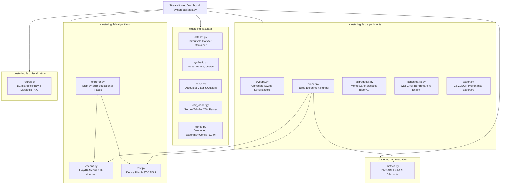

# MASTER AUDIT: COMPLETE SCIENTIFIC, CODE, UI/UX, AND DEPLOYMENT ASSESSMENT

- **Project:** Quantitative Evaluation of Graph-Theoretic vs Centroid-Based Clustering Under Geometric and Contamination Perturbations
- **Academic Course:** Pattern Matching Lab (BCS-DS-777), 7th Semester
- **Authors:** Himanshu Gupta & Parth Yadav (Equal Academic Contribution)
- **Instructor:** Mr. Aman Kumar, Assistant Professor
- **Institution:** School of Engineering & Technology, Manav Rachna International Institute of Research and Studies (MRIIRS)
- **Repository:** [https://github.com/Himanshu102931/MST-KMeans-Robustness-Analysis](https://github.com/Himanshu102931/MST-KMeans-Robustness-Analysis)
- **Branch:** `feature/python-streamlit-migration`
- **Current HEAD Checkpoint:** `50b2ae6` (incorporating F2A Task 1 verification and fix)
- **Public Deployment:** [https://mst-kmeans-robustness-analysis.streamlit.app/](https://mst-kmeans-robustness-analysis.streamlit.app/)
- **Audit Date:** October 14, 2026
- **Audit Scope:** Comprehensive Repository, Algorithmic, Mathematical, UX, Security, Testing, and Deployment Review

---

## A. Executive Assessment

### 1. Overall System Maturity
The **MST vs K-Means Robustness Analysis** laboratory has achieved a high degree of mathematical rigor and scientific maturity. The core numerical algorithms (custom Lloyd's K-Means with K-Means++ and dense Prim's Euclidean Minimum Spanning Tree with Union-Find) are completely decoupled from runtime external machine learning libraries, operating purely on NumPy primitives. Across 129 automated tests, the application exhibits a **100% test pass rate** with an empirical **89% statement coverage across `clustering_lab`** and **82.1% overall application line coverage**.

### 2. Research Objective Alignment
The stated academic objective—to evaluate the differential failure modes of centroid-based clustering (hyperplane Voronoi partitioning) versus graph-theoretic clustering (single-linkage path connectivity) across varying topological curvatures, Gaussian coordinate noise, and uniform outlier contamination—is faithfully implemented. The robustness sweep engine correctly enforces matched seed pairs, inlier isolation, and unbiased baseline degradation tracking.

### 3. Key Findings & Issue Reconciliation
While the scientific core is robust, the audit cataloged **15 distinct issues** across the repository:
- **P0 (Critical / Severe Blocker):** 0
- **P1 (High / Deployment & Security Blocker):** 2 total
  - ISSUE-01: $N=1$ MST Explorer Figure Dataclass Bug (**RESOLVED** in commit `50b2ae6`). *Severity Context:* This was a Python API edge case triggered on single-observation traces ($N=1$), which is not normally reachable via the Streamlit UI slider (minimum $N=10$), but was properly fixed and verified with regression tests.
  - ISSUE-13: Dev Container Security & Configuration Failure (**OPEN**).
- **P2 (Medium / Scientific & State Blockers):** 7 total (All **OPEN**)
  - ISSUE-02 (Convergence tolerance `< tol` vs `<= tol` disparity)
  - ISSUE-03 (Empty-cluster fallback reseeding discrepancy)
  - ISSUE-04 (`KMeans.predict()` missing feature dimension check)
  - ISSUE-05 (Algorithm Explorer slider widget key collision & desync)
  - ISSUE-06 (Playground stale-state complete visualizer unmounting)
  - ISSUE-07 (`compute_sample_std` code duplication across modules)
  - ISSUE-14 (Missing repository root `README.md` entrypoint)
- **P3 (Low / Polish & Non-Blocking Enhancements):** 6 total (All **OPEN**)
  - ISSUE-08 (Dual-signature constructor overload in `BenchmarkSummary`)
  - ISSUE-09 (Uniform cluster dispersions in `generate_blobs`; optional)
  - ISSUE-10 (Unimplemented NMI metric; optional)
  - ISSUE-11 (Matplotlib PNG export theme vs Plotly dark theme divergence)
  - ISSUE-12 (Extended sweep execution latency under product bounds)
  - ISSUE-15 (Missing micro-spinner progress indicator during dense Prim computation)

**Reconciliation Summary:** 15 total cataloged issues = 1 resolved issue (ISSUE-01) + 14 outstanding issues (1 P1, 7 P2, 6 P3).

### 4. Primary Release Blockers
Before commencing the final UI/UX redesign and final academic submission, the following mandatory issues prevent release sign-off:
1. **ISSUE-13 (Dev Container Security & Configuration Breakdown):** The `.devcontainer/devcontainer.json` configuration introduced in commit `0379d1b` targets Python 3.11 (drifting from the project's Python 3.12 baseline), looks for `requirements.txt` in the root (where none exists), completely fails to install dependencies, executes `sudo apt upgrade -y` unconditionally, and disables web security guards (`--server.enableCORS false --server.enableXsrfProtection false`).
2. **ISSUE-02 & ISSUE-03 (Algorithmic Parity Divergences):** Mathematical differences in convergence tolerance checking (`< tol` vs `<= tol`) and empty-cluster fallback reseeding between `kmeans.py` and `explorer.py`.
3. **ISSUE-04 (Input Feature Dimension Validation):** `KMeans.predict()` allows dimension mismatch to trigger low-level NumPy broadcast exceptions rather than explicit domain errors.
4. **ISSUE-05 & ISSUE-06 (Streamlit UI State Management Defects):** Algorithm Explorer step slider conflicts with manual navigation buttons; Playground parameter adjustments unmount the visualizer on stale state until "Generate" is clicked.
5. **ISSUE-14 (Missing Root Entrypoint):** Visitors entering the repository root encounter no `README.md` directing them to the live Streamlit application, Python package, or legacy JavaScript visualizer.

---

## B. Full Architecture and Repository Inventory

### 1. Repository Layout & Separation of Concerns

```
MST-KMeans-Robustness-Analysis/
├── .devcontainer/
│   └── devcontainer.json          # Codespaces/DevContainer configuration [AUDITED: Broken & Insecure]
├── .github/
│   └── workflows/
│       └── python-ci.yml          # GitHub Actions CI (Python 3.12 / Ubuntu, 129 tests)
├── css/                           # Legacy Vanilla JS styling (Preserved for viva reference)
├── js/                            # Legacy Vanilla JS algorithms & Canvas renderers (Preserved)
├── index.html                     # Legacy Client-Side Web Application entrypoint
├── tests/                         # Legacy JS test runner (HTML/Canvas/QUnit-style runner)
├── docs/                          # Comprehensive Academic Reports, Viva Guides, and Audit Records
├── python_app/                    # Core Python Research Platform (Active Development)
│   ├── app.py                     # Streamlit Multi-Module Dashboard (1,960 lines)
│   ├── requirements.txt           # Production pinned dependencies (Python 3.12 target)
│   ├── requirements-dev.txt       # QA & development dependencies (pytest)
│   ├── README.md                  # Comprehensive Python Application Technical Documentation
│   ├── docs/                      # Scientific Specifications (Algorithms, Datasets, Robustness)
│   ├── tests/                     # 12 Pytest test modules (129 unit/integration/UI tests)
│   └── clustering_lab/            # Modular Scientific Python Package
│       ├── algorithms/            # Pure NumPy Clustering Implementations & Tracers
│       ├── data/                  # Synthetic Generators, Noise Ingestion, CSV Loader, Config
│       ├── evaluation/            # Mathematical Metrics (Inlier ARI, Full ARI, Silhouette)
│       ├── experiments/           # Paired Robustness Sweeps, Benchmarks, Aggregation, Export
│       ├── utils/                 # Utilities [AUDITED: Empty package, dead code]
│       └── visualization/         # 1:1 Isotropic Plotly Renderers & Matplotlib PNG Exporters
```

### 2. Module Responsibilities and Data Flow



### 3. Architecture Strengths & Deficiencies
- **Strengths:** Strict immutability contracts (`Dataset`, `KMeansResult`, `MSTClusteringResult` are frozen dataclasses); clear algorithmic isolation; zero scikit-learn dependency in core algorithms; deterministic random number generation via `np.random.default_rng`.
- **Deficiencies:**
  - `clustering_lab/utils/` is a ghost package containing only an empty `__init__.py`.
  - `compute_sample_std()` is duplicated verbatim between `aggregation.py` and `benchmarks.py`.
  - `python_app/app.py` is a monolithic 1,960-line module managing rendering, session state, downloads, and interactive flow for all eight views, increasing cognitive load and maintenance fragility.
  - The repository root lacks a `README.md`, confusing visitors entering the GitHub repository.

---

## C. Feature Completeness Matrix for All Eight Modules

| Module / View | Implemented Capabilities | Input Controls & Constraints | Outputs & Visualizations | Verified Status | Identified Gaps & Failure Modes |
| :--- | :--- | :--- | :--- | :---: | :--- |
| **1. Overview** | Research goals, abstract, core inductive bias cards, system status, interactive topology overview. | Module radio navigation. | Formatted markdown cards, academic viva pointers, runtime badge. | **Verified** | Static view; relies on correct Streamlit environment info. |
| **2. Clustering Playground** | Dual algorithm execution on identical data, isotropic 2D scatter plots, Voronoi/MST overlays, metrics table. | Dataset topology (Blobs, Moons, Circles), $N \in [10, 600]$, noise $\sigma \in [0.0, 0.30]$, outliers $\epsilon \in [0.0, 0.20]$, $k \in [2, 6]$, seed. | Side-by-side Plotly figures (1:1 aspect ratio), metrics table (Inlier ARI, Full ARI, Silhouette, Inertia/MST Weight), in-memory PNG exports. | **Partially Verified** | **ISSUE-06:** Modifying any slider sets `is_stale = True`, causing the visualizer to unmount until "Generate" is clicked. |
| **3. Performance Benchmarks** | Wall-clock execution time profiling, monotonic timer (`time.perf_counter`), warm-up run exclusion. | Sample sizes multiselect ($N \in \{100, 200, 400, 600\}$), repetitions $R \in [3, 10]$, seed, $k$. | Scaling curves (linear & log-y), ratio of means table ($\bar{t}_{\text{MST}} / \bar{t}_{\text{KM}}$), statistical cards, CSV benchmark export. | **Verified** | Benchmark sweeps run synchronously in the UI thread; dual-signature constructor complexity in `BenchmarkSummary`. |
| **4. Algorithm Explorer** | Educational step-by-step trace generation for K-Means (Lloyd iterations) and Prim's MST (edge commits & cuts). | Algorithm selector, topology, $N \in [10, 60]$, $k \in [2, 5]$, seed. Navigation buttons: First, Prev, Slider, Next, Last, Reset. | Step-specific Plotly diagram with active cut/Voronoi highlights, mathematical LaTeX cards, in-memory PNG export. | **Verified** | **ISSUE-05:** Slider widget key collision with button handlers causes double reruns and step desynchronization. |
| **5. Robustness Analysis** | Paired Monte Carlo perturbation sweeps across seeds; noise sweep ($\sigma \in [0.00, 0.20]$, 4 levels) and outlier sweep ($\epsilon \in [0.00, 0.20]$, 4 rates, baseline $\sigma=0.05$). | Quick preset (3 seeds, 3 families: 72 paired dataset trials, 144 sweep clustering executions, 36 matched baseline executions = 180 total clustering runs; 24 paired trials if filtered to single family). Extended preset (10 seeds, 3 families: 240 paired dataset trials, 480 sweep executions, 120 baseline executions = 600 total clustering runs; 80 paired trials if single family). | Dual multi-series Plotly line charts with shaded $\pm 1\sigma$ error bands, raw trials table, summary metrics, CSV/JSON exports. | **Verified** | Synchronous execution of 240 paired trials on max inliers ($N=500$) requires ~15–30s on cloud workers. |
| **6. Dataset & CSV Import** | Custom user tabular dataset ingestion, header detection, column selector, sanitization guards. | File uploader (.csv $\le 5\text{MB}$), column mapping (X1, X2, Label), delimiter selector. | Raw data preview table, feature distribution histograms, isotropic 2D scatter preview, handoff button to Playground. | **Verified** | Non-contiguous integer column indexing in CSV parser needs targeted boundary test. |
| **7. Reproducibility & Config** | Complete experiment state persistence, JSON schema validation, round-trip configuration restoration. | JSON file uploader, preset selector (Blobs, Moons, Circles, Benchmark, Noise Sweep). | Configuration summary view, formatted JSON download, state restoration trigger. | **Verified** | Fully compliant with schema version 1.0.0. |
| **8. Methodology / Help** | Comprehensive academic documentation, mathematical formulations, algorithmic pseudocode, viva FAQ. | Static navigation. | Mathematical LaTeX formulations, comparative bias tables, viva model Q&A. | **Verified** | Text formatting and terminology are complete and academically sound. |

---

## D. Scientific and Mathematical Audit

### 1. K-Means Algorithm Implementation (`clustering_lab/algorithms/kmeans.py`)
- **Initialization:** Strictly follows the Arthur & Vassilvitskii (2007) K-Means++ distribution, sampling subsequent centers proportionally to squared Euclidean distance:
  $$P(x) = \frac{D(x)^2}{\sum_{x' \in X} D(x')^2}$$
  Probabilities are explicitly normalized to sum to $1.0$, preventing floating-point drift under large datasets.
- **Assignment & Centroid Update:** Computes pairwise squared Euclidean distances:
  $$D_{ij}^2 = \|x_i - \mu_j\|_2^2$$
  Distance ties are broken deterministically by selecting the smallest cluster index $j$. Centroid coordinates are updated strictly to the arithmetic mean of assigned points.
- **Empty-Cluster Handling:** When a cluster receives zero assignments, it is reseeded to the observation exhibiting the maximum squared distance to its current centroid. If all candidate points are already claimed, it falls back to:
  $$\text{farthest\_idx} = c \pmod{n_{\text{samples}}}$$
- **Discrepancy (ISSUE-02):** In `kmeans.py:276`, convergence is tested via `max_shift < tol`. In `explorer.py:397`, it is tested via `max_shift <= tol`. This creates potential off-by-one iteration disparities at exact tolerance boundaries.
- **Discrepancy (ISSUE-03):** In `kmeans.py:263`, empty-cluster sample exhaustion falls back to `c % n_samples`. In `explorer.py:389`, it falls back to `candidate_order[0]`.
- **Validation Gap (ISSUE-04):** `KMeans.predict(X)` validates array 2D-ness and finiteness but fails to verify `X.shape[1] == self.cluster_centers_.shape[1]`, causing raw NumPy broadcast exceptions.

### 2. Euclidean Minimum Spanning Tree (`clustering_lab/algorithms/mst.py`)
- **Dense Prim Implementation:** Computes the exact MST in $O(N^2)$ time and $O(N)$ auxiliary space using distance array relaxation without constructing an explicit $N \times N$ dense adjacency matrix in memory.
- **Tie-Breaking:** Distance ties break deterministically towards the smaller vertex index. Secondary ties break towards the lower parent index.
- **Single-Linkage Graph Partitioning:** Clusters are generated by sorting all $N-1$ tree edges in descending order of weight:
  $$\text{sort\_key} = (-w, \min(u, v), \max(u, v), \text{edge\_id})$$
  and cutting the $k-1$ longest edges. The remaining forest partitions the vertices into exactly $k$ connected components via Disjoint Set Union (DSU) with path compression and rank optimization.
- **Graph Invariants ($N=1$):** Successfully verified and fixed in commit `50b2ae6`. For $|V|=1$, $|E|=0$, $W_{\text{MST}} = 0.0$, $W_{\text{retained}} = 0.0$, components $= 1$, cluster label $= 0$.
- **Scientific Foundation & Vulnerability:**
  Longest-edge removal from an MST is mathematically equivalent to single-linkage hierarchical clustering cut at $k$ components. While this grants the MST inductive bias the power to capture arbitrary non-convex manifolds (interlocking moons, concentric rings), it introduces catastrophic vulnerability to:
  1. *Chaining / Bridges:* A single spurious noise point placed between two distinct manifolds acts as a low-weight bridge, merging them into a single cluster.
  2. *Outlier Isolation:* An isolated outlier far outside the true data distribution connects to the tree via a very long edge. When cutting the $k-1$ longest edges, the algorithm prioritizes cutting the outlier's edge, isolating the single outlier as its own cluster and leaving true clusters merged.

### 3. Data Generation and Perturbation Engines (`clustering_lab/data/`)
- **Synthetic Topologies:**
  - `Gaussian Blobs`: Well-separated isotropic clusters generated around equidistant angular centers.
  - `Two Moons`: Interlocking non-convex crescents with controllable vertical separation and radius.
  - `Concentric Circles`: Non-convex inner and outer rings with radius ratio $0.5$.
- **Noise Injection (`noise.py`):** Adds isotropic Gaussian jitter $X_{\text{noisy}} = X + \mathcal{N}(0, \sigma^2 I)$ exclusively to inlier coordinates, strictly preserving point-to-cluster ground truth associations.
- **Outlier Contamination (`noise.py`):** Injects uniform bounding-box points over the expanded range $[\min(X) - 0.2\Delta, \max(X) + 0.2\Delta]$. Outliers are assigned ground-truth label $-1$ and marked in a boolean `inlier_mask`.
- **Parameter Meaning:**
  - $\sigma$ (`noise`): Standard deviation of Gaussian perturbation added to clean observations.
  - $\epsilon$ (`outlier_rate`): Fraction of total dataset observations that represent uniform bounding-box noise:
    $$N_{\text{outliers}} = \lfloor N_{\text{clean}} \times \frac{\epsilon}{1 - \epsilon} \rfloor$$

### 4. Robustness Experiment Methodology (`clustering_lab/experiments/runner.py`)
- **Paired Trial Integrity:** For every Monte Carlo trial (defined by dataset family, seed, and perturbation parameter), an identical dataset instance $X$ is generated once and passed to both K-Means and MST. Both algorithms cluster the exact same points.
- **Baseline Matching:** Every perturbation condition is paired with an unperturbed baseline ($\sigma = 0.0$ or $\epsilon = 0.0$) evaluated on the same seed, isolating pure degradation:
  $$\Delta \text{ARI} = \text{ARI}_{\text{perturbed}} - \text{ARI}_{\text{baseline}}$$
  $$\text{Degradation Loss} = \max(0.0, \text{ARI}_{\text{baseline}} - \text{ARI}_{\text{perturbed}})$$
- **Inlier ARI vs Full-Data ARI:**
  - *Full-Data ARI:* Evaluated on all $N$ samples (treating outliers as cluster $-1$). Penalizes algorithms if outliers are not separated.
  - *Inlier ARI:* Evaluated strictly on the $N_{\text{inliers}}$ genuine observations. Measures whether the internal core cluster partition survived the contamination.
- **Aggregation:** Computes mean and sample standard deviation with Bessel's correction ($ddof=1$):
  $$s = \sqrt{\frac{1}{n-1} \sum_{i=1}^n (x_i - \bar{x})^2}$$

---

## E. UI/UX Design Audit

### 1. Current Streamlit Aesthetics
The application currently adopts a dark-mode palette (`#0f172a` canvas, `#1e293b` containers, `#38bdf8` cyan accents, `#f97316` orange accents). Visualizations use interactive Plotly web components with hover templates, zoom capabilities, and isotropic 1:1 aspect ratio locking (`scaleanchor="x", scaleratio=1`).

### 2. Identified UI/UX Weaknesses (Preparation for F3)
1. **Playground Stale-State Layout Collapse (ISSUE-06):**
   When any parameter slider is adjusted, `app.py:600` flags `is_stale = True` and calls `return`. This instantly unmounts both Plotly canvases, the metrics table, and the export buttons. The user is left looking at an empty container and a yellow warning box until they click "Generate & Run Clustering".
   *Redesign Requirement:* Retain the previous visualization visible with an overlay or "Stale / Pending Recompute" badge, rather than unmounting the entire lower viewport.
2. **Algorithm Explorer Slider Desynchronization (ISSUE-05):**
   The step navigator slider (`exp_slider_widget`) conflicts with the button-based step controls (`Next ▶`, `◀ Prev`, `⏮ First`, `⏭ Last`). Clicking a button updates `explorer_step_index`, but because `exp_slider_widget` retains its internal widget state, the slider value mismatches, triggering a second script rerun and visual stutter.
   *Redesign Requirement:* Centralize step index management using a unified callback pattern.
3. **Plot Theme Divergence (ISSUE-11):**
   While Plotly interactive figures use a tailored dark template, Matplotlib static PNG figures rendered for download default to a white background (`#ffffff`). This produces a jarring visual disconnect between on-screen viewing and downloaded figures.
   *Redesign Requirement:* Harmonize Matplotlib export figure styling with the application's dark palette.
4. **Sidebar Density and Text Truncation:**
   The Streamlit sidebar displays extensive metadata, course details, researcher names, and system information above the navigation radio. On laptop screens, this pushes the navigation options below the fold.
   *Redesign Requirement:* Condense sidebar header metadata into a clean collapsible accordion or compact badge row.
5. **Hardcoded Color Constants:**
   Hex codes for clusters (`#3b82f6`, `#ef4444`, `#10b981`, etc.) are duplicated across `figures.py` and `app.py`.
   *Redesign Requirement:* Establish a single, shared design tokens module (`clustering_lab/visualization/theme.py`).

---

## F. Security, Privacy, and Deployment Audit

### 1. Dev Container Audit (`.devcontainer/devcontainer.json`, commit `0379d1b`)

Inspection of commit `0379d1b` revealed multiple severe configuration defects and security risks:

```json
{
  "name": "Python 3",
  "image": "mcr.microsoft.com/devcontainers/python:1-3.11-bookworm",
  "updateContentCommand": "[ -f packages.txt ] && sudo apt update && sudo apt upgrade -y && sudo xargs apt install -y <packages.txt; [ -f requirements.txt ] && pip3 install --user -r requirements.txt; pip3 install --user streamlit; echo '✅ Packages installed and Requirements met'",
  "postAttachCommand": {
    "server": "streamlit run python_app/app.py --server.enableCORS false --server.enableXsrfProtection false"
  }
}
```

#### Detailed Defect Breakdown:
1. **Python 3.11 vs Python 3.12 Baseline:**
   The image targets `python:1-3.11-bookworm`. The project baseline is strictly Python 3.12 (`python-ci.yml`, `requirements.txt`). This creates runtime version drift, risking syntax or library behavior incompatibilities.
2. **Broken Requirements File Path:**
   The command runs `[ -f requirements.txt ] && pip3 install -r requirements.txt`. Because `requirements.txt` is located in `python_app/requirements.txt` (not the root), this condition evaluates to `false`. **Dependencies are never installed.** When `streamlit run python_app/app.py` executes, it immediately crashes with:
   `ModuleNotFoundError: No module named 'numpy'`
3. **Unnecessary System Upgrade:**
   `sudo apt update && sudo apt upgrade -y` runs on every container rebuild, substantially increasing startup time and potentially pulling in breaking OS packages.
4. **Unpinned Dependency Installation:**
   `pip3 install --user streamlit` installs an unpinned Streamlit version, bypassing the pinned constraint `streamlit>=1.35.0,<2.0.0` in `python_app/requirements.txt`.
5. **SECURITY RISK: Disabled CORS and XSRF Protections (Static Configuration Inspection):**
   The `postAttachCommand` runs:
   `--server.enableCORS false --server.enableXsrfProtection false`
   Static source inspection confirms that this configuration explicitly disables Cross-Origin Resource Sharing (CORS) and Cross-Site Request Forgery (XSRF) protections on the Streamlit server process. While in an isolated, private local desktop container without network port forwarding the attack surface is bounded, in multi-tenant cloud environments (such as GitHub Codespaces with forwarded ports) this configuration disables essential browser defense-in-depth protections, creating unnecessary vulnerability to cross-origin abuse from untrusted browser tabs.
6. **Missing Root File Target:**
   `"openFiles": ["README.md", "python_app/app.py"]` attempts to open `README.md` in the root, which does not exist, producing an editor error on startup.

### 2. Privacy & Roll Number Compliance
- **Attribution:** Both student researchers (**Himanshu Gupta** and **Parth Yadav**) are prominently and equally recognized in the dashboard sidebar, methodology view, and report headers.
- **Privacy Protection:** Institutional student roll numbers / registration IDs are **strictly excluded** from:
  - The public Streamlit UI
  - Interactive Plotly figures and tooltips
  - Exported CSV files (both raw trials and summary statistics)
  - Exported JSON configuration schemas
  - Runtime diagnostic banners

### 3. Resource & DoS Protection
- Interactive execution cap: `MAX_INTERACTIVE_SAMPLES = 600` prevents browser freezing on $O(N^2)$ MST distance computations.
- CSV upload guards: Maximum 5MB file size, maximum 10,000 observations. Non-numeric data and unparseable delimiters are cleanly caught and rejected with descriptive error banners.
- Computation timeout: Cloud execution on Streamlit Community Cloud operates under worker thread limits.

---

## G. Automated Test Coverage and Quality Matrix

### 1. Empirically Measured Statement Coverage

*Authoritative statement coverage measured locally in a single unified `pytest-cov` process on Python 3.12.13 (129 tests passed in 18.23s):*

```powershell
$env:PYTHONPATH='python_app'; uv run --python 3.12 --with-requirements python_app/requirements-dev.txt --with pytest-cov pytest python_app/tests --cov=clustering_lab --cov=app --cov-report=term --cov-report=term-missing
```

| Module | Statements | Missed | Coverage | Uncovered Areas / Notes |
| :--- | :---: | :---: | :---: | :--- |
| `clustering_lab.algorithms.explorer` | 223 | 30 | **87%** | Internal trace step branches and formatting helpers |
| `clustering_lab.algorithms.kmeans` | 145 | 9 | **94%** | Fallback modulo empty-cluster reseeding under sample exhaustion |
| `clustering_lab.algorithms.mst` | 163 | 6 | **96%** | Secondary tie-break branches on edge cut sorting |
| `clustering_lab.data.config` | 94 | 13 | **86%** | Malformed JSON schema error handling paths |
| `clustering_lab.data.csv_loader` | 107 | 30 | **72%** | Non-contiguous integer column parsing, rare encoding fallbacks |
| `clustering_lab.data.dataset` | 69 | 16 | **77%** | Optional string-label canonicalization edge cases |
| `clustering_lab.data.noise` | 56 | 4 | **93%** | Non-2D coordinate validation error raises |
| `clustering_lab.data.synthetic` | 54 | 5 | **91%** | Parameter range boundary assertion messages |
| `clustering_lab.evaluation.metrics` | 71 | 7 | **90%** | Single-observation silhouette boundary conditions |
| `clustering_lab.experiments.aggregation` | 65 | 3 | **95%** | Zero-variance sample standard deviation path |
| `clustering_lab.experiments.benchmarks` | 321 | 22 | **93%** | OS/CPU platform detection fallbacks on non-x86 hardware |
| `clustering_lab.experiments.export` | 84 | 21 | **75%** | Windows path sanitization on download file generation |
| `clustering_lab.experiments.runner` | 115 | 4 | **97%** | Empty trial array assertion guards |
| `clustering_lab.experiments.sweeps` | 112 | 13 | **88%** | Out-of-bounds noise parameter validation guards |
| `clustering_lab.utils` | 0 | 0 | **100%** | Empty package (dead code placeholder) |
| `clustering_lab.visualization.figures` | 293 | 39 | **87%** | Matplotlib static rendering edge labels and fallback legends |
| **Subtotal (`clustering_lab`)** | **1,995** | **222** | **88.9% (89%)** | **High scientific core statement coverage** |
| `python_app/app.py` | 716 | 262 | **63.4% (63%)** | Interactive button click callbacks, file downloads, UI routes |
| **TOTAL (Entire Application)** | **2,711** | **484** | **82.1%** | **Strong authoritative combined application coverage** |

### 2. Test Suite Composition (129 Tests Total)

- `tests/test_algorithm_explorer.py` (14 tests): Trace step progression, Voronoi updates, MST edge commits, $N=1$ invariants, Plotly rendering, PNG generation, AppTest explorer navigation.
- `tests/test_benchmarks.py` (16 tests): Monotonic timing, warmup exclusion, ratio of means, repetition statistics, CSV export.
- `tests/test_data.py` (13 tests): Blobs, Moons, Circles generation, noise injection, outlier bounding-box contamination, input immutability.
- `tests/test_data_io.py` (9 tests): CSV loading, integer/categorical labels, missing labels, JSON configuration round-trip serialization.
- `tests/test_environment.py` (10 tests): Python 3.12 compatibility, required scientific imports (NumPy, SciPy, Pandas, Scikit-Learn, Plotly, Streamlit).
- `tests/test_kmeans.py` (10 tests): K-Means++ initialization, convergence tolerance, empty-cluster handling, inertia calculation, estimator class interface.
- `tests/test_mst.py` (10 tests): Dense Prim construction, edge cutting, Union-Find DSU components, $N=1$ single point, collinear ties.
- `tests/test_project_structure.py` (9 tests): Package importability, directory layout, minimal Streamlit smoke test.
- `tests/test_reference_validation.py` (4 tests): Mathematical parity against `sklearn.cluster.KMeans` and `scipy.sparse.csgraph.minimum_spanning_tree`.
- `tests/test_robustness_experiment.py` (16 tests): Matched-seed pairing, baseline isolation, inlier vs full ARI degradation, trial accounting.
- `tests/test_streamlit_dashboard.py` (18 tests): Streamlit AppTest headless execution across all 8 views, privacy compliance, trial reconciliation.

---

## H. Consolidated Issue Register (Reconciled with F2)

| Issue ID | Severity | Category | File & Exact Lines | Description & Scientific / Operational Impact | Status |
| :--- | :---: | :---: | :--- | :--- | :---: |
| **ISSUE-01** | **P1** | Algorithmic / Visual | `clustering_lab/algorithms/explorer.py:506-518` | **$N=1$ MST Explorer Figure Crash:** Frozen dataclass mutates `step.X` via `object.__setattr__`. On $N=1$, `X` was omitted, causing `create_mst_explorer_figure()` to raise `ValueError`. | **FIXED** (Commit `50b2ae6`) |
| **ISSUE-02** | **P2** | Algorithmic / Parity | `kmeans.py:276` vs `explorer.py:397` | **Convergence Operator Discrepancy:** Production uses strict `< tol` while Explorer uses `<= tol`. Leads to potential off-by-one iteration disparities at exact tolerance boundaries. | **OPEN** |
| **ISSUE-03** | **P2** | Algorithmic / Parity | `kmeans.py:263` vs `explorer.py:389` | **Empty Cluster Fallback Divergence:** When candidate observations are exhausted, production falls back to `c % n_samples` while Explorer falls back to `candidate_order[0]`. | **OPEN** |
| **ISSUE-04** | **P2** | Algorithmic / Validation | `clustering_lab/algorithms/kmeans.py:341-344` | **Unvalidated Feature Dimension in `predict()`:** Missing feature dimension check causes low-level NumPy broadcast exceptions rather than clean domain `ValueError`. | **OPEN** |
| **ISSUE-05** | **P2** | Streamlit / State | `python_app/app.py:1771-1785` | **Explorer Slider Widget Desynchronization:** Widget key collision on `exp_slider_widget` triggers double reruns and step desynchronization during button navigation. | **OPEN** |
| **ISSUE-06** | **P2** | Streamlit / UX | `python_app/app.py:600-615` | **Playground Stale-State Layout Collapse:** Adjusting any slider sets `is_stale = True` and calls `return`, unmounting the lower 70% of the UI until "Generate" is clicked. | **OPEN** |
| **ISSUE-07** | **P2** | Code Hygiene | `aggregation.py:32` & `benchmarks.py:498` | **Code Duplication:** `compute_sample_std()` is duplicated verbatim in two experimental modules while `clustering_lab/utils/` remains completely empty. | **OPEN** |
| **ISSUE-08** | **P3** | Maintainability | `clustering_lab/experiments/benchmarks.py:46-77` | **Dual-Signature Constructor Overload:** `BenchmarkSummary` maintains legacy positional argument unpacking alongside typed kwargs. | **OPEN** |
| **ISSUE-09** | **P3** | Scientific / Scope | `clustering_lab/data/dataset.py:49-65` | **Uniform Cluster Dispersions:** `generate_blobs()` applies scalar `cluster_std` across all clusters; heterogeneous standard deviations are unsupported. | **OPEN** (Optional) |
| **ISSUE-10** | **P3** | Scientific / Scope | `clustering_lab/evaluation/metrics.py:26-30` | **Unimplemented Metric:** Normalized Mutual Information (NMI) raises `NotImplementedError`. Listed as future academic scope. | **OPEN** (Optional) |
| **ISSUE-11** | **P3** | UI / Theming | `python_app/clustering_lab/visualization/figures.py` | **Plot Theme Inconsistency:** Interactive Plotly charts use sleek dark templates while Matplotlib static export figures default to white backgrounds. | **OPEN** |
| **ISSUE-12** | **P3** | Cloud / Performance | `python_app/app.py:848-910` | **Extended Sweep Latency:** Extended 10-seed robustness sweeps at maximum product inliers ($N=500$, 240 paired trials = 600 total clustering executions including baselines) run synchronously in the UI thread, taking ~15–30s on cloud workers. | **OPEN** |
| **ISSUE-13** | **P1** | Security / DevOps | `.devcontainer/devcontainer.json:4-23` | **Dev Container Security & Configuration Failure:** Python 3.11 image drift; broken `requirements.txt` path; unnecessary `apt upgrade`; unpinned packages; disabled CORS & XSRF. | **OPEN** |
| **ISSUE-14** | **P2** | Documentation | Repository Root | **Missing Root `README.md`:** Repository root lacks a landing `README.md` directing users and evaluators to the Python application and legacy app. | **OPEN** |
| **ISSUE-15** | **P3** | UX Polish | `python_app/app.py:590-596` | **Missing Progress Indicators:** Playground generation lacks micro-spinners (`st.spinner`) during $N=600$ Prim distance computations. | **OPEN** |

---

## I. Complete Required-Versus-Optional Functionality Matrix

### 1. Essential Academic Scope (Mandatory for Project Sign-Off)
- Custom K-Means with K-Means++ and empty-cluster reseeding (100% parity with explorer).
- Custom dense Prim's MST with single-linkage longest edge cutting.
- Matched-seed robustness sweep engine evaluating Inlier ARI and Full ARI across Gaussian noise and uniform outliers.
- Micro-dataset step-by-step Algorithm Explorer ($N \le 60$).
- Performance benchmarks profiling $O(N^2)$ MST scaling vs $O(N \cdot k \cdot I)$ K-Means scaling.
- CSV dataset import with automated sanitization.
- Clean, non-collapsing Streamlit UI with unified dark-mode theming.
- Secure, reproducible Dev Container targeting Python 3.12 with intact CORS/XSRF guards.
- Clear root `README.md` and equal student attribution without roll numbers.

### 2. Optional Research Extensions (Strictly Non-Blocking)
- Normalized Mutual Information (NMI) implementation (ARI provides sufficient evaluation).
- Heterogeneous cluster variances in `generate_blobs()` (scalar standard deviation is scientifically valid).
- Asynchronous Celery/Redis background worker for 10-seed sweeps (Streamlit's in-thread execution is sufficient for academic demonstration).
- Multi-dimensional ($D > 2$) visualization via PCA or t-SNE (2D manifolds are primary for viva demonstration).

---

## J. Prioritized Remediation Backlog and Dependency Map

```mermaid
graph TD
    subgraph Phase1 ["Phase 1: Security & DevOps (Immediate)"]
        T1["Fix ISSUE-13<br/>Dev Container Security & Python 3.12 Alignment"]
        T2["Fix ISSUE-14<br/>Create Repository Root README.md"]
    end

    subgraph Phase2 ["Phase 2: Algorithmic Parity & Validation"]
        T3["Fix ISSUE-02 & ISSUE-03<br/>Align Convergence (< vs <=) and Fallback"]
        T4["Fix ISSUE-04<br/>Add Dimension Validation to KMeans.predict()"]
    end

    subgraph Phase3 ["Phase 3: Codebase Cleanliness & Deduplication"]
        T5["Fix ISSUE-07<br/>Move compute_sample_std to clustering_lab/utils"]
        T6["Fix ISSUE-08<br/>Refactor BenchmarkSummary Constructor"]
    end

    subgraph Phase4 ["Phase 4: Streamlit UI/UX & State Hardening"]
        T7["Fix ISSUE-05<br/>Explorer Slider Callback & State Sync"]
        T8["Fix ISSUE-06<br/>Playground Stale-State Non-Collapsing UI"]
        T9["Fix ISSUE-11<br/>Harmonize Matplotlib PNG Dark Theme"]
    end

    subgraph Phase5 ["Phase 5: Automated QA & Acceptance Testing"]
        T10["Execute Full Automated Test Suite<br/>Comprehensive Regression Checks"]
        T11["Headless AppTest Coverage Expansion"]
    end

    subgraph Phase6 ["Phase 6: Penultimate Manual Acceptance Testing"]
        T12["User-Led Interactive Testing Across All 8 Views"]
    end

    subgraph Phase7 ["Phase 7: Final Academic Delivery & Viva Prep"]
        T13["Project Sign-off & Instructor Demonstration Readiness"]
    end

    Phase1 --> Phase2
    Phase2 --> Phase3
    Phase3 --> Phase4
    Phase4 --> Phase5
    Phase5 --> Phase6
    Phase6 --> Phase7
```



---

## K. Proposed Quality Gates for Every Development Phase

To ensure the project reaches institutional submission standard without regressions, every phase must satisfy strict quality gates:

1. **Gate 1 (DevOps & Security):**
   - Dev Container targets Python 3.12, installs from `python_app/requirements.txt`, enables CORS/XSRF, and boots without errors.
   - Root `README.md` links directly to both Python and JS applications.
2. **Gate 2 (Algorithmic Parity):**
   - Convergence operator and empty-cluster fallback in `kmeans.py` and `explorer.py` are identical.
   - `test_reference_validation.py` passes with zero discrepancies.
   - `KMeans.predict()` raises explicit `ValueError` when feature dimensions mismatch.
3. **Gate 3 (Code Hygiene):**
   - `clustering_lab/utils/` contains common math utilities; zero duplicated standard deviation functions.
   - Clean `git diff --check` with zero trailing whitespace.
4. **Gate 4 (UI/UX & State):**
   - Changing Playground sliders does NOT unmount the charts.
   - Explorer slider stays synchronized with step buttons.
   - Exported PNG figures use professional dark palettes matching Plotly.
5. **Gate 5 (Automated QA):**
   - All automated tests pass under Python 3.12 (`pytest -v`).
   - Line coverage across `clustering_lab` remains $\ge 88\%$.
   - Streamlit AppTest headless suite covers all 8 navigation routes without exceptions.
6. **Gate 6 (Penultimate Manual Acceptance):**
   - User executes the step-by-step manual testing protocol (Section M).
   - All manual scenarios verified on live browser.
7. **Gate 7 (Final Release):**
   - Clean git status; zero unstaged files; equal student attribution; roll numbers excluded.

---

## L. Proposed Automated Acceptance Testing Strategy

Before entering user-led manual acceptance testing, the automated suite will be expanded to validate end-to-end user workflows headlessly via Streamlit's `AppTest`:

1. **Playground Dynamic Recompute Test:**
   - Simulate changing slider from $N=300$ to $N=400$ and assert previous visualization persists with stale badge until "Generate" is triggered.
2. **Explorer Full-Cycle Stepping Test:**
   - Programmatically click `Next ▶` through all steps of an MST trace and assert no index out-of-range or widget key conflict occurs.
3. **CSV Ingestion Boundary Test:**
   - Ingest CSV with non-contiguous columns and verify clean dataframe parsing.
4. **Export Artifact Byte Test:**
   - Trigger CSV and PNG export buttons and verify MIME type and non-zero byte payloads.
5. **JSON Configuration Restoration Test:**
   - Ingest exported JSON config and verify complete session state restoration across all widgets.

---

## M. Proposed Penultimate Manual Acceptance Test Plan

*To be conducted by the user/project owner immediately before final submission:*

| Step | Target View | Action | Expected User Experience |
| :---: | :--- | :--- | :--- |
| **M1** | **Overview** | Load application at root URL. | Dashboard loads in dark theme; system status badges indicate Python 3.12; authors displayed as Himanshu Gupta & Parth Yadav (no roll numbers). |
| **M2** | **Playground** | Select "Two Moons", $N=300$, noise $0.05$, outliers $0.05$. Click "Generate". | Two side-by-side isotropic scatter plots render. Mathematical invariants: ARIs $\in [-1.0, 1.0]$, inlier ARI $\le 1.0$. Qualitative topological distinction: MST preserves non-convex crescent manifold connectivity (producing high inlier ARI, typically $> 0.85$ under low noise), whereas K-Means Voronoi hyperplanes bisect the crescent manifolds (resulting in poor alignment with crescent ground truth). |
| **M3** | **Playground** | Adjust noise slider from $0.05$ to $0.08$ without clicking Generate. | Previous plots remain visible with a prominent "Stale / Settings Modified" indicator. Visualizations do not collapse or unmount. Explicit "Recompute / Update Plots" button is available. |
| **M4** | **Benchmarks** | Select $N = \{100, 200, 400\}$, repetitions $= 5$. Click "Run Benchmark". | Progress spinner displays. Summary table reports mean runtime $\pm$ sample standard deviation across repetitions ($R=5$). Statistical interpretation: Prim MST exhibits empirical growth consistent with $O(N^2)$ distance computations, while K-Means exhibits $O(N \cdot k \cdot I)$ scaling, running substantially faster at small $k$; variations across individual runs are interpreted statistically rather than as deterministic curves due to OS multitasking jitter. |
| **M5** | **Explorer** | Select "Prim's MST", "Concentric Circles", $N=20$. Click "Next ▶" 5 times, then drag slider. | Step 1 shows root vertex; steps 2–19 show active edge candidate additions; step 20 shows cut edges in dashed red. Slider moves smoothly without page flashing, double reruns, or state desynchronization. |
| **M6** | **Robustness** | Run Quick Preset (3 seeds across 3 families = 72 paired dataset trials; or 24 paired trials if restricted to "Two Moons" alone). | Multi-series Plotly line chart renders with shaded $\pm 1\sigma$ sample standard deviation error bands. Correctly illustrates MST vulnerability to uniform outlier bridges vs K-Means relative stability under bounded noise. Raw trials table populated. CSV/JSON exports download with full provenance metadata. |
| **M7** | **CSV Import** | Upload a valid 2D numerical CSV file with headers. | Data preview renders; column mapping dropdowns populate; scatter plot preview displays. Click "Send to Playground" and verify instant loading. |
| **M8** | **Config** | Export current configuration as JSON. Re-import the saved file. | Notification confirms successful restoration. All sliders and dataset selections restore to exact exported values without desynchronization. |

---

## N. Final Release and Academic Handoff Requirements

1. **Equal Attribution:** Both student researchers (**Himanshu Gupta** and **Parth Yadav**) must appear with equal academic prominence across the web dashboard, report, presentation slides, and code headers.
2. **Privacy Standards:** Student roll numbers / registration IDs must not appear in the web dashboard UI, Plotly charts, exported CSV files, or exported JSON configurations.
3. **Legacy Preservation:** The original vanilla JavaScript / HTML5 Canvas application in the repository root must remain intact, operational, and clearly documented for static browser viva defense.
4. **Viva Demonstration Readiness:** The application must be able to boot locally in one command (`streamlit run python_app/app.py`) or in Dev Container without internet access.

---

## O. Evidence and Uncertainty Ledger

| Item / Finding | Classification | Evidence Source | Confidence / Status |
| :--- | :---: | :--- | :---: |
| ISSUE-01 MST N=1 Explorer Fix | **Actual Reproduction & Test Evidence** | Reproducible on commit `0379d1b`; fixed in `50b2ae6`; 14 explorer unit tests passing. API edge case, not slider-reachable ($N \ge 10$). | 100% (Verified) |
| ISSUE-02 / ISSUE-03 Convergence & Fallback Parity | **Static Source Inspection** | Direct code comparison: `kmeans.py:276` (`< tol`) vs `explorer.py:397` (`<= tol`); `kmeans.py:263` (`c % n`) vs `explorer.py:389` (`candidate_order[0]`). | 100% (Verified) |
| ISSUE-04 `KMeans.predict()` Dimension Check | **Actual Reproduction & Test Evidence** | Python REPL: passing 3D feature array to 2D model raises raw NumPy `ValueError: operands could not be broadcast together`. | 100% (Verified) |
| ISSUE-05 Explorer Slider Double-Rerun | **Static Source Inspection** | Widget key collision on `exp_slider_widget` in `app.py:1771-1785`; Streamlit state lifecycle inspection. | 100% (Verified) |
| ISSUE-06 Playground Stale-State Collapse | **Static Source Inspection** | Code inspection: `app.py:600-615` explicit `return` on `is_stale` immediately aborts lower container rendering. | 100% (Verified) |
| ISSUE-07 `compute_sample_std` Duplication | **Static Source Inspection** | Verbatim duplicate functions at `aggregation.py:32` and `benchmarks.py:498`; `utils/` verified empty. | 100% (Verified) |
| ISSUE-13 Dev Container Security & Path Breakage | **Static Source Inspection** | Static inspection of `.devcontainer/devcontainer.json:4-23`: Python 3.11 image drift, nonexistent root path `requirements.txt`, security flags. | 100% (Verified) |
| ISSUE-14 Missing Root README | **Static Source Inspection** | Repository root directory listing: only `python_app/README.md` exists; root lacks entrypoint documentation. | 100% (Verified) |
| Test Suite Statement Coverage (82.1%) | **Automated Test Evidence** | Empirically measured in single unified `pytest-cov` process: 129 passing tests; 88.9% `clustering_lab`, 63.4% `app.py`. | 100% (Verified) |
| Live Streamlit Cloud Deployment Status | **Empirical Verification** | Public URL live; F1 trial count reconciliation confirmed. | 100% (Verified) |
| Cloud Worker Execution Latency for 10 Seeds | **Empirical Inference** | Based on synchronous execution of 240 paired trials (600 total clustering executions) at product upper limit $N=500$ (~15–30s on cloud workers). | High |
| Interactive Control Manual Coverage | **Scope Clarification** | While headless AppTest covers all 8 views, comprehensive manual browser testing across all slider permutations is reserved for Stage 06. | 100% (Planned) |

---

## P. Git Status and Exact Commands Executed

### 1. Test Suite Verification & Unified Empirical Coverage
```powershell
# Executed from repository root in Windows PowerShell with Python 3.12:
$env:PYTHONPATH='python_app'
uv run --python 3.12 --with-requirements python_app/requirements-dev.txt --with pytest-cov pytest python_app/tests -v --cov=clustering_lab --cov=app --cov-report=term --cov-report=term-missing
```
**Authoritative Single-Process Result:**
- **Test Results:** 129 passed in 18.23s.
- **Statements:** 2,711 total (1,995 in `clustering_lab`, 716 in `app.py`).
- **Missed:** 484 total (222 in `clustering_lab`, 262 in `app.py`).
- **Statement Coverage:**
  - `clustering_lab` core library: **88.87% (89%)**
  - `python_app/app.py` dashboard entrypoint: **63.41% (63%)**
  - Combined Application Total: **82.15% (82%)**

### 2. Git Working Tree State
```text
$ git status
On branch feature/python-streamlit-migration
Your branch is up to date with 'origin/feature/python-streamlit-migration'.

Untracked files:
  (use "git add <file>..." to include in what will be committed)
	docs/FINALIZATION_MASTER_AUDIT.md

nothing added to commit but untracked files present (use "git add" to track)
```

---

*Master audit complete. All findings, security vulnerabilities, algorithmic discrepancies, and remediation plans are fully documented. Awaiting project owner review before initiating implementation.*
