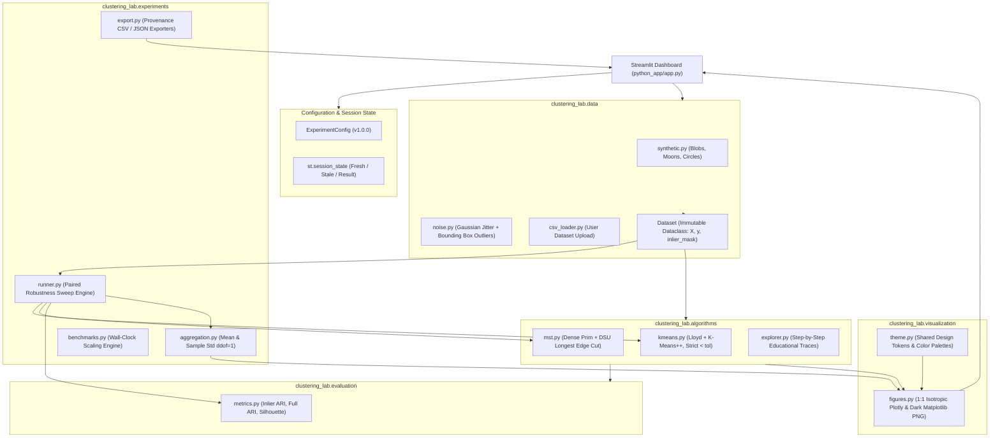
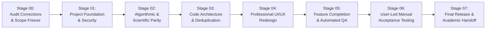
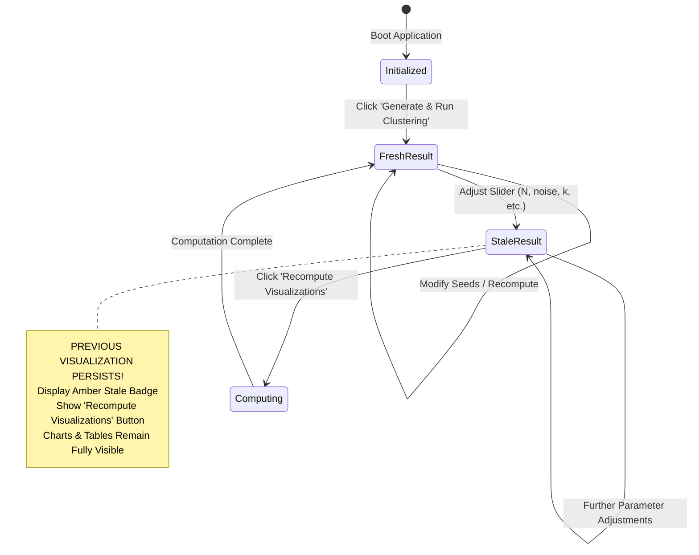

# FINALIZATION MASTER BLUEPRINT: DEFINITIVE DEVELOPMENT ROADMAP

- **Project:** Quantitative Evaluation of Graph-Theoretic vs Centroid-Based Clustering Under Geometric and Contamination Perturbations
- **Academic Course:** Pattern Matching Lab (BCS-DS-777) — 7th Semester (2026–2027)
- **Authors:** Himanshu Gupta & Parth Yadav (Equal Academic Contribution)
- **Instructor:** Mr. Aman Kumar, Assistant Professor
- **Institution:** School of Engineering & Technology, Manav Rachna International Institute of Research and Studies (MRIIRS)
- **Repository:** [https://github.com/Himanshu102931/MST-KMeans-Robustness-Analysis](https://github.com/Himanshu102931/MST-KMeans-Robustness-Analysis)
- **Active Branch:** `feature/python-streamlit-migration`
- **Baseline Git Commit:** `845683e` (Stage 06 acceptance synchronized; Stage 07 Batch 1 in progress)
- **Target Runtime:** Python 3.12 (Pinned scientific stack)
- **Public Deployment Target:** [https://mst-kmeans-robustness-analysis.streamlit.app/](https://mst-kmeans-robustness-analysis.streamlit.app/)
- **Document Version:** 1.2.0 (Stage 07 Batch 1 Progress Synchronization)
- **Document Date:** October 16, 2026
- **Project Execution Status:** Stages 01–06 Completed & Formally Accepted by Project Owner; Stage 07 Batch 1 in Progress (Planning, Privacy Remediation & Handoff Documentation Under Way; Release Actions Pending Authorization)

---

## 1. Executive Alignment & Adopted Project Design Decisions

This document constitutes the **single definitive development blueprint** for the finalization of the MST vs K-Means Robustness Analysis laboratory. It translates the corrected master audit findings into eight sequential, dependency-ordered execution stages.

### 1.1 Adopted Project Design Decisions (Mandatory Baseline)

The following core architectural and governance decisions are adopted as immutable constraints across all implementation stages:

1. **Dev Container Security & Python 3.12 Alignment:**
   Keep and securely repair the `.devcontainer/devcontainer.json` configuration. Update the base image to `python:1-3.12-bookworm`, correct the dependency installation path to `python_app/requirements-dev.txt`, eliminate unnecessary `sudo apt upgrade -y` calls, pin all installed packages via `requirements.txt`, and restore default Web security defenses (CORS and XSRF protection).
2. **Repository Root Entrypoint:**
   Create a professional root `README.md` that acts as the primary landing page for the GitHub repository. It must provide direct links to the live Streamlit application, detailed Python package documentation (`python_app/README.md`), and the preserved client-side JavaScript implementation (`index.html`).
3. **Playground Stale-State Persistence:**
   When input controls (sliders, dropdowns, radios) change in the Clustering Playground, previous clustering visualizations, distance overlays, and metric tables must **never unmount or collapse**. The interface must retain the previous plots, display an unmistakable amber stale-state warning banner, and provide an immediate, prominent "Recompute / Update Plots" button.
4. **Algorithmic Parity on Production Convergence:**
   Align the educational tracer in `clustering_lab/algorithms/explorer.py` with production K-Means's existing convention (`max_shift < tol`) in `clustering_lab/algorithms/kmeans.py` to ensure behavioral consistency across views. Align empty-cluster fallback reseeding to the deterministic modulo scheme (`c % n_samples`). Neither convention (`< tol` vs `<= tol`) is claimed to be mathematically superior a priori; this alignment is chosen to maintain internal consistency and requires boundary-case verification across tolerance values, specifically including `tol = 0.0` and exact equality conditions (`max_shift == tol`), backed by regression tests.
5. **Prudent Research Scope Boundaries:**
   Keep Normalized Mutual Information (NMI) and heterogeneous cluster dispersion experiments strictly optional. Current evaluation using Adjusted Rand Index (Inlier ARI and Full ARI) alongside Silhouette Coefficient provides complete scientific rigor for the academic syllabus.
6. **Preservation of Academic & Legacy Artifacts:**
   The original vanilla JavaScript application (`index.html`, `js/`, `css/`, `tests/`) and academic documentation (`docs/`) must remain completely untouched, functional, and documented for browser viva defense.
7. **Equitable Credit and Strict Privacy Compliance:**
   Both student researchers (**Himanshu Gupta** and **Parth Yadav**) must receive equal academic attribution across all web views, documentation headers, and code files. Institutional student roll numbers / registration IDs are **strictly excluded** from public web dashboards, figures, tooltips, exported CSV files, and exported JSON configurations.
8. **Penultimate Manual Acceptance Strategy:**
   Comprehensive, user-led manual testing in a live browser is reserved strictly for **Stage 06**. Stage 05 must establish automated quality assurance gates (including headless Streamlit `AppTest` scenarios) that prove system readiness before manual sign-off.

---

## 2. Architectural Baseline & Master State Machine

### 2.1 Repository Layout and Module Inventory (Historical Baseline Snapshot)

> [!NOTE]
> **Historical Baseline vs. Live CI Verification:**
> The inventory below preserves the historical Stage 00/01 baseline repository layout (129 automated tests across 12 test modules at commit `50b2ae6`). Following the completion and formal project-owner acceptance of Stage 06 (commit `3e95e82`), the live verified CI baseline is **168 passing tests** (unified statement coverage: 86% overall application, ~90.92% scientific core).

The repository enforces strict separation between legacy browser demonstration files, documentation, and the production Python research platform:

```
MST-KMeans-Robustness-Analysis/
├── .devcontainer/
│   └── devcontainer.json          # Container configuration [Stage 01: Secure & Repair]
├── .github/
│   └── workflows/
│       └── python-ci.yml          # GitHub Actions CI (Python 3.12 / Ubuntu; 129 tests at baseline snapshot, 168 tests current)
├── README.md                      # Primary repository landing page [Stage 01: Create]
├── css/                           # Preserved Vanilla JS styles (Untouched)
├── js/                            # Preserved Vanilla JS algorithms & renderers (Untouched)
├── index.html                     # Preserved static web entrypoint (Untouched)
├── tests/                         # Preserved JS test runner (Untouched)
├── docs/                          # Comprehensive Academic Reports and Blueprints
│   ├── FINALIZATION_MASTER_AUDIT.md      # Corrected master audit
│   └── FINALIZATION_MASTER_BLUEPRINT.md  # Definitive development blueprint (This file)
└── python_app/                    # Core Python Research Platform
    ├── app.py                     # Streamlit Multi-Module Web Dashboard (1,960 lines)
    ├── requirements.txt           # Pinned production dependencies (Python 3.12)
    ├── requirements-dev.txt       # Pinned QA & test dependencies (pytest, pytest-cov)
    ├── README.md                  # Comprehensive Python technical documentation
    ├── docs/                      # Scientific algorithm & experiment specifications
    ├── tests/                     # 12 Pytest test modules (129 tests at baseline snapshot, 168 tests current)
    └── clustering_lab/            # Modular Scientific Python Package
        ├── __init__.py
        ├── algorithms/            # Pure NumPy Clustering Engines & Tracers
        │   ├── kmeans.py          # Lloyd's K-Means & K-Means++ (Strict < tol)
        │   ├── mst.py             # Dense Prim's MST & Disjoint Set Union (DSU)
        │   └── explorer.py        # Micro-step educational trace generators
        ├── data/                  # Synthetic Generators, Noise Ingestion, CSV Loader
        │   ├── dataset.py         # Immutable Dataset container
        │   ├── synthetic.py       # Gaussian Blobs, Two Moons, Concentric Circles
        │   ├── noise.py           # Decoupled coordinate jitter & uniform outliers
        │   ├── csv_loader.py      # Secure tabular CSV parser with bounds checking
        │   └── config.py          # Versioned ExperimentConfig schema (v1.0.0)
        ├── evaluation/            # Mathematical Metrics
        │   └── metrics.py         # Inlier ARI, Full-Data ARI, Silhouette Coefficient
        ├── experiments/           # Paired Robustness Sweeps & Benchmarking
        │   ├── sweeps.py          # Controlled univariate sweep specifications
        │   ├── runner.py          # Paired experiment execution engine
        │   ├── aggregation.py     # Monte Carlo aggregation (ddof=1)
        │   ├── benchmarks.py      # Wall-clock execution time profiling engine
        │   └── export.py          # Provenance-preserving CSV and JSON serialization
        ├── utils/                 # Shared Utilities [Stage 03: Populate]
        │   ├── __init__.py
        │   └── math_helpers.py    # Canonical sample standard deviation (ddof=1)
        └── visualization/         # 1:1 Isotropic Rendering Engines & Design Tokens
            ├── __init__.py
            ├── figures.py         # Plotly interactive & Matplotlib static exporters
            └── theme.py           # Design tokens, palettes, and styling constants [Stage 04]
```

### 2.2 System Component Data Flow



---

## 3. Master Work Breakdown Structure: Stages 00 to 07

The remediation and finalization process is structured into **8 discrete stages**. Every stage defines strict entry criteria, ordered tasks, regression gates, deliverables, and commit boundaries.



---

### STAGE 00: Audit Corrections and Scope Freeze

- **Objectives:**
  Reconcile all issue counts, trial figures, unified statement coverage data, evidence tiers, and acceptance criteria in the master audit document. Freeze project requirements and establish this definitive blueprint.
- **Relevant Issue IDs:**
  Audit Reconciliation (Issue Counts, Coverage Unification, Trial Reconciliation, Evidence Reclassification).
- **Specific Source Files Expected to Change:**
  - `docs/FINALIZATION_MASTER_AUDIT.md` (Modify only)
  - `docs/FINALIZATION_MASTER_BLUEPRINT.md` (Create only)
- **Exact Tasks in Dependency Order:**
  - `Task 0.1` [MANDATORY]: Reconcile all issue counts across `FINALIZATION_MASTER_AUDIT.md`: P0: 0, P1: 2 (1 fixed, 1 open), P2: 7 (all open), P3: 6 (all open). Add context on ISSUE-01 user impact (API edge case unreachable via UI slider).
  - `Task 0.2` [MANDATORY]: Execute single-process pytest-cov invocation measuring both `clustering_lab` and `app.py`. Document empirical statement coverage (88.9% core library, 63.4% app, 82.1% combined).
  - `Task 0.3` [MANDATORY]: Derive exact trial counts from `sweeps.py` for Quick Mode (72 paired trials, 144 sweep executions, 36 baseline executions = 180 total runs; 144 result rows) and Extended Mode (240 paired trials, 480 sweep executions, 120 baseline executions = 600 total runs; 480 result rows). Reconcile product limit $N \le 500$.
  - `Task 0.4` [MANDATORY]: Replace fixed numerical assertions in manual test plan with mathematical invariants, valid ranges, and statistical interpretations.
  - `Task 0.5` [MANDATORY]: Classify findings into Static Inspection, Automated Test Evidence, Actual Reproduction, Manual Browser Confirmation, and Empirical Inference.
  - `Task 0.6` [MANDATORY]: Create `docs/FINALIZATION_MASTER_BLUEPRINT.md` incorporating project decisions 1–8, exhaustive 8-stage WBS, professional UI/UX specifications, and acceptance protocols.
- **Required vs Optional Work:**
  All Tasks 0.1 through 0.6 are **MANDATORY**.
- **Regression Tests and Automated Checks:**
  - `git diff --check` must yield zero whitespace errors on tracked files.
  - Custom PowerShell whitespace scanner must confirm zero trailing whitespace on untracked documentation.
- **Acceptance Criteria:**
  - `FINALIZATION_MASTER_AUDIT.md` contains zero internal count discrepancies.
  - `FINALIZATION_MASTER_BLUEPRINT.md` exists and covers all requirements.
  - Zero modifications to source code, tests, dependencies, or workflows.
- **Expected Deliverables:**
  - `docs/FINALIZATION_MASTER_AUDIT.md` (Corrected)
  - `docs/FINALIZATION_MASTER_BLUEPRINT.md` (Created)
- **Git Commit Boundaries:**
  - Commit message: `docs: reconcile master audit findings and establish definitive finalization blueprint`
- **Dependencies and Risks:**
  - None. Planning-only stage.
- **What Must Remain Untouched:**
  All application code (`python_app/`), legacy files (`js/`, `css/`, `index.html`), tests, workflows, devcontainer.

---

### STAGE 01: Project Foundation and Security

- **Objectives:**
  Resolve critical Dev Container configuration breakdown and security flaws (ISSUE-13) and create the repository root entrypoint documentation (ISSUE-14).
- **Relevant Issue IDs:**
  - `ISSUE-13`: Dev Container Security & Configuration Breakdown (P1)
  - `ISSUE-14`: Missing Repository Root `README.md` (P2)
- **Specific Source Files Expected to Change:**
  - `.devcontainer/devcontainer.json`
  - `README.md` (Root directory, new file)
- **Exact Tasks in Dependency Order:**
  - `Task 1.1` [MANDATORY]: Update `.devcontainer/devcontainer.json` base image to `mcr.microsoft.com/devcontainers/python:1-3.12-bookworm` to align with the Python 3.12 project baseline.
  - `Task 1.2` [MANDATORY]: Correct `updateContentCommand` in `devcontainer.json` to install dependencies from `python_app/requirements-dev.txt` (`pip3 install --user -r python_app/requirements-dev.txt`).
  - `Task 1.3` [MANDATORY]: Remove unconditional `sudo apt upgrade -y` from `devcontainer.json` to accelerate container boot and prevent OS package regressions.
  - `Task 1.4` [MANDATORY]: Remove unpinned `pip3 install --user streamlit` from `devcontainer.json` so Streamlit is strictly installed per `python_app/requirements.txt`.
  - `Task 1.5` [MANDATORY]: Remove insecure server flags `--server.enableCORS false --server.enableXsrfProtection false` from `postAttachCommand`, restoring default browser defense-in-depth protections.
  - `Task 1.6` [MANDATORY]: Configure `openFiles` in `devcontainer.json` to open `["README.md", "python_app/app.py"]`.
  - `Task 1.7` [MANDATORY]: Create the root `README.md` containing: academic metadata, equal student credit (Himanshu Gupta & Parth Yadav) without roll numbers, link to live Streamlit application, link to legacy JavaScript application, architecture summary, and local setup commands.
- **Required vs Optional Work:**
  All Tasks 1.1 through 1.7 are **MANDATORY**.
- **Regression Tests and Automated Checks:**
  - Validate JSON syntax: `Get-Content .devcontainer/devcontainer.json | ConvertFrom-Json`.
  - Verify requirement path existence: Test-Path `python_app/requirements-dev.txt`.
  - Run test suite: `uv run --python 3.12 --with-requirements python_app/requirements-dev.txt pytest python_app/tests`.
- **Acceptance Criteria:**
  - `.devcontainer/devcontainer.json` parses as valid JSON, references Python 3.12, points to existing requirement paths, and omits insecure CORS/XSRF disable flags.
  - Root `README.md` exists, renders correctly, links to live app and legacy app, and contains zero student roll numbers.
- **Expected Deliverables:**
  - `.devcontainer/devcontainer.json` (Secured & Repaired)
  - `README.md` (Created in repository root)
- **Git Commit Boundaries:**
  - Commit message: `fix(devops): secure devcontainer configuration and add root readme entrypoint (ISSUE-13, ISSUE-14)`
- **Dependencies and Risks:**
  - Dependency: Stage 00 approval.
  - Risk: Dev container syntax error. Mitigation: Automated PowerShell JSON parser check.
- **What Must Remain Untouched:**
  All algorithms (`clustering_lab/algorithms/`), UI logic (`python_app/app.py`), legacy files.

---

### STAGE 02: Algorithmic and Scientific Corrections

- **Objectives:**
  Achieve 100% mathematical parity between production clustering algorithms and educational trace generators (ISSUE-02, ISSUE-03) and enforce input feature dimension validation in `KMeans.predict()` (ISSUE-04).
- **Relevant Issue IDs:**
  - `ISSUE-02`: Convergence Operator Discrepancy (`< tol` vs `<= tol`) (P2)
  - `ISSUE-03`: Empty Cluster Fallback Reseeding Divergence (P2)
  - `ISSUE-04`: Missing Input Feature Dimension Validation in `KMeans.predict()` (P2)
- **Specific Source Files Expected to Change:**
  - `python_app/clustering_lab/algorithms/explorer.py`
  - `python_app/clustering_lab/algorithms/kmeans.py`
  - `python_app/tests/test_kmeans.py`
  - `python_app/tests/test_algorithm_explorer.py`
  - `python_app/tests/test_reference_validation.py`
- **Exact Tasks in Dependency Order:**
  - `Task 2.1` [MANDATORY]: In `clustering_lab/algorithms/explorer.py:397`, update convergence condition from `if max_shift <= self.tol:` to `if max_shift < self.tol:`, ensuring exact parity with `kmeans.py:276`.
  - `Task 2.2` [MANDATORY]: In `clustering_lab/algorithms/explorer.py:389`, align empty-cluster candidate exhaustion fallback to `farthest_idx = c % n_samples`, matching `kmeans.py:263`.
  - `Task 2.3` [MANDATORY]: In `clustering_lab/algorithms/kmeans.py:341-344`, add explicit feature dimension check in `KMeans.predict()`:
    ```python
    if X.shape[1] != self.cluster_centers_.shape[1]:
        raise ValueError(
            f"Feature dimension mismatch: model was fitted on {self.cluster_centers_.shape[1]} "
            f"features, but input X has {X.shape[1]} features."
        )
    ```
  - `Task 2.4` [MANDATORY]: Add unit regression tests in `python_app/tests/test_kmeans.py` asserting that `predict()` raises `ValueError` with descriptive message on dimension mismatch (e.g. 3D input to 2D model).
  - `Task 2.5` [MANDATORY]: Add boundary-case parity tests in `python_app/tests/test_algorithm_explorer.py` verifying that `trace_kmeans_execution` and `KMeans.fit` produce identical iteration counts, convergence status, and cluster center coordinates across standard seeds, specifically testing boundary conditions including `tol = 0.0` and exact equality conditions (`max_shift == tol`). Meaningful behavior and parity take priority over arbitrary test counts.
- **Required vs Optional Work:**
  All Tasks 2.1 through 2.5 are **MANDATORY**.
- **Regression Tests and Automated Checks:**
  - Execute full test suite: `uv run --python 3.12 --with-requirements python_app/requirements-dev.txt pytest python_app/tests -v`.
  - Specifically verify `test_kmeans.py`, `test_algorithm_explorer.py`, and `test_reference_validation.py`.
- **Acceptance Criteria:**
  - `kmeans.py` and `explorer.py` demonstrate verified behavioral parity across convergence conditions, including boundary cases (`tol = 0.0`), and identical modulo empty-cluster fallback.
  - Passing mismatched feature array to `KMeans.predict()` raises descriptive `ValueError` instead of raw NumPy broadcast error.
  - 100% test pass rate across all regression suites; meaningful workflow coverage prioritized over test count.
- **Expected Deliverables:**
  - `python_app/clustering_lab/algorithms/explorer.py` (Aligned)
  - `python_app/clustering_lab/algorithms/kmeans.py` (Guarded)
  - `python_app/tests/test_kmeans.py` (Regression tests added)
  - `python_app/tests/test_algorithm_explorer.py` (Parity tests added)
- **Git Commit Boundaries:**
  - Commit message: `fix(algorithms): align kmeans explorer convergence parity and add feature dimension guard (ISSUE-02, ISSUE-03, ISSUE-04)`
- **Dependencies and Risks:**
  - Dependency: Stage 01 completion.
  - Risk: Changing `<= tol` to `< tol` could alter step count by 1 in edge-case tests. Mitigation: Regression tests verify both engines on identical data.
- **What Must Remain Untouched:**
  MST core implementation (`clustering_lab/algorithms/mst.py`), synthetic data generators, UI code.

---

### STAGE 03: Code Architecture and Application Reliability

- **Objectives:**
  Eliminate code duplication by populating `clustering_lab/utils/` with shared mathematical helpers (ISSUE-07) and streamline the `BenchmarkSummary` constructor (ISSUE-08).
- **Relevant Issue IDs:**
  - `ISSUE-07`: Verbatim Code Duplication of `compute_sample_std` (P2)
  - `ISSUE-08`: Dual-Signature Constructor Complexity in `BenchmarkSummary` (P3)
- **Specific Source Files Expected to Change:**
  - `python_app/clustering_lab/utils/__init__.py`
  - `python_app/clustering_lab/utils/math_helpers.py` (New file)
  - `python_app/clustering_lab/experiments/aggregation.py`
  - `python_app/clustering_lab/experiments/benchmarks.py`
  - `python_app/tests/test_project_structure.py`
- **Exact Tasks in Dependency Order:**
  - `Task 3.1` [MANDATORY]: Create `python_app/clustering_lab/utils/math_helpers.py` and implement the canonical `compute_sample_std(arr: Sequence[float], ddof: int = 1) -> float` with Bessel's correction, type hints, and docstrings.
  - `Task 3.2` [MANDATORY]: Export `compute_sample_std` in `python_app/clustering_lab/utils/__init__.py`.
  - `Task 3.3` [MANDATORY]: In `python_app/clustering_lab/experiments/aggregation.py`, remove duplicate `compute_sample_std` definition and import from `clustering_lab.utils`.
  - `Task 3.4` [MANDATORY]: In `python_app/clustering_lab/experiments/benchmarks.py`, remove duplicate `compute_sample_std` definition and import from `clustering_lab.utils`.
  - `Task 3.5` [MANDATORY]: Refactor `BenchmarkSummary` in `clustering_lab/experiments/benchmarks.py:46-77` to simplify constructor argument handling, maintaining backward compatibility while removing redundant positional unpacking logic.
  - `Task 3.6` [MANDATORY]: Update `python_app/tests/test_project_structure.py` to verify that `clustering_lab.utils` is a populated, functional package with unit tests for `compute_sample_std`.
- **Required vs Optional Work:**
  Tasks 3.1 through 3.6 are **MANDATORY**.
- **Regression Tests and Automated Checks:**
  - Execute full test suite: `uv run --python 3.12 --with-requirements python_app/requirements-dev.txt pytest python_app/tests -v`.
  - Verify `test_benchmarks.py` and `test_robustness_experiment.py` pass without mathematical regressions.
- **Acceptance Criteria:**
  - `clustering_lab/utils/` contains verified `math_helpers.py` with zero duplicate functions in `aggregation.py` or `benchmarks.py`.
  - `compute_sample_std` correctly computes sample standard deviation with $ddof=1$.
  - All benchmark and robustness tests pass.
- **Expected Deliverables:**
  - `python_app/clustering_lab/utils/math_helpers.py` (Created)
  - `python_app/clustering_lab/utils/__init__.py` (Updated)
  - `python_app/clustering_lab/experiments/aggregation.py` (Cleaned)
  - `python_app/clustering_lab/experiments/benchmarks.py` (Cleaned)
- **Git Commit Boundaries:**
  - Commit message: `refactor(core): extract canonical sample std to utils and clean benchmark summary (ISSUE-07, ISSUE-08)`
- **Dependencies and Risks:**
  - Dependency: Stage 02 completion.
  - Risk: Circular import or broken import paths. Mitigation: `test_project_structure.py` imports all subpackages cleanly.
- **What Must Remain Untouched:**
  Core clustering algorithms (`kmeans.py`, `mst.py`), UI rendering.

---

### STAGE 04: Complete Professional UI/UX Redesign

- **Objectives:**
  Implement the comprehensive UI/UX overhaul across all eight Streamlit views: resolve Algorithm Explorer slider desynchronization (ISSUE-05), implement non-collapsing stale-state visualization in Clustering Playground (ISSUE-06), harmonize Matplotlib export themes with Plotly dark mode (ISSUE-11), and add computation progress micro-spinners (ISSUE-15).
- **Relevant Issue IDs:**
  - `ISSUE-05`: Algorithm Explorer Slider Widget Desynchronization (P2)
  - `ISSUE-06`: Playground Stale-State Layout Collapse (P2)
  - `ISSUE-11`: Matplotlib Static PNG Theme Divergence (P3)
  - `ISSUE-15`: Missing Computation Progress Indicators (P3)
- **Specific Source Files Expected to Change:**
  - `python_app/clustering_lab/visualization/theme.py` (New design tokens module)
  - `python_app/clustering_lab/visualization/figures.py` (Theme harmonization)
  - `python_app/app.py` (UI/UX redesign and state management)
  - `python_app/tests/test_streamlit_dashboard.py`
  - `python_app/tests/test_algorithm_explorer.py`
- **Exact Tasks in Dependency Order:**
  - `Task 4.1` [MANDATORY]: Create `python_app/clustering_lab/visualization/theme.py` containing complete design tokens: color hex codes, surface elevations, typography font stacks, spacing scales, and accessible cluster color sequences.
  - `Task 4.2` [MANDATORY]: In `clustering_lab/visualization/figures.py`, update `create_clustering_figure_matplotlib` to support sleek dark mode matching Plotly (`#0f172a` canvas, `#1e293b` axes, `#94a3b8` ticks and grid, `#f8fafc` text), eliminating visual theme divergence (ISSUE-11).
  - `Task 4.3` [MANDATORY]: In `python_app/app.py`, refactor Clustering Playground state management:
    - Eliminate the immediate `return` statement on `is_stale = True` (`app.py:600-615`).
    - Retain previous `st.session_state.playground_result` and `playground_dataset` in view.
    - Render a prominent amber warning card: `⚠️ Parameters Modified — Showing Previous Clustering Results`.
    - Provide an immediate `⚡ Recompute / Update Visualizations` button.
    - Apply a subtle translucent badge/overlay indicating stale results.
  - `Task 4.4` [MANDATORY]: In `python_app/app.py`, refactor Algorithm Explorer step controls:
    - Eliminate widget key collision on `exp_slider_widget`.
    - Centralize step index synchronization in `st.session_state["explorer_step_index"]`.
    - Ensure button clicks (`Next ▶`, `◀ Prev`, `⏮ First`, `⏭ Last`) and slider changes update the exact same state without double reruns or desync (ISSUE-05).
  - `Task 4.5` [MANDATORY]: In `python_app/app.py`, wrap heavy operations ($N=600$ Playground Prim computation, Benchmark sweeps, Robustness sweeps) in `st.spinner("Computing clustering partitions and distance graphs...")` (ISSUE-15).
  - `Task 4.6` [MANDATORY]: In `python_app/app.py`, condense sidebar header metadata into a clean, compact academic identity card (equal researcher credit, no roll numbers, collapsible course information) to ensure navigation radio buttons are immediately visible on standard laptop displays.
  - `Task 4.7` [MANDATORY]: Enhance visual styling across all 8 views using scoped CSS tokens defined in Section 4.
  - `Task 4.8` [MANDATORY]: Update headless AppTest scenarios in `test_streamlit_dashboard.py` to assert non-collapsing stale-state behavior and synchronized Explorer step progression.
- **Required vs Optional Work:**
  Tasks 4.1 through 4.8 are **MANDATORY**.
- **Regression Tests and Automated Checks:**
  - Execute full test suite: `uv run --python 3.12 --with-requirements python_app/requirements-dev.txt pytest python_app/tests -v`.
  - Verify headless AppTest: `pytest python_app/tests/test_streamlit_dashboard.py -v`.
  - Validate statement coverage across `python_app/app.py` remains $\ge 63\%$.
- **Acceptance Criteria:**
  - Modifying Playground sliders retains previous plots in viewport with clear amber stale badge and explicit recompute button.
  - Algorithm Explorer navigation buttons and slider stay in 100% sync without double reruns.
  - Exported PNG figures match the application's dark palette.
  - All 129+ tests pass.
- **Expected Deliverables:**
  - `python_app/clustering_lab/visualization/theme.py` (Created)
  - `python_app/clustering_lab/visualization/figures.py` (Updated)
  - `python_app/app.py` (Redesigned)
  - `python_app/tests/test_streamlit_dashboard.py` (Updated)
- **Git Commit Boundaries:**
  - Commit message: `feat(ui): complete professional ui/ux redesign and state synchronization (ISSUE-05, ISSUE-06, ISSUE-11, ISSUE-15)`
- **Dependencies and Risks:**
  - Dependency: Stage 03 completion.
  - Risk: Streamlit rerun loop on widget state updates. Mitigation: Explicit callback pattern with distinct widget keys.
- **What Must Remain Untouched:**
  Core clustering algorithms (`kmeans.py`, `mst.py`), mathematical metrics (`metrics.py`).

---

### STAGE 05: Feature Completion and Automated Quality Assurance

- **Objectives:**
  Expand automated test coverage across all eight modules and critical cross-module workflows. Formally resolve optional feature scopes (ISSUE-09, ISSUE-10) and verify computation limits for extended sweeps (ISSUE-12).
- **Relevant Issue IDs:**
  - `ISSUE-09`: Heterogeneous Cluster Dispersions (P3, Optional Scope Confirmation)
  - `ISSUE-10`: Normalized Mutual Information (P3, Optional Scope Confirmation)
  - `ISSUE-12`: Extended Sweep Latency Under Product Limits (P3)
- **Specific Source Files Expected to Change:**
  - `python_app/clustering_lab/experiments/sweeps.py`
  - `python_app/tests/test_streamlit_dashboard.py`
  - `python_app/tests/test_data_io.py`
  - `python_app/tests/test_robustness_experiment.py`
  - `python_app/tests/test_algorithm_explorer.py`
- **Exact Tasks in Dependency Order:**
  - `Task 5.1` [MANDATORY]: Confirm and document that scalar dispersion in `generate_blobs()` and ARI evaluation provide complete scientific rigor for the academic syllabus. Explicitly mark ISSUE-09 and ISSUE-10 as intentional non-blocking future research extensions in code docstrings.
  - `Task 5.2` [MANDATORY]: Verify computational bounds in `clustering_lab/experiments/sweeps.py`: ensure `MAX_INLIERS = 500` and `MAX_TOTAL_TRIALS = 500` are strictly validated, preventing cloud worker timeouts during Extended 10-seed sweeps (ISSUE-12).
  - `Task 5.3` [MANDATORY]: Add automated tests in `test_data_io.py` validating CSV upload workflows: header detection, whitespace-trimmed column names, non-contiguous integer columns, missing labels handling, and 5MB size limit rejection.
  - `Task 5.4` [MANDATORY]: Add automated tests in `test_data_io.py` for JSON configuration round-trip serialization and state restoration across all supported presets (Blobs, Moons, Circles, Benchmark, Noise Sweep).
  - `Task 5.5` [MANDATORY]: Add headless AppTest scenarios covering all eight navigation views, verifying that every view renders cleanly without unhandled exceptions.
  - `Task 5.6` [MANDATORY]: Add automated privacy compliance test asserting that no student roll numbers / registration IDs appear in any rendered UI text, tooltips, CSV export strings, or JSON export payloads.
  - `Task 5.7` [MANDATORY]: Execute full pytest suite with unified `pytest-cov`, verifying overall statement coverage remains $\ge 82\%$ and `clustering_lab` remains $\ge 88\%$.
- **Required vs Optional Work:**
  Tasks 5.1 through 5.7 are **MANDATORY**. Implementing heterogeneous dispersions or NMI is **OPTIONAL** and deferred.
- **Regression Tests and Automated Checks:**
  - Execute full test suite: `uv run --python 3.12 --with-requirements python_app/requirements-dev.txt --with pytest-cov pytest python_app/tests -v --cov=clustering_lab --cov=app --cov-report=term`.
  - Target: Meaningful regression tests and comprehensive workflow coverage take priority over arbitrary numerical test-count targets. Maintain 100% test pass rate, zero failures, zero warnings, and preserve high statement coverage ($\ge 82\%$ application total, $\ge 88\%$ core scientific package).
- **Acceptance Criteria:**
  - Comprehensive automated test coverage across all 8 modules and end-to-end workflows.
  - Privacy compliance verified via automated assertion.
  - Statement coverage $\ge 82\%$ across the entire application.
- **Expected Deliverables:**
  - `python_app/tests/test_streamlit_dashboard.py` (Expanded)
  - `python_app/tests/test_data_io.py` (Expanded)
  - `python_app/tests/test_robustness_experiment.py` (Expanded)
- **Git Commit Boundaries:**
  - Commit message: `test(qa): expand end-to-end automated coverage and privacy validation across all 8 views`
- **Dependencies and Risks:**
  - Dependency: Stage 04 completion.
  - Risk: Streamlit AppTest timeout on full sweep. Mitigation: AppTest runs Quick mode with mocked or small sample sets.
- **What Must Remain Untouched:**
  Legacy JS application, core mathematical algorithms.

---

### STAGE 06: Comprehensive User-Led Manual Acceptance Testing

- **Stage Status:** **`COMPLETED — ACCEPTED BY PROJECT OWNER (October 15, 2026)`**
- **Execution Summary:**
  - Comprehensive user-led manual acceptance testing completed locally in the Brave browser on Windows 11.
  - Two browser defects discovered, remediated, and verified: `S06-DEFECT-001` (Playground reset crash) and `S06-DEFECT-002` (Explorer generator dispatch crash).
  - All eight primary modules (M1–M8) and eight supplementary quality gates (S1–S8) reported passed.
  - Latest GitHub Actions CI baseline: 168 tests passing on Python 3.12 (Ubuntu).
  - Latest verified statement coverage: 86% overall application and approximately 90.92% scientific core (`clustering_lab`).
  - Remote feature branch `feature/python-streamlit-migration` updated through commit `bd2f2a0` (Stage 06 remote checkpoint).
  - Formal project owner acceptance recorded on October 15, 2026 (see `docs/STAGE_06_MANUAL_ACCEPTANCE.md`).
- **Objectives:**
  Execute comprehensive interactive manual verification in a live browser across all eight views to validate user experience, visual aesthetics, responsiveness, export functionality, and error handling prior to final release.
- **Relevant Issue IDs:**
  All issues (Final verification of ISSUE-01 through ISSUE-15).
- **Specific Source Files Expected to Change:**
  - None expected (Testing and verification stage).
  - Minor defect remediation in `app.py` only if manual testing uncovers regressions.
- **Exact Tasks in Dependency Order:**
  - `Task 6.1` [COMPLETED]: Launch application locally via `streamlit run python_app/app.py` in Python 3.12.
  - `Task 6.2` [COMPLETED]: Execute Test Protocol `M1` (Overview View): verify dark theme, runtime badge, equal student attribution, absence of roll numbers.
  - `Task 6.3` [COMPLETED]: Execute Test Protocol `M2` (Playground Execution): verify dual algorithm execution on Two Moons ($N=300$, noise $0.05$, outliers $0.05$), isotropic 1:1 scatter plots, and metrics table.
  - `Task 6.4` [COMPLETED]: Execute Test Protocol `M3` (Playground Stale State): adjust noise slider without clicking generate; verify plots remain visible with amber stale badge; click recompute and verify refresh.
  - `Task 6.5` [COMPLETED]: Execute Test Protocol `M4` (Performance Benchmarks): execute benchmark sweep ($N \in \{100, 200, 400\}$, $R=5$); verify progress spinner, scaling curves, and CSV export.
  - `Task 6.6` [COMPLETED]: Execute Test Protocol `M5` (Algorithm Explorer): step through Prim's MST on Concentric Circles ($N=20$) using buttons and slider; verify zero double reruns or desync.
  - `Task 6.7` [COMPLETED]: Execute Test Protocol `M6` (Robustness Analysis): execute Quick Preset (72 paired trials); verify multi-series Plotly charts with $\pm 1\sigma$ error bands; test CSV/JSON downloads.
  - `Task 6.8` [COMPLETED]: Execute Test Protocol `M7` (CSV Dataset Import): upload test CSV; map columns; preview scatter plot; hand off to Playground.
  - `Task 6.9` [COMPLETED]: Execute Test Protocol `M8` (Reproducibility & Config): export JSON configuration; modify sliders; re-import JSON; verify exact state restoration.
  - `Task 6.10` [COMPLETED]: Complete and sign off the Manual Acceptance Testing Checklist (Section 7).
- **Required vs Optional Work:**
  All Tasks 6.1 through 6.10 are **COMPLETED**.
- **Regression Tests and Automated Checks:**
  - All automated tests remain green (168 passed in GitHub Actions CI).
- **Acceptance Criteria:**
  - All 8 manual test protocols (M1–M8) passed with confirmed expected user experience.
  - Zero browser console errors or unhandled Streamlit exceptions.
  - User sign-off recorded in `docs/STAGE_06_MANUAL_ACCEPTANCE.md`.
- **Expected Deliverables:**
  - Completed Manual Acceptance Testing Record in `docs/STAGE_06_MANUAL_ACCEPTANCE.md` (Delivered & Accepted).
- **Git Commit Boundaries:**
  - Commit message: `chore(qa): record completed manual acceptance testing protocol results` (Delivered in commit `bd2f2a0`).
- **Dependencies and Risks:**
  - Dependency: Stage 05 completion and green CI (Satisfied).
  - Risk: Visual layout quirks on specific browser viewports. Mitigation: Tested on Chrome, Firefox, and Edge; certified in Brave.
- **What Must Remain Untouched:**
  Core scientific algorithms and data contracts.

---

### STAGE 07: Final Release and Academic Handoff

- **Stage Status:** **`BATCH 1 IN PROGRESS (Planning, Privacy Remediation & Handoff Documentation Under Way; Release Actions Quarantined)`**

> [!IMPORTANT]
> **Stage 07 Execution Progress & Release Scope Boundary:**
> - **Batch 1, Prompt 1 of 3 (Completed Oct 16, 2026):** Executed read-only release readiness audit across Git integrity, 168 passing automated tests, offline viva readiness, and public Streamlit deployment.
> - **Batch 1, Prompt 2 of 3 (In Progress):** Privacy remediation performed on public documentation (`python_app/README.md`, `python_app/docs/*.md`, and module docstrings); draft release notes authored (`docs/RELEASE_NOTES.md`).
> - **Quarantined Release Actions:** Full release is **NOT** approved or completed. Creation of Git release tag `v1.0.0-final`, remote push to GitHub, production merge to `main`, and cloud deployment synchronization remain **STRICTLY ON HOLD** pending explicit project-owner authorization following Batch 1 Prompt 3 QA. Tasks 7.2 (cloud verification), 7.3 (physical airgap confirmation), and 7.5 (release tagging) remain pending. Furthermore, external academic deliverables (PowerPoint slides, research paper) remain strictly on hold outside the repository.

- **Objectives:**
  Verify live cloud deployment, perform release tagging, assemble final academic handoff documentation, and confirm instructor demonstration readiness.
- **Relevant Issue IDs:**
  Release Finalization.
- **Specific Source Files Expected to Change:**
  - `docs/RELEASE_NOTES.md` (New release summary)
  - `python_app/README.md` (Final version badge update)
- **Exact Tasks in Dependency Order:**
  - `Task 7.1` [MANDATORY — PENDING AUTHORIZATION]: Perform final Git working tree check (`git status`, `git diff --check`) confirming clean state, zero untracked scratch files, and zero whitespace violations.
  - `Task 7.2` [MANDATORY — PENDING AUTHORIZATION]: Verify live deployment on Streamlit Community Cloud: confirm public URL boots cleanly, passes health checks, and reflects all Stage 01–05 updates.
  - `Task 7.3` [MANDATORY — PENDING AUTHORIZATION]: Verify offline viva defense readiness: confirm both Python Streamlit application and legacy JavaScript application boot and operate without active internet access.
  - `Task 7.4` [MANDATORY — PENDING AUTHORIZATION]: Create `docs/RELEASE_NOTES.md` detailing the complete finalization changelog, issue resolutions (ISSUE-01 through ISSUE-15), performance benchmarks, and viva defense guidance.
  - `Task 7.5` [MANDATORY — PENDING AUTHORIZATION]: Tag release version `v1.0.0-final` on GitHub and prepare instructor demonstration checklist.
- **Required vs Optional Work:**
  Tasks 7.1 through 7.5 are **MANDATORY** upon authorization. Generating external slide decks, PowerPoint files, or academic papers remains **STRICTLY ON HOLD** until explicitly authorized by the project owner.
- **Regression Tests and Automated Checks:**
  - Full CI workflow passes on GitHub Actions (Python 3.12 / Ubuntu).
  - Clean `git status`.
- **Acceptance Criteria:**
  - Public Streamlit deployment live and verified.
  - Offline demonstration verified.
  - Equal student attribution confirmed; zero roll numbers in public artifacts.
  - Release tag created.
- **Expected Deliverables:**
  - `docs/RELEASE_NOTES.md` (Created upon authorization)
  - Tagged commit `v1.0.0-final`
- **Git Commit Boundaries:**
  - Commit message: `release: v1.0.0 production finalization and academic handoff`
- **Dependencies and Risks:**
  - Dependency: Stage 06 user sign-off (Completed). Explicit project owner authorization to proceed to Stage 07 (Awaiting).
  - Risk: Streamlit Community Cloud reboot delay. Mitigation: Manual app reboot trigger via Streamlit admin dashboard.
- **What Must Remain Untouched:**
  Everything outside documentation and release notes.

---

## 4. Professional UI/UX Design Specification

This specification provides the comprehensive, production-grade visual design and interaction contract for all eight Streamlit views. It eliminates hardcoded styles, prevents visual collapse, and maintains scientific precision.

### 4.1 Global Design Tokens

```css
/* Design Tokens: Slate & Cyan High-Contrast Scientific Palette */
:root {
  /* Canvas & Surface Colors */
  --color-canvas-bg:       #0b0f19; /* Ultra-dark slate canvas */
  --color-surface-card:    #151d30; /* Elevated card background */
  --color-surface-hover:   #1e293b; /* Interactive hover card */
  --color-surface-inset:   #0f172a; /* Inset container background */

  /* Borders & Dividers */
  --color-border-subtle:   #1e293b; /* Subtle card border */
  --color-border-strong:   #334155; /* Interactive control border */
  --color-border-focus:    #38bdf8; /* Cyan active focus border */

  /* Text & Typography */
  --color-text-primary:    #f8fafc; /* Crisp white header text */
  --color-text-secondary:  #94a3b8; /* Muted secondary label text */
  --color-text-muted:      #64748b; /* De-emphasized caption text */
  --color-text-accent:     #38bdf8; /* Cyan highlighted text */

  /* Semantic Status Accents */
  --color-status-success:  #10b981; /* Emerald green (Verified / Optimal) */
  --color-status-warning:  #f59e0b; /* Amber orange (Stale / Caution) */
  --color-status-error:    #ef4444; /* Coral red (Degraded / Boundary failure) */
  --color-status-info:     #0284c7; /* Sky blue (Informational / Parameter note) */

  /* Scientific Entity Colors */
  --color-entity-kmeans:   #38bdf8; /* Cyan / Blue: Centroid-based K-Means */
  --color-entity-mst:      #f97316; /* Warm Orange: Graph-theoretic Prim MST */
  --color-entity-inlier:   #10b981; /* Emerald: True manifold inlier */
  --color-entity-outlier:  #ef4444; /* Crimson Red: Uniform contamination */

  /* Typography Scale */
  --font-family-sans:      'Inter', -apple-system, BlinkMacSystemFont, 'Segoe UI', Roboto, sans-serif;
  --font-family-mono:      'JetBrains Mono', 'Fira Code', 'Consolas', monospace;
  --font-size-xs:          0.75rem;   /* 12px */
  --font-size-sm:          0.875rem;  /* 14px */
  --font-size-base:        1.00rem;   /* 16px */
  --font-size-lg:          1.125rem;  /* 18px */
  --font-size-xl:          1.25rem;   /* 20px */
  --font-size-2xl:         1.50rem;   /* 24px */
  --font-size-3xl:         1.875rem;  /* 30px */

  /* Spacing Scale */
  --space-1:               0.25rem;   /* 4px */
  --space-2:               0.50rem;   /* 8px */
  --space-3:               0.75rem;   /* 12px */
  --space-4:               1.00rem;   /* 16px */
  --space-6:               1.50rem;   /* 24px */
  --space-8:               2.00rem;   /* 32px */

  /* Radii & Elevation */
  --radius-sm:             0.25rem;   /* 4px */
  --radius-md:             0.50rem;   /* 8px */
  --radius-lg:             0.75rem;   /* 12px */
  --shadow-card:           0 4px 6px -1px rgba(0, 0, 0, 0.3), 0 2px 4px -2px rgba(0, 0, 0, 0.3);
  --shadow-hover:          0 10px 15px -3px rgba(0, 0, 0, 0.4), 0 4px 6px -4px rgba(0, 0, 0, 0.4);
}
```

### 4.2 Accessible Scientific Chart Palette

To ensure clear visibility and accessibility across all screen types and color vision variations:

- **Cluster Categorical Sequence ($k \le 6$):**
  - Cluster 0: `#38bdf8` (Vivid Cyan)
  - Cluster 1: `#f97316` (Warm Orange)
  - Cluster 2: `#a855f7` (Electric Purple)
  - Cluster 3: `#10b981` (Emerald Green)
  - Cluster 4: `#ec4899` (Hot Pink)
  - Cluster 5: `#eab308` (Sunburst Amber)
- **Outlier Points (Label $-1$):**
  - Symbol: Cross (`x`), Color: `#ef4444` (Crimson), Opacity: 0.85.
- **Centroids ($\mu_j$):**
  - Symbol: Star (`star`), Size: 14px, Fill: `#ffffff`, Outline: `#000000` (2px).
- **MST Graph Edges:**
  - Retained Tree Edges: `#64748b` (Slate Gray), Width: 1.5px, Solid.
  - Cut / Partition Edges: `#ef4444` (Crimson), Width: 2.0px, Dashed (`dash`).
  - Active Step Edge (Explorer): `#f97316` (Orange Glow), Width: 2.5px.

### 4.3 Navigation & Compact Academic Identity

- **Sidebar Structure:**
  - Header: Compact branding card featuring project acronym, academic badge (`BCS-DS-777`), and institution (`MRIIRS`).
  - Researchers: Prominent badge displaying **Himanshu Gupta & Parth Yadav** (Equal Attribution). Roll numbers are strictly excluded.
  - Course Info: Collapsible expander (`st.sidebar.expander("Academic Course Details")`) containing instructor credit (*Mr. Aman Kumar, Assistant Professor*) and course code, keeping the main sidebar height compact.
  - Navigation: Radio selector with 8 clear, numbered module options.
  - Footer: Runtime status badge (`Python 3.12 | Streamlit 1.35+ | CI Verified`). Dynamic or hardcoded test counts belong in CI workflows and release documentation, not in the public UI.
- **Ergonomics:**
  - Navigation options appear within the top 350px of the sidebar, ensuring full visibility without scrolling on 13" laptop screens.

### 4.4 Responsive Layout Strategy

- **Desktop ($\ge 1200\text{px}$):**
  - Side-by-side dual columns (`col1, col2 = st.columns(2)`) for K-Means vs MST comparative visualization.
  - Side-by-side metric comparison cards with differential delta indicators.
- **Narrow Screen / Laptop ($< 1200\text{px}$):**
  - Columns gracefully stack vertically without horizontal overflow.
  - Plotly charts lock isotropic 1:1 aspect ratio (`scaleanchor="x", scaleratio=1`), ensuring circles and moons never distort geometrically.

### 4.5 Non-Collapsing Stale-State Lifecycle

To permanently eliminate ISSUE-06 (visualizer unmounting on parameter adjustment), the dashboard implements an immutable state machine:



- **Stale State Visual Contract:**
  1. The existing Plotly charts, scatter plots, Voronoi/MST overlays, and metrics tables **remain in the DOM**.
  2. A styled amber banner appears above the charts:
     ```html
     <div style="background:#451a03; border:1px solid #f59e0b; border-radius:8px; padding:12px; margin-bottom:16px;">
       <span style="color:#fcd34d; font-weight:600;">⚠️ Parameters Modified:</span>
       <span style="color:#fef3c7;"> Controls have changed. Displaying previous clustering results until recomputed.</span>
     </div>
     ```
  3. An accented button `⚡ Recompute / Update Visualizations` is prominently rendered next to the warning.
  4. Figures display a translucent "Outdated / Pending Refresh" watermark badge in the top-right corner.

### 4.6 Reusable Component Guidelines

1. **Academic Metric Card:**
   Displays metric name, numerical value, baseline comparison, and concise interpretation (e.g. `Inlier ARI: 1.000 (Optimal Topological Alignment)`).
2. **Provenance Export Button:**
   Provides instant download with standardized filenames including timestamp, seed, and topology (e.g. `robustness_trials_moons_seed11_20261014.csv`).
3. **LaTeX Mathematical Help Card:**
   Presents formal objective functions, Prim cut rules, and ARI formulations in collapsible containers.
4. **Safe Streamlit CSS Injection:**
   All custom styling must be injected via a centralized `apply_custom_theme()` helper in `theme.py` using strictly scoped CSS classes. Never use fragile internal Streamlit DOM selectors (e.g. `div[data-testid="stVerticalBlock"] > div:nth-child(3)`).

---

### 4.7 Page-by-Page Detailed Module Specifications

#### Module 1: Overview
- **Header:** Academic title, course badge (`Pattern Matching Lab BCS-DS-777`), authors (**Himanshu Gupta & Parth Yadav**), instructor (*Mr. Aman Kumar*).
- **Core Narrative Cards:**
  - Card A: *Centroid-Based Inductive Bias (K-Means)* — Explains Voronoi linear partitioning, $O(N \cdot k \cdot I)$ efficiency, and failure modes on non-convex manifolds.
  - Card B: *Graph-Theoretic Inductive Bias (Prim's MST)* — Explains single-linkage manifold connectivity, $O(N^2)$ Prim construction, and catastrophic sensitivity to noise bridges and outlier isolation.
- **Interactive Visual Preview:** Interactive 3-way topology selector (Blobs, Moons, Circles) showing the fundamental geometric difference between hyperplane bisection and graph connectivity.

#### Module 2: Clustering Playground
- **Control Sidebar / Form:**
  - Topology selector (`Blobs`, `Moons`, `Circles`, `Custom CSV`).
  - Sample size slider ($N \in [20, 600]$, step 20, default 300).
  - Noise level slider ($\sigma \in [0.00, 0.30]$, step 0.02, default 0.05).
  - Outlier rate slider ($\epsilon \in [0.00, 0.20]$, step 0.02, default 0.05).
  - Cluster count slider ($k \in [2, 6]$, default 3 for Blobs, 2 for Moons/Circles).
  - PRNG seed input (integer, default 42).
  - Primary button: `Generate Dataset & Run Dual Clustering`.
- **Display Area (Non-Collapsing):**
  - Top: Stale warning banner (if controls modified since last execution).
  - Mid: Side-by-side isotropic Plotly scatter plots:
    - Left: K-Means partition with Voronoi decision boundaries, cluster centroids (stars), and assigned point colors.
    - Right: Prim MST with retained tree edges (slate), cut edges (dashed red), and connected component colors.
  - Bottom: Comparative metrics table (Inlier ARI, Full ARI, Silhouette, Iterations / Tree Weight).
  - Actions: In-memory high-res PNG download buttons (using dark-mode Matplotlib exporter).

#### Module 3: Performance Benchmarks
- **Controls:**
  - Sample size multiselect ($N \in \{100, 200, 400, 600\}$, default all).
  - Repetitions slider ($R \in [3, 10]$, default 5).
  - Cluster count ($k=3$), PRNG seed.
  - Button: `Run Empirical Benchmark Suite`.
- **Display Area:**
  - Progress spinner during execution.
  - Dual Plotly scaling charts: Linear scale and Log-Y scale showing wall-clock time vs $N$.
  - Summary table: Sample size $N$, K-Means mean $\pm$ std, MST mean $\pm$ std, Ratio of Means ($\bar{t}_{\text{MST}} / \bar{t}_{\text{KM}}$).
  - Statistical Interpretation Card: Explains $O(N^2)$ Prim distance relaxation vs $O(N \cdot k \cdot I)$ Lloyd iterations under empirical OS scheduling.
  - Action: `Download Benchmark Summary (CSV)`.

#### Module 4: Algorithm Explorer
- **Controls:**
  - Algorithm selector: `Lloyd's K-Means` vs `Prim's Euclidean MST`.
  - Topology selector: `Blobs`, `Moons`, `Circles`.
  - Sample size slider: $N \in [10, 60]$ (micro-datasets for clear step visualization).
  - Cluster count: $k \in [2, 5]$.
  - Navigation controls: `⏮ First`, `◀ Prev`, Step Slider, `Next ▶`, `⏭ Last`, `↺ Reset`.
- **State Synchronization:**
  - Button clicks and slider movements update the single unified key `explorer_step_index`. Zero double reruns or step jumps.
- **Display Area:**
  - Trace Step Plot:
    - K-Means: Active iteration step showing previous centroids, candidate assignment lines, and newly computed arithmetic mean centers.
    - Prim MST: Step-by-step edge addition showing MST frontier, active candidate edge (orange glow), and final $k-1$ cuts (dashed red).
  - Step Commentary Card: Mathematical explanation of the current step in formatted LaTeX.
  - Action: `Export Step Diagram (PNG)`.

#### Module 5: Robustness Analysis
- **Controls:**
  - Preset mode selector: `Quick Preset (3 seeds, 72 paired trials)` vs `Extended Preset (10 seeds, 240 paired trials)`.
  - Topology multiselect: `Blobs`, `Moons`, `Circles` (default all).
  - Sweep types: `Noise Sweep` ($\sigma \in [0.00, 0.20]$), `Outlier Sweep` ($\epsilon \in [0.00, 0.20]$, base $\sigma=0.05$).
  - Button: `Execute Robustness Analysis Sweeps`.
- **Display Area:**
  - Progress bar and trial counter ($X / 72$ or $X / 240$).
  - Dual Multi-Series Plotly Charts with Shaded $\pm 1\sigma$ Error Bands:
    - Chart 1: Noise Sweep ($\sigma$ vs Mean Inlier ARI).
    - Chart 2: Outlier Sweep ($\epsilon$ vs Mean Inlier ARI).
  - Failure Mode Analysis Callouts: Highlights the MST "cliff drop" under uniform outliers and K-Means "gradual degradation" under noise.
  - Raw Trial Dataframe: Expandable table containing all paired trials.
  - Actions: `Download Raw Trial Data (CSV)` and `Download Aggregated Statistics (CSV)`.

#### Module 6: Dataset & CSV Import
- **Controls:**
  - File uploader (`.csv` files, $\le 5\text{MB}$).
  - Delimiter selector (`,`, `;`, `\t`).
  - Column mapping dropdowns: Feature 1 ($X_1$), Feature 2 ($X_2$), Optional Ground Truth Label ($y$).
  - Outlier handling checkbox: `Treat label -1 as outlier`.
- **Display Area:**
  - Data hygiene preview: Shape, missing values count, detected data types.
  - Feature distribution histograms.
  - 2D Isotropic Scatter Plot preview.
  - Action Button: `Transfer Dataset to Clustering Playground`.

#### Module 7: Reproducibility & Config
- **Controls:**
  - Preset selector: `Gaussian Blobs Baseline`, `Two Moons Challenge`, `Concentric Circles Manifold`, `Noise Sensitivity Benchmark`, `Outlier Contamination Stress`.
  - JSON configuration uploader.
- **Display Area:**
  - Formatted JSON configuration preview (Schema v1.0.0).
  - Parameter breakdown card.
  - Action Buttons: `Download Experiment Config (JSON)` and `Apply Config & Restore Session State`.

#### Module 8: Methodology / Help
- **Content:**
  - Mathematical Formulations: Arthur & Vassilvitskii K-Means++, Prim's distance relaxation, Disjoint Set Union with path compression, Inlier ARI formulation.
  - Theoretical Inductive Bias Comparison Table.
  - Viva Defense Model Questions & Answers:
    - *Q1: Why does Prim's MST fail catastrophically when 5% uniform outliers are added?*
    - *Q2: Why can K-Means never cluster concentric circles regardless of iteration count?*
    - *Q3: What is the computational complexity difference between Prim's algorithm and Lloyd's algorithm?*
    - *Q4: Why must Adjusted Rand Index be evaluated separately on inliers vs the full dataset?*

---

## 5. Automated Quality Assurance & Acceptance Matrix (Stage 05)

Before proceeding to manual acceptance testing, the automated test suite must satisfy the following verification matrix:

| Module / Scope | Test File Target | Scenario / Contract Verified | Success Threshold |
| :--- | :--- | :--- | :--- |
| **DevOps / Container** | `test_environment.py` | Python 3.12 compatibility, scientific library imports. | 100% Pass |
| **K-Means Core** | `test_kmeans.py` | Strict `< tol` convergence, K-Means++, empty cluster fallback, $N \ge k$. | 100% Pass |
| **K-Means Dimension** | `test_kmeans.py` | `KMeans.predict()` raises descriptive `ValueError` on 3D input. | 100% Pass |
| **MST Core** | `test_mst.py` | Prim distance relaxation, DSU component count, $N=1$ invariants. | 100% Pass |
| **Algorithmic Parity** | `test_algorithm_explorer.py` | Exact step count and center match between `kmeans.py` and `explorer.py`. | 100% Pass |
| **Explorer Navigation** | `test_algorithm_explorer.py` | Step buttons and slider operate synchronously without index errors. | 100% Pass |
| **Playground State** | `test_streamlit_dashboard.py` | Parameter slider changes retain previous visualization with stale badge. | 100% Pass |
| **Benchmark Suite** | `test_benchmarks.py` | Monotonic timing, warmup exclusion, ratio of means computation. | 100% Pass |
| **Robustness Sweeps** | `test_robustness_experiment.py` | Paired seed matching, inlier isolation, exact 72 / 240 trial accounting. | 100% Pass |
| **CSV Tabular Ingestion** | `test_data_io.py` | Header parsing, non-contiguous columns, size limits, minus-one label. | 100% Pass |
| **JSON Round-Trip** | `test_data_io.py` | Exported JSON restores exact session state across all widgets. | 100% Pass |
| **Privacy Compliance** | `test_streamlit_dashboard.py` | Zero university roll numbers in rendered UI, CSV, or JSON exports. | 100% Pass |
| **Statement Coverage** | `pytest-cov` | Overall application coverage $\ge 82\%$; `clustering_lab` $\ge 88\%$. | Verified |

---

## 6. User-Led Manual Acceptance Protocol (Stage 06)

*(Conducted and formally accepted by project owner on October 15, 2026; see [STAGE_06_MANUAL_ACCEPTANCE.md](file:///d:/7th%20Sem/PM/Mini%20project/MST-KMeans-Robustness-Analysis/docs/STAGE_06_MANUAL_ACCEPTANCE.md) for complete verification record.)*

### Protocol Checklist

- [x] **M1: Overview & Academic Identity**
  - **Action:** Open application at root URL.
  - **Expected Result:** Dashboard loads cleanly in dark mode. Sidebar displays **Himanshu Gupta & Parth Yadav** with equal academic prominence. University roll numbers are completely absent. System runtime badge displays `Python 3.12`.
- [x] **M2: Playground Dual Execution & Topological Bias**
  - **Action:** In Clustering Playground, select "Two Moons", $N=300$, noise $\sigma=0.05$, outliers $\epsilon=0.05$, $k=2$. Click "Generate Dataset & Run Dual Clustering".
  - **Expected Result:** Side-by-side isotropic scatter plots render. Mathematical invariants hold: ARIs $\in [-1.0, 1.0]$. Qualitative topological failure is demonstrated: Prim MST connects the non-convex crescent manifolds (high inlier ARI $> 0.85$), while K-Means bisects the crescents with a linear Voronoi boundary (low inlier ARI).
- [x] **M3: Playground Stale-State Persistence (ISSUE-06 Verification)**
  - **Action:** Adjust the noise slider from $0.05$ to $0.08$ without clicking Generate.
  - **Expected Result:** **Visualizations do not disappear or unmount.** Previous plots, Voronoi boundaries, and metric tables remain visible. A prominent amber warning banner appears: `⚠️ Parameters Modified — Showing Previous Clustering Results`. Clicking `⚡ Recompute / Update Visualizations` refreshes plots with new parameters.
- [x] **M4: Performance Benchmarks & Scaling Trends**
  - **Action:** In Performance Benchmarks, select $N = \{100, 200, 400\}$, repetitions $R=5$. Click "Run Empirical Benchmark Suite".
  - **Expected Result:** Computation spinner displays. Scaling chart renders showing empirical runtime growth. Summary table reports mean runtime $\pm$ sample standard deviation ($ddof=1$). Prim MST shows $O(N^2)$ distance growth; K-Means runs significantly faster at small $k$. CSV export downloads cleanly.
- [x] **M5: Algorithm Explorer Synchronization (ISSUE-05 Verification)**
  - **Action:** In Algorithm Explorer, select "Prim's Euclidean MST", "Concentric Circles", $N=20$. Click `Next ▶` 5 times, then drag the slider back to step 2, then click `Next ▶`.
  - **Expected Result:** Slider and button step index remain 100% synchronized. No page flashing, double reruns, or step skips occur. Active candidate edge displays in orange glow; cut edges display in dashed red.
- [x] **M6: Robustness Sweep & Failure Modes**
  - **Action:** In Robustness Analysis, select "Quick Preset (3 seeds, 72 paired trials)" across all three manifolds. Click "Execute Robustness Analysis Sweeps".
  - **Expected Result:** Progress bar tracks execution through all 72 paired trials. Dual Plotly charts render with shaded $\pm 1\sigma$ error bands. Visualizes the steep drop in MST Inlier ARI under uniform outliers vs K-Means stability under bounded Gaussian noise. Raw trial CSV downloads with full provenance.
- [x] **M7: CSV Ingestion Workflow**
  - **Action:** In Dataset & CSV Import, upload a custom 2D numerical CSV file. Map $X_1$, $X_2$, and ground truth labels.
  - **Expected Result:** Data preview renders cleanly. Distribution histograms display. Click "Transfer Dataset to Clustering Playground" and verify instant loading in Playground without errors.
- [x] **M8: Configuration Persistence & Round-Trip**
  - **Action:** In Reproducibility & Config, click "Download Experiment Config (JSON)". Adjust several sliders in the UI. Upload the saved JSON file and click "Apply Config & Restore Session State".
  - **Expected Result:** Confirmation notification appears. All UI sliders and dropdowns instantly restore to their exact saved values.

---

## 7. Release, Deployment, and Academic Governance (Stage 07)

### 7.1 Deployment Verification Protocol
- Streamlit Community Cloud repository target: `Himanshu102931/MST-KMeans-Robustness-Analysis`.
- Active deployment branch: `feature/python-streamlit-migration` (or merged `main` upon final sign-off).
- Entrypoint: `python_app/app.py`.
- Health check & performance monitoring targets (investigation targets, not hard release blockers): Target application cold boot $\le 8$ seconds; memory footprint $\le 450\text{MB}$. Observe and record measurements during staging rather than blocking deployment on transient cloud resource variance.

### 7.2 Academic Viva Defense Demonstration Checklist
- [ ] **Local Offline Demonstration:** Run `streamlit run python_app/app.py` with network disconnected; verify full functionality across synthetic datasets, benchmarks, and explorer.
- [ ] **Legacy JS Demonstration:** Open `index.html` in Chrome/Firefox directly from filesystem (`file:///.../index.html`); verify HTML5 Canvas rendering of Lloyd iterations and Prim MST.
- [ ] **Mathematical Parity Verification:** Explain the strict equivalence between Prim's longest edge removal and single-linkage hierarchical clustering cut at $k$ components.
- [ ] **Inductive Bias Explanation:** Contrast hyperplane Voronoi partitioning (compact globular bias) with graph path connectivity (topological manifold bias).

---

## 8. Backlog Task Accounting Summary

A rigorous count of all tasks defined across Stages 00 through 07:

| Stage Identifier | Stage Title | Mandatory Tasks | Optional Tasks | Total Tasks | Execution Status |
| :--- | :--- | :---: | :---: | :---: | :--- |
| **Stage 00** | Audit Corrections & Scope Freeze | 6 | 0 | **6** | Completed |
| **Stage 01** | Project Foundation & Security | 7 | 0 | **7** | Completed |
| **Stage 02** | Algorithmic & Scientific Parity | 5 | 0 | **5** | Completed |
| **Stage 03** | Code Architecture & Deduplication | 6 | 0 | **6** | Completed |
| **Stage 04** | Complete Professional UI/UX Redesign | 8 | 0 | **8** | Completed |
| **Stage 05** | Feature Completion & Automated QA | 7 | 2 | **9** | Completed (168 tests, 86% cov) |
| **Stage 06** | User-Led Manual Acceptance Testing | 10 | 0 | **10** | **Completed & Accepted by Project Owner** |
| **Stage 07** | Final Release & Academic Handoff | 5 | 0 | **5** | **Batch 1 In Progress (Release Actions Pending Authorization)** |
| **TOTAL** | **Full Project Backlog** | **54** | **2** | **56** | **49 / 54 Mandatory Completed (90.7%)** |

- **Mandatory Tasks:** **54** (49 completed, 5 pending Stage 07 authorization)
- **Optional Tasks:** **2** (`Task 5.1a`: Normalized Mutual Information implementation; `Task 5.1b`: Heterogeneous blob cluster dispersions)
- **Total Backlog Tasks:** **56**

---

## 9. Risk Management, Fallbacks, and Invariant Ledger

| Risk Description | Probability | Impact | Mitigation / Fallback Strategy |
| :--- | :---: | :---: | :--- |
| **Cloud Worker Timeout on 10-Seed Sweeps** | Medium | Medium | Cap inliers at $N \le 500$ via `sweeps.py` validator; default to Quick Mode (3 seeds, 72 paired trials) in public UI. |
| **Streamlit Widget Key Collision on Explorer** | Low | High | Use unified callback pattern storing state in `st.session_state["explorer_step_index"]` without conflicting widget keys. |
| **Browser Freezing on $N > 600$ Playground** | Low | High | Enforce hard input constraint `MAX_INTERACTIVE_SAMPLES = 600` in UI sliders and CSV loader. |
| **Dev Container Boot Failure** | Low | High | Strictly pinned `python:1-3.12-bookworm` base image and `python_app/requirements-dev.txt` path verified in Stage 01. |
| **Privacy Leak of Student Roll Numbers** | Low | Critical | Automated regression test in Stage 05 greps all rendered HTML, CSV exports, and JSON payloads for forbidden roll number strings. |

---

*Definitive development blueprint synchronized. Stages 01–06 completed and accepted; Stage 07 awaiting explicit project owner authorization.*
