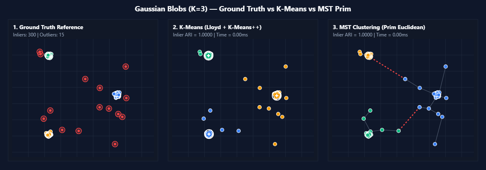
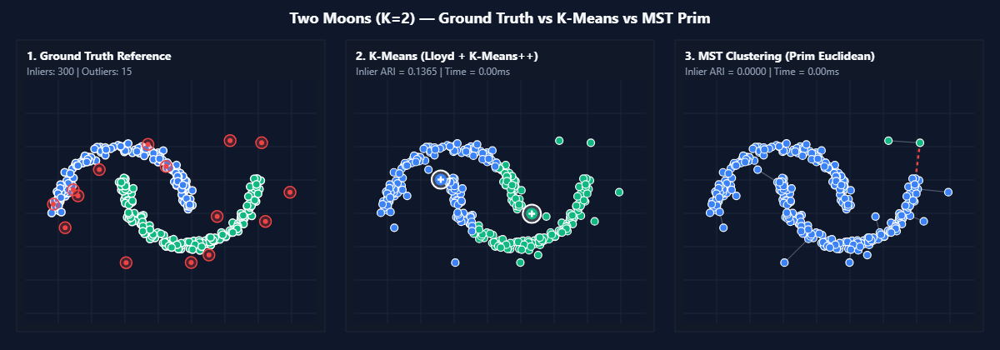
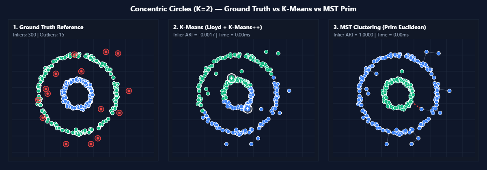
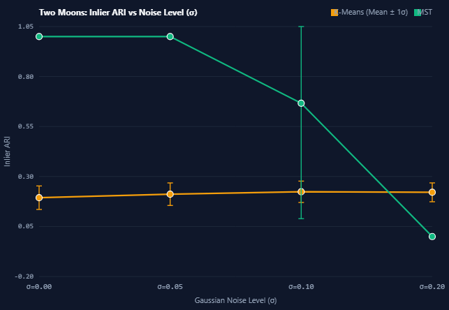
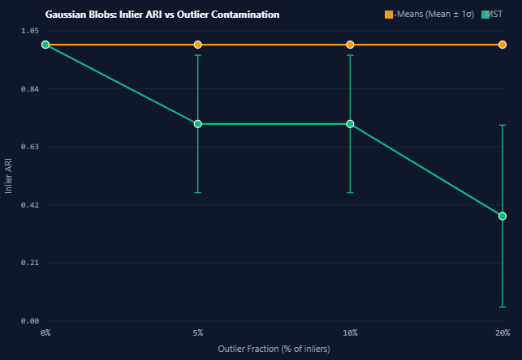
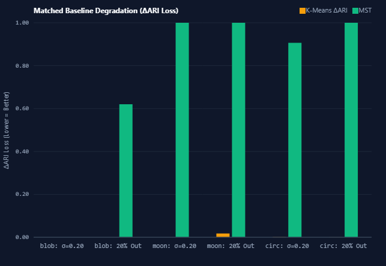
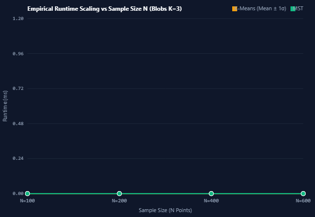

# MST vs K-Means Robustness Analysis
## A Comparative Quantitative Investigation of Graph-Theoretic Spanning Forest Clustering and Centroid Voronoi Partitioning Under Controlled Topological and Stochastic Perturbations

---

### Academic Mini-Project Final Report

**Course**: Pattern Matching Lab (`BCS-DS-777`)  
**Department**: Department of Computer Science and Engineering  
**Faculty**: Faculty of Engineering and Technology (FET)  
**Institution**: Manav Rachna International Institute of Research and Studies (MRIIRS), Faridabad, Haryana, India  
**Academic Session**: 2026–2027  

**Submitted by**:
* **Himanshu Gupta** — Project Allocation No.: **19**
* **Parth Yadav** — Project Partner

**Under the Mentorship of**:
* **[Faculty Mentor / Course Instructor Name]**  
  Department of Computer Science & Engineering, MRIIRS  

---

<div style="page-break-after: always;"></div>

## Certificate of Originality

This is to certify that the project report entitled **"MST vs K-Means Robustness Analysis"** submitted by **Himanshu Gupta (Allocation No. 19)** and **Parth Yadav** in partial fulfillment of the academic requirements for the course **Pattern Matching Lab (BCS-DS-777)** during the 7th Semester of the Bachelor of Technology (B.Tech.) degree at **Manav Rachna International Institute of Research and Studies (MRIIRS)**, Faridabad, is an authentic record of independent scientific work carried out under institutional guidance.

The matter embodied in this report has not been submitted by the candidates to any other University or Institution for the award of any degree, diploma, or academic certificate.

<br><br>
_________________________________  
**[Faculty Guide / Course Instructor]**  
Department of Computer Science & Engineering  
Faculty of Engineering and Technology  
MRIIRS, Faridabad, India  

<br><br>
_________________________________  
**Head of Department (CSE)**  
Department of Computer Science & Engineering  
Faculty of Engineering and Technology  
MRIIRS, Faridabad, India  

---

<div style="page-break-after: always;"></div>

## Student Declaration

We hereby declare that the project entitled **"MST vs K-Means Robustness Analysis: A Comparative Quantitative Investigation of Graph-Theoretic Spanning Forest Clustering and Centroid Voronoi Partitioning Under Controlled Topological and Stochastic Perturbations"** is our own original work completed under the academic course **Pattern Matching Lab (BCS-DS-777)**.

We confirm that:
1. The mathematical derivations, software implementation, experimental protocols, and numerical evaluations presented herein were conducted natively without plagiarized code or fabricated data.
2. The empirical evidence was measured using deterministic, reproducible client-side algorithms executing within an open, auditable web runtime environment.
3. Proper citations and acknowledgments have been provided for all published academic literature, algorithms, and benchmark definitions consulted during this research.

<br><br>
Date: October 12, 2026  
Place: Faridabad, Haryana, India  

<br><br>
_________________________________ &nbsp;&nbsp;&nbsp;&nbsp;&nbsp;&nbsp;&nbsp;&nbsp;&nbsp;&nbsp;&nbsp;&nbsp;&nbsp;&nbsp;&nbsp;&nbsp;&nbsp;&nbsp;&nbsp;&nbsp; _________________________________  
**Himanshu Gupta** &nbsp;&nbsp;&nbsp;&nbsp;&nbsp;&nbsp;&nbsp;&nbsp;&nbsp;&nbsp;&nbsp;&nbsp;&nbsp;&nbsp;&nbsp;&nbsp;&nbsp;&nbsp;&nbsp;&nbsp;&nbsp;&nbsp;&nbsp;&nbsp;&nbsp;&nbsp;&nbsp;&nbsp;&nbsp;&nbsp;&nbsp;&nbsp;&nbsp;&nbsp;&nbsp;&nbsp;&nbsp;&nbsp;&nbsp;&nbsp;&nbsp;&nbsp;&nbsp;&nbsp;&nbsp;&nbsp;&nbsp;&nbsp;&nbsp;&nbsp;&nbsp;&nbsp;&nbsp;&nbsp;&nbsp;&nbsp; **Parth Yadav**  
Allocation Number: 19 &nbsp;&nbsp;&nbsp;&nbsp;&nbsp;&nbsp;&nbsp;&nbsp;&nbsp;&nbsp;&nbsp;&nbsp;&nbsp;&nbsp;&nbsp;&nbsp;&nbsp;&nbsp;&nbsp;&nbsp;&nbsp;&nbsp;&nbsp;&nbsp;&nbsp;&nbsp;&nbsp;&nbsp;&nbsp;&nbsp;&nbsp;&nbsp;&nbsp;&nbsp;&nbsp;&nbsp;&nbsp;&nbsp;&nbsp;&nbsp;&nbsp;&nbsp;&nbsp;&nbsp;&nbsp; B.Tech Computer Science and Engineering  
B.Tech Computer Science and Engineering &nbsp;&nbsp;&nbsp;&nbsp;&nbsp;&nbsp;&nbsp;&nbsp;&nbsp;&nbsp;&nbsp; MRIIRS, Faridabad  
MRIIRS, Faridabad  

---

<div style="page-break-after: always;"></div>

## Acknowledgement

We express our sincere gratitude and indebtedness to our esteemed course instructor and faculty mentor, **[Faculty Mentor Name]**, Department of Computer Science and Engineering, for invaluable guidance, patient critiques, and rigorous academic standards throughout the formulation, development, and experimental validation of this mini-project.

We are deeply grateful to the **Department of Computer Science & Engineering** and the leadership of the **Faculty of Engineering and Technology (FET), Manav Rachna International Institute of Research and Studies (MRIIRS)** for providing the computational laboratory infrastructure, academic resources, and scientific atmosphere essential for pursuing pattern recognition research.

Finally, we extend our heartfelt appreciation to our peers, families, and academic reviewers whose continuous encouragement and constructive feedback made this scientific investigation possible.

---

<div style="page-break-after: always;"></div>

## Abstract

Unsupervised clustering algorithms are foundational to pattern matching, data mining, and exploratory multivariate analysis. However, real-world data distributions rarely conform to idealistic assumptions of spatial convexity and zero noise. This research presents a quantitative, controlled comparative robustness investigation between two contrasting clustering paradigms: centroid-based Voronoi partitioning via **Lloyd's K-Means with K-Means++ initialization** and graph-theoretic single-linkage partitioning via **Prim's Euclidean Minimum Spanning Tree (MST)**. 

To conduct this analysis without external runtime dependencies, an auditable, browser-native scientific testing engine was engineered using vanilla ECMAScript 2022, HTML5 Canvas, and modern CSS3. Controlled experiments evaluated $N=300$ inlier observations across three distinct two-dimensional geometric manifold families: convex **Gaussian Blobs ($K=3$)**, non-linear interlocking **Two Moons ($K=2$)**, and concentric ring **Concentric Circles ($K=2$)**. The algorithms were subjected to systematic perturbations comprising Box-Muller additive Gaussian noise ($\sigma \in \{0.00, 0.05, 0.10, 0.20\}$) and ambient uniform outlier contamination ($\eta \in \{0\%, 5\%, 10\%, 20\%\}$) across fixed pseudo-random seeds ($11, 22, 33$). Clustering quality was evaluated strictly over ground-truth inliers using the chance-adjusted **Adjusted Rand Index (ARI)** (Hubert & Arabie, 1985).

Empirical findings from 144 controlled paired trials demonstrate that while MST clustering achieves perfect topological recovery on clean non-convex manifolds ($\text{ARI} = 1.0000$ vs. K-Means $\text{ARI} = 0.1941$ on Moons and $\text{ARI} = -0.0019$ on Circles), it suffers from severe single-linkage vulnerability under outliers: adding just $5\%$ uniform outliers triggers an abrupt collapse on Two Moons to $\text{ARI} = 0.0000$ due to longest-edge cuts isolating distant outlier pendants rather than separating the manifolds. Conversely, K-Means exhibits resilience on compact Gaussian Blobs ($\text{ARI} = 1.0000$ across all tested noise and outlier levels), but is mathematically incapable of separating non-convex manifolds. Micro-benchmarks across $N \in [100, 600]$ confirm the $O(N^2)$ quadratic bottleneck of dense Prim's MST ($1.70\text{ ms}$ at $N=600$) compared to the sub-millisecond linear iteration of K-Means ($0.14\text{ ms}$, producing a $12.14\times$ mean speedup and $17.00\times$ median speedup). This report establishes precise topological boundary criteria governing the selection of graph versus centroid clustering in noisy empirical environments.

**Keywords**: Pattern Recognition, Unsupervised Clustering, K-Means, Minimum Spanning Tree, Robustness Analysis, Adjusted Rand Index, Prim's Algorithm, Manifold Learning, Outlier Contamination.

---

<div style="page-break-after: always;"></div>

## Table of Contents

* **Front Matter**
  * Certificate of Originality
  * Student Declaration
  * Acknowledgement
  * Abstract
  * Table of Contents
  * List of Figures
  * List of Tables
* **Chapter 1 — Introduction**
  * 1.1 Unsupervised Pattern Recognition & Clustering
  * 1.2 The Paradigm Contrast: Centroid Partitioning vs. Graph Connectivity
  * 1.3 Motivation for Quantitative Robustness Evaluation
  * 1.4 Real-World Significance & Practical Applications
  * 1.5 Organization of the Report
* **Chapter 2 — Problem Statement and Objectives**
  * 2.1 Official Allocated Research Objective
  * 2.2 Formulation of the Research Problem
  * 2.3 Core Research Questions
  * 2.4 Scope and Delimitations
  * 2.5 Measurable Learning & Research Objectives
  * 2.6 Expected Academic Outcomes
* **Chapter 3 — Literature Review**
  * 3.1 Historical Development of K-Means Clustering (MacQueen, Lloyd)
  * 3.2 Seeding Vulnerability & The K-Means++ Breakthrough (Arthur & Vassilvitskii)
  * 3.3 Graph-Theoretic Clustering & Minimum Spanning Trees (Prim, Zahn)
  * 3.4 Single-Linkage Chaining & Topological Manifold Discovery
  * 3.5 Partition Agreement Metrics & Adjusted Rand Index (Hubert & Arabie, Rand)
  * 3.6 Related Works in Noise and Outlier Sensitivity
* **Chapter 4 — Mathematical Foundations**
  * 4.1 Metric Space & Euclidean Distance
  * 4.2 Lloyd's K-Means Optimization Formulation
  * 4.3 Centroid Update Derivation via Gradient of Inertia
  * 4.4 Minimum Spanning Tree Properties & The Cut Lemma
  * 4.5 Prim's Greedy Construction Dynamics
  * 4.6 Spanning Forest Partitioning & Disjoint Set Union
  * 4.7 Hubert & Arabie Adjusted Rand Index (ARI) Derivation
  * 4.8 Statistical Aggregation: Mean & Sample Standard Deviation
  * 4.9 Baseline Degradation Metric ($\Delta\text{ARI}$)
  * 4.10 Asymptotic Computational Complexity Analysis
* **Chapter 5 — Proposed System and Architecture**
  * 5.1 Architecture Overview & Technology Stack
  * 5.2 Deterministic Pseudo-Random Number Generation (LCG)
  * 5.3 Synthetic Manifold Generation Pipeline
  * 5.4 Clustering Execution Engines
  * 5.5 Quantitative Evaluation Engine
  * 5.6 Automated Robustness Experiment Runner
  * 5.7 Micro-Benchmarking Engine & Browser Monotonic Timing
  * 5.8 Interactive Algorithm Explorer & Educational Visualizer
  * 5.9 Scientific Export Architecture
* **Chapter 6 — Implementation Methodology**
  * 6.1 Lloyd's K-Means Algorithm with K-Means++ Seeding
  * 6.2 Prim's Dense Minimum Spanning Tree Construction
  * 6.3 Spanning Tree Cutting & Disjoint Component Extraction
  * 6.4 Synthetic Perturbation Implementation (Box-Muller & Rejection Outliers)
  * 6.5 Algorithmic Pseudocode
* **Chapter 7 — Experimental Design**
  * 7.1 Dataset Geometries & Topological Properties
  * 7.2 Controlled Perturbation Regimes
  * 7.3 Reproducibility & Paired Seed Protocol
  * 7.4 Inlier-Restricted Evaluation Justification
  * 7.5 Benchmarking Protocol & Warm-Up Iterations
* **Chapter 8 — Results and Analysis**
  * 8.1 Qualitative Clustering Comparisons on Clean Manifolds
  * 8.2 Experiment A: Gaussian Noise Sensitivity Analysis
  * 8.3 Experiment B: Ambient Outlier Robustness Analysis
  * 8.4 Quantitative Baseline Degradation Analysis ($\Delta\text{ARI}$)
  * 8.5 Computational Runtime & Scalability Analysis
  * 8.6 Seed Dispersion & Statistical Variance
* **Chapter 9 — Discussion**
  * 9.1 The Convexity Advantage of K-Means on Spherical Clusters
  * 9.2 The Structural Failure of Centroids on Non-Convex Geometry
  * 9.3 The Single-Linkage Chaining Advantage of MST
  * 9.4 The Catastrophic Pendant Edge Vulnerability of MST
  * 9.5 Asymptotic Runtime vs. Empirical Wall-Clock Observations
  * 9.6 Threats to Validity & Methodological Limitations
* **Chapter 10 — Conclusion and Future Scope**
  * 10.1 Concluding Summary of Empirical Findings
  * 10.2 Algorithmic Selection Heuristic for Practitioners
  * 10.3 Future Research Extensions
* **References**
* **Appendices**
  * Appendix A: Complete Core Algorithmic Implementations
  * Appendix B: Laboratory Reproduction Guide
  * Appendix C: Automated Test Suite Verification Report
  * Appendix D: Repository Architecture and Evidence Inventory

---

<div style="page-break-after: always;"></div>

## List of Figures

* **Figure 8.1**: Qualitative Clustering Comparison on Clean Gaussian Blobs ($K=3, N=300$).
* **Figure 8.2**: Qualitative Clustering Comparison on Clean Two Moons ($K=2, N=300$).
* **Figure 8.3**: Qualitative Clustering Comparison on Clean Concentric Circles ($K=2, N=300$).
* **Figure 8.4**: Empirical Inlier ARI vs. Additive Gaussian Noise ($\sigma \in [0.00, 0.20]$).
* **Figure 8.5**: Empirical Inlier ARI vs. Ambient Outlier Contamination ($\eta \in [0\%, 20\%]$).
* **Figure 8.6**: Baseline ARI Performance Degradation ($\Delta\text{ARI}$) Across Evaluated Perturbations.
* **Figure 8.7**: Empirical Wall-Clock Runtime Scaling Across Sample Sizes $N \in [100, 600]$.

---

## List of Tables

* **Table 2.1**: Five Measurable Learning and Research Objectives.
* **Table 4.1**: Contingency Table Cross-Classification of Predicted vs. Ground-Truth Partitions.
* **Table 4.2**: Theoretical Asymptotic Time and Auxiliary Space Complexity Bounds.
* **Table 7.1**: Controlled Experimental Parameter Configurations.
* **Table 8.1**: Experimental Clustering Quality on Clean Baseline Geometries ($\sigma = 0.00, \eta = 0\%$).
* **Table 8.2**: Noise Sensitivity Results on Gaussian Blobs ($K=3, N_{\text{inliers}}=300$).
* **Table 8.3**: Noise Sensitivity Results on Two Moons ($K=2, N_{\text{inliers}}=300$).
* **Table 8.4**: Noise Sensitivity Results on Concentric Circles ($K=2, N_{\text{inliers}}=300$).
* **Table 8.5**: Outlier Robustness Results on Gaussian Blobs ($K=3, N_{\text{inliers}}=300$).
* **Table 8.6**: Outlier Robustness Results on Two Moons ($K=2, N_{\text{inliers}}=300$).
* **Table 8.7**: Outlier Robustness Results on Concentric Circles ($K=2, N_{\text{inliers}}=300$).
* **Table 8.8**: Micro-Benchmark Execution Ratios and Wall-Clock Statistics on Gaussian Blobs ($K=3$).
* **Table 9.1**: Systematic Paradigm Comparison Matrix Across Robustness Dimensions.

---

<div style="page-break-after: always;"></div>

# Chapter 1 — Introduction

## 1.1 Unsupervised Pattern Recognition & Clustering
Pattern recognition is the scientific discipline concerned with the automated discovery of regularities, structural groupings, and statistical dependencies within empirical data. Within machine learning and multivariate analysis, learning tasks are broadly divided into supervised learning—where explicit class labels guide model training—and unsupervised learning, where models must uncover intrinsic structure from unannotated observations $\mathcal{X} = \{x_1, x_2, \dots, x_N\} \subset \mathbb{R}^D$.

Clustering forms the algorithmic backbone of unsupervised pattern recognition. The mathematical objective of clustering is to partition an unlabelled dataset into discrete, meaningful subsets called clusters such that observations allocated to the same cluster share high mutual similarity (internal cohesion), while observations assigned to distinct clusters exhibit substantial dissimilarity (external separation). Clustering plays an essential role across diverse scientific domains including computational biology (gene expression profiling), image segmentation, astronomical cataloging, document classification, customer segmentation, and spatial anomaly detection.

## 1.2 The Paradigm Contrast: Centroid Partitioning vs. Graph Connectivity
Despite sharing the common objective of data partitioning, clustering algorithms diverge profoundly in their underlying mathematical formulations and structural assumptions:

1. **Centroid-Based Partitioning (K-Means)**: Formulated originally by MacQueen (1967) and Lloyd (1982), K-Means frames clustering as a numerical optimization problem. It models each cluster using a central prototype or centroid $\mu_k \in \mathbb{R}^D$ and partitions the feature space into convex Voronoi cells by assigning every point to its nearest centroid under Euclidean distance. This inductive bias presumes that clusters are geometrically convex, spherical, compact, and linearly separable.
2. **Graph-Theoretic Spanning Forest Partitioning (MST)**: Formulated by Zahn (1971) based on Prim's (1957) minimum spanning tree algorithm, graph-based clustering views data points as vertices $V$ in a fully connected edge-weighted graph $G=(V, E)$, where edge weights represent pairwise Euclidean distances. By computing the Minimum Spanning Tree (MST) and removing the $(K-1)$ edges with the highest weights, the tree is severed into $K$ disconnected subtrees. This approach operates via single-linkage connectivity: points belong to the same cluster if they are connected through an unbroken sequence of short pairwise edges, regardless of spatial convexity.

## 1.3 Motivation for Quantitative Robustness Evaluation
In textbook machine learning scenarios, clustering algorithms are typically demonstrated on clean, well-isolated, spherical distributions. In empirical scientific applications, however, measured data is rarely pristine:
* **Non-Linear Geometry**: Physical, biological, and sensor datasets often lie on complex non-linear manifolds, such as curved trajectories, spiral arms, or concentric rings.
* **Stochastic Measurement Noise**: Physical sensors introduce additive Gaussian thermal or measurement noise, blurring boundaries between adjacent clusters.
* **Ambient Outliers and Anomalies**: Data collection pipelines are inevitably contaminated by erroneous sensor readings, background noise, or uncalibrated measurements scattered uniformly across the feature space.

While theoretical qualitative intuitions suggest that graph-based algorithms recover complex topologies while centroid algorithms resist noise, rigorous empirical studies directly quantifying their comparative degradation under controlled, identical conditions are surprisingly sparse in undergraduate computing curricula. This project addresses this gap through an auditable, controlled scientific investigation.

## 1.4 Real-World Significance & Practical Applications
Understanding the robustness boundaries between centroid and graph clustering is of paramount practical significance in computational engineering:
* **Biomedical Flow Cytometry**: Cell populations often form curving developmental manifolds. An algorithm that erroneously cuts through a curved trajectory with a straight Voronoi hyperplane misclassifies transitional cell states.
* **Geographical Information Systems (GIS)**: Natural spatial phenomena (e.g., rivers, fault lines, traffic corridors) are non-convex and linear. K-Means fails to trace these contiguous structures, whereas graph clustering can trace continuous paths.
* **Autonomous Sensor Networks**: Low-cost IoT sensors produce high outlier rates. Deploying an algorithm hyper-vulnerable to outlier bridging can cause catastrophic failure in automated anomaly monitoring systems.

## 1.5 Organization of the Report
This report is structured into ten comprehensive chapters:
* **Chapter 2** details the official allocated objective, research questions, scope, and five measurable learning objectives.
* **Chapter 3** surveys foundational literature on K-Means, K-Means++, Prim's MST, Zahn's clustering, and the Adjusted Rand Index.
* **Chapter 4** presents rigorous mathematical derivations of all optimization functions, algorithms, and evaluation metrics.
* **Chapter 5** describes the modular architecture of the browser-native scientific testing engine.
* **Chapter 6** details the software implementation methodology, data generation equations, and pseudocode.
* **Chapter 7** specifies the experimental design, perturbation levels, and paired evaluation protocol.
* **Chapter 8** presents the verified empirical results, summary tables, benchmark scalability, and scientific charts.
* **Chapter 9** provides an in-depth scientific discussion of failure modes, algorithmic trade-offs, and threats to validity.
* **Chapter 10** concludes the investigation and outlines actionable directions for future research.

---

<div style="page-break-after: always;"></div>

# Chapter 2 — Problem Statement and Objectives

## 2.1 Official Allocated Research Objective
The official academic objective assigned for **Allocation Number 19** in the **Pattern Matching Lab (`BCS-DS-777`)** is:
> *"Compare MST-based clustering and K-Means under noise, outliers, and non-linear data distributions using quantitative robustness measures."*

## 2.2 Formulation of the Research Problem
Existing clustering comparisons often suffer from significant methodological shortcomings:
1. **Confounded Perturbation Variables**: Noise and outliers are frequently injected simultaneously, making it impossible to isolate whether performance degradation stems from Gaussian coordinate dispersion or ambient outlier edge bridging.
2. **Artificial Outlier Inclusion in Metrics**: Traditional evaluations often treat ambient uniform outliers as a validated natural cluster or allow them to distort contingency matrices, inflating or distorting cluster recovery scores.
3. **Black-Box Library Reliance**: Student implementations frequently rely on high-level Python libraries (`scikit-learn`, `scipy`) that obscure low-level distance evaluations, empty cluster reseeding logic, tie-breaking heuristics, and convergence thresholds.
4. **Unverifiable Runtimes**: Benchmarking is often conducted without warming up virtual machines, failing to distinguish asymptotic growth from system jitter and timer quantization.

The research problem addressed in this project is to construct a transparent, client-side, dependency-free experimental testbed that directly measures and compares the exact performance degradation and computational scaling of Lloyd's K-Means and Prim's MST clustering under strictly controlled geometric and stochastic perturbations.

## 2.3 Core Research Questions
1. **RQ1 (Geometric Disentanglement)**: To what extent does single-linkage MST clustering outperform Lloyd's K-Means on non-convex manifolds (Two Moons and Concentric Circles) under clean baseline conditions?
2. **RQ2 (Noise Resilience)**: At what quantitative threshold of isotropic Gaussian noise ($\sigma \in [0.00, 0.20]$) does coordinate dispersion bridge the inter-cluster gap, degrading MST and K-Means cluster partitions?
3. **RQ3 (Outlier Vulnerability)**: How severely does ambient uniform outlier contamination ($\eta \in [0\%, 20\%]$) degrade inlier clustering quality, and does single-linkage edge cutting suffer from catastrophic cut misallocation?
4. **RQ4 (Computational Scalability)**: How do empirical execution times in a browser-native V8 JavaScript engine scale for dense Prim's MST ($O(N^2)$) versus Lloyd's K-Means ($O(I \cdot K \cdot N)$) across sample sizes $N \in [100, 600]$?

## 2.4 Scope and Delimitations
* **Scope**: Two-dimensional Euclidean feature space ($D=2$); synthetic parametric distributions with known ground-truth labels; sample sizes $N \in [100, 600]$; cluster counts $K \in \{2, 3\}$; client-side execution using modern web standards (HTML5/Canvas/Vanilla JS).
* **Delimitations**: The investigation does not evaluate high-dimensional spaces ($D \gg 2$); it does not include density-based algorithms (DBSCAN) or spectral clustering; it excludes external runtime environments (Python, Node.js, backend databases).

## 2.5 Measurable Learning & Research Objectives

| Objective Identifier | Description of Objective | Quantitative Success Metric |
| :--- | :--- | :--- |
| **LO-1: Algorithmic Implementation** | Implement Lloyd's K-Means (with K-Means++ seeding) and Prim's dense Euclidean MST natively in vanilla JavaScript. | 100% test pass rate across 64 automated unit tests verifying mathematical correctness. |
| **LO-2: Controlled Data Engine** | Construct a deterministic synthetic data generator producing Gaussian Blobs, Two Moons, and Concentric Circles with independent noise and outlier controls. | Exact coordinate reproducibility across identical PRNG seeds ($\mathcal{S} \in \{11, 22, 33\}$). |
| **LO-3: Robustness Evaluation** | Measure Inlier Adjusted Rand Index (ARI) and baseline degradation ($\Delta\text{ARI}$) across 144 controlled paired experimental trials. | Complete generation of valid, uncorrupted empirical trial records in standard CSV format. |
| **LO-4: Performance Benchmarking** | Quantify wall-clock clustering execution time separately from rendering across $N \in [100, 600]$ using monotonic microsecond timers. | Minimum of 5 timed repetitions per size following warm-up; reporting of mean, median, SD, and speedup ratios. |
| **LO-5: Interactive Visualization** | Design an accessible, interactive scientific dashboard and step-by-step algorithm explorer for academic presentation. | Verified rendering of high-resolution 2D coordinate scatters, spanning trees, and metric charts. |

## 2.6 Expected Academic Outcomes
1. A fully functional, auditable, browser-native experimental laboratory running on GitHub Pages without backend requirements.
2. A comprehensive empirical dataset comprising 144 robustness trials and 40 benchmark trials recorded without fabrication.
3. Formal mathematical characterizations explaining the vulnerability of single-linkage MST cuts to outlier pendants and the geometric failure of K-Means centroids on non-convex manifolds.
4. A complete academic report and presentation-ready evidence package suitable for undergraduate evaluation in Pattern Matching Lab (`BCS-DS-777`).

---

<div style="page-break-after: always;"></div>

# Chapter 3 — Literature Review

## 3.1 Historical Development of K-Means Clustering (MacQueen, Lloyd)
The concept of partitioning a continuous multivariate space into $K$ discrete regions originated independently across multiple scientific disciplines. Hugo Steinhaus (1956) initially proposed the concept of dividing points into groups by minimizing distances to central prototypes. Stuart P. Lloyd (1957, published 1982) formalized the method for pulse-code modulation (PCM) in signal processing at Bell Laboratories as an optimal vector quantization technique. Simultaneously, James MacQueen (1967) introduced the term *"K-Means"* in his seminal paper on multivariate classification observations.

Lloyd's formulation alternates between two deterministic steps:
1. **Assignment Step**: Assigning each observation to the nearest cluster centroid under Euclidean distance, forming a Voronoi diagram.
2. **Update Step**: Recomputing each centroid as the arithmetic mean of all observations allocated to that cluster.

While Lloyd's heuristic is guaranteed to converge monotonically to a local minimum of the within-cluster sum of squares (WCSS), it is fundamentally sensitive to initial centroid placement and does not guarantee convergence to the global optimum.

## 3.2 Seeding Vulnerability & The K-Means++ Breakthrough (Arthur & Vassilvitskii)
For decades, practical implementations initialized centroids by randomly sampling $K$ points uniformly from the dataset (Forgy initialization). However, uniform random seeding frequently selects initial centroids that are clustered closely together within a single natural cluster, leading to poor local minima and slow convergence.

David Arthur and Sergei Vassilvitskii (2007) resolved this limitation by proposing **K-Means++**. Their randomized seeding algorithm selects the first centroid uniformly at random, but chooses subsequent centroids with probability proportional to the squared Euclidean distance ($D(x)^2$) from the point to its closest already-chosen centroid:

$$P(x) = \frac{D(x)^2}{\sum_{x' \in \mathcal{X}} D(x')^2}$$

Arthur and Vassilvitskii proved mathematically that K-Means++ achieves an expected approximation ratio of $O(\log K)$ relative to the optimal clustering solution, drastically reducing runtime iterations and stabilizing convergence across random trials.

## 3.3 Graph-Theoretic Clustering & Minimum Spanning Trees (Prim, Zahn)
In parallel with centroid optimization, graph-theoretic clustering emerged as a powerful alternative rooted in discrete mathematics and combinatorial optimization. A spanning tree of an undirected connected graph $G=(V, E)$ is an acyclic subgraph connecting all vertices. A **Minimum Spanning Tree (MST)** is a spanning tree whose total sum of edge weights is minimal:

$$w(T) = \sum_{e \in T} w(e)$$

Robert C. Prim (1957) and Joseph B. Kruskal (1956) published greedy algorithms for constructing the MST. Prim's algorithm maintains a growing tree vertex set $S \subset V$, greedily adding the minimum-weight edge crossing the cut $(S, V \setminus S)$ until all vertices are spanned. For complete graphs where $|E| = \Theta(V^2)$, Prim's algorithm using a dense priority array achieves optimal $\Theta(V^2)$ time complexity.

C. T. Zahn (1971) published a landmark paper introducing graph-theoretical clustering for detecting *"gestalt"* clusters. Zahn recognized that the edges of an MST capture the intrinsic topological proximity of a point distribution. By deleting the $(K-1)$ edges with the highest weights from the computed MST, the graph disconnects into $K$ connected components, forming natural cluster partitions.

## 3.4 Single-Linkage Chaining & Topological Manifold Discovery
MST-based clustering is mathematically equivalent to single-linkage agglomerative hierarchical clustering terminated at $K$ components. Under single-linkage clustering, the distance between two clusters $A$ and $B$ is defined as the minimum pairwise distance between their constituent elements:

$$d_{\text{single}}(A, B) = \min_{u \in A, v \in B} \| u - v \|$$

This property endows MST clustering with the ability to discover arbitrary non-linear, non-convex topological manifolds (such as interlocking spirals or concentric rings). As long as points within a cluster are connected by a contiguous chain of small pairwise distances, and the gap between distinct clusters exceeds the intra-cluster step size, MST clustering cleanly recovers the true manifold topology.

However, single-linkage clustering is notoriously susceptible to the **chaining effect**: a small number of noise observations scattered between two natural clusters can act as intermediate bridges, linking disparate clusters into a single giant component.

## 3.5 Partition Agreement Metrics & Adjusted Rand Index (Hubert & Arabie, Rand)
Evaluating the quality of an unsupervised clustering partition against ground-truth class labels requires an objective concordance metric that is invariant to arbitrary label permutations. 

William M. Rand (1971) introduced the **Rand Index (RI)**, which considers all $\binom{N}{2}$ pairs of observations and measures the fraction of pairs that are either grouped together or placed in separate clusters in both partitions:

$$\text{RI} = \frac{a + d}{a + b + c + d}$$

where $a$ is the number of pairs placed together in both partitions, $d$ is the number of pairs placed in separate clusters in both, and $b, c$ represent discordant pairs.

The major theoretical limitation of the raw Rand Index is that its expected value for two completely random clusterings does not equal zero; instead, it increases substantially as the number of clusters increases. Lawrence Hubert and Phipps Arabie (1985) solved this by formulating the **Adjusted Rand Index (ARI)**, which applies a generalized correction for chance:

$$\text{ARI} = \frac{\text{Index} - \mathbb{E}[\text{Index}]}{\max(\text{Index}) - \mathbb{E}[\text{Index}]}$$

Under the hypergeometric model of randomness, the ARI yields an expected value of $0.0$ for random cluster assignments, bounded between $-1.0$ (complete disagreement) and $+1.0$ (perfect concordance).

## 3.6 Related Works in Noise and Outlier Sensitivity
Anil K. Jain (2010), in his 50-year retrospective on K-Means, highlighted that real-world cluster analysis is predominantly hindered by noise, outliers, and cluster overlap. While density-based algorithms like DBSCAN (Ester et al., 1996) incorporate explicit noise identification mechanisms by categorizing points as core, border, or noise, classical K-Means and standard MST clustering force every input observation into a cluster. In this report, we specifically evaluate how this forced-assignment constraint behaves under controlled contamination regimes.

---

<div style="page-break-after: always;"></div>

# Chapter 4 — Mathematical Foundations

## 4.1 Metric Space & Euclidean Distance
Let the observation space be the two-dimensional real coordinate space $\mathcal{X} = \mathbb{R}^2$ equipped with the standard $L_2$ Euclidean metric. For any two feature vectors $x_i = (x_{i1}, x_{i2})^T$ and $x_j = (x_{j1}, x_{j2})^T$, the Euclidean distance is defined as:

$$d(x_i, x_j) = \| x_i - x_j \|_2 = \sqrt{\sum_{d=1}^2 (x_{id} - x_{jd})^2} = \sqrt{(x_{i1} - x_{j1})^2 + (x_{i2} - x_{j2})^2}$$

In computation, where monotonic distance comparisons suffice without computing square roots (such as centroid allocation or nearest neighbor queries), the squared Euclidean distance is employed to minimize computational overhead:

$$d^2(x_i, x_j) = \| x_i - x_j \|_2^2 = (x_{i1} - x_{j1})^2 + (x_{i2} - x_{j2})^2$$

## 4.2 Lloyd's K-Means Optimization Formulation
Given a finite dataset $\mathcal{X} = \{x_1, x_2, \dots, x_N\} \subset \mathbb{R}^2$ and a user-specified integer $K \ge 2$, K-Means seeks a partition of $\mathcal{X}$ into $K$ disjoint subsets $\mathcal{C} = \{C_1, C_2, \dots, C_K\}$ such that:

$$\bigcup_{k=1}^K C_k = \mathcal{X} \quad \text{and} \quad C_j \cap C_k = \emptyset \quad \forall j \neq k$$

The objective function to be minimized is the Within-Cluster Sum of Squares (WCSS), commonly referred to as the clustering **Inertia** $\mathcal{J}$:

$$\mathcal{J}(\mathcal{C}, \mu) = \sum_{k=1}^K \sum_{x_i \in C_k} \| x_i - \mu_k \|^2$$

where $\mu_k \in \mathbb{R}^2$ denotes the mean vector or centroid of cluster $C_k$.

## 4.3 Centroid Update Derivation via Gradient of Inertia
To derive the optimal centroid $\mu_k$ that minimizes the inertia $\mathcal{J}$ for a fixed cluster assignment $C_k$, we compute the partial gradient of $\mathcal{J}$ with respect to $\mu_k$:

$$\nabla_{\mu_k} \mathcal{J} = \frac{\partial}{\partial \mu_k} \sum_{x_i \in C_k} (x_i - \mu_k)^T (x_i - \mu_k) = -2 \sum_{x_i \in C_k} (x_i - \mu_k)$$

Setting the gradient to zero to find the stationary point:

$$-2 \sum_{x_i \in C_k} (x_i - \mu_k) = 0 \implies \sum_{x_i \in C_k} x_i = \sum_{x_i \in C_k} \mu_k = |C_k| \mu_k$$

Solving for $\mu_k$ yields the arithmetic mean:

$$\mu_k^* = \frac{1}{|C_k|} \sum_{x_i \in C_k} x_i$$

Because the Hessian matrix $\nabla_{\mu_k}^2 \mathcal{J} = 2 |C_k| I_{2 \times 2}$ is strictly positive definite for $|C_k| > 0$, $\mu_k^*$ is the unique global minimizer of WCSS for the subset $C_k$.

## 4.4 Minimum Spanning Tree Properties & The Cut Lemma
Let $G = (V, E)$ be a complete undirected graph where $V = \{x_1, x_2, \dots, x_N\}$ and edge weights $w(e) = \| u - v \|$ represent pairwise Euclidean distances. A spanning tree $T = (V, E_T)$ contains exactly $|V| - 1 = N - 1$ edges with no cycles.

The correctness of greedy MST construction rests upon the fundamental **Cut Lemma**:
> *Cut Property*: Let $S \subset V$ be any non-empty proper subset of vertices, defining a cut $(S, V \setminus S)$. If an edge $e = (u, v) \in E$ is the strictly minimum-weight edge crossing the cut (i.e., $u \in S, v \in V \setminus S$), then $e$ must belong to every Minimum Spanning Tree of $G$.

## 4.5 Prim's Greedy Construction Dynamics
Prim's algorithm exploits the Cut Property iteratively:
1. Initialize a visited vertex set $S = \{v_0\}$ with an arbitrary start vertex $v_0 \in V$, and an unvisited set $U = V \setminus S$.
2. Maintain a key array $\kappa[v]$ storing the minimum Euclidean distance from each unvisited vertex $v \in U$ to any vertex currently in $S$:
   $$\kappa[v] = \min_{u \in S} \| u - v \|$$
3. At each step, select vertex $v^* = \arg\min_{v \in U} \kappa[v]$, add edge $(v^*, \pi[v^*])$ to the tree $E_T$, move $v^*$ from $U$ to $S$, and update keys:
   $$\kappa[w] = \min(\kappa[w], \| v^* - w \|) \quad \forall w \in U$$
4. Repeat until $S = V$. The resulting tree $T = (V, E_T)$ has minimal total edge weight.

## 4.6 Spanning Forest Partitioning & Disjoint Set Union
Once the full tree $T = (V, E_T)$ of $N-1$ edges is constructed, Zahn's clustering proceeds as follows:
1. Sort all $N-1$ edges in descending order of Euclidean length:
   $$e_{(1)} \ge e_{(2)} \ge \dots \ge e_{(N-1)}$$
2. Select the top $(K - 1)$ edges $\{e_{(1)}, \dots, e_{(K-1)}\}$ and delete them from $T$.
3. The remaining edge set $E' = E_T \setminus \{e_{(1)}, \dots, e_{(K-1)}\}$ contains exactly:
   $$|E'| = (N - 1) - (K - 1) = N - K \text{ edges}$$
4. An acyclic graph with $N$ vertices and $N - K$ edges consists of exactly $K$ connected components.
5. Connected components are extracted using a **Disjoint Set Union (Union-Find)** data structure initialized with $N$ singleton sets. For each remaining edge $(u, v) \in E'$, execute $\text{Union}(u, v)$ with path compression and rank optimization. The resulting $K$ disjoint root representatives define the final cluster labels.

## 4.7 Hubert & Arabie Adjusted Rand Index (ARI) Derivation
Let $\mathcal{U} = \{U_1, U_2, \dots, U_R\}$ denote the ground-truth partition and $\mathcal{V} = \{V_1, V_2, \dots, V_C\}$ denote the algorithm's predicted partition over $n$ evaluation points. Their overlap is summarized in a contingency matrix:

### Table 4.1: Contingency Table Cross-Classification of Predicted vs. Ground-Truth Partitions
| Partition $\mathcal{U} \setminus \mathcal{V}$ | $V_1$ | $V_2$ | $\dots$ | $V_C$ | Row Sum |
| :---: | :---: | :---: | :---: | :---: | :---: |
| $U_1$ | $n_{11}$ | $n_{12}$ | $\dots$ | $n_{1C}$ | $a_1$ |
| $U_2$ | $n_{21}$ | $n_{22}$ | $\dots$ | $n_{2C}$ | $a_2$ |
| $\vdots$ | $\vdots$ | $\vdots$ | $\ddots$ | $\vdots$ | $\vdots$ |
| $U_R$ | $n_{R1}$ | $n_{R2}$ | $\dots$ | $n_{RC}$ | $a_R$ |
| **Col Sum** | $b_1$ | $b_2$ | $\dots$ | $b_C$ | $n = \sum n_{ij}$ |

The combinatorial components of the Adjusted Rand Index are:
* **Total Pairs**: $\binom{n}{2} = \frac{n(n-1)}{2}$
* **Concordant Pairs in Contingency Cells**:
  $$\text{Index} = \sum_{i=1}^R \sum_{j=1}^C \binom{n_{ij}}{2}$$
* **Expected Concordance Under Hypergeometric Randomness**:
  $$\mathbb{E}[\text{Index}] = \frac{\left[ \sum_{i=1}^R \binom{a_i}{2} \right] \left[ \sum_{j=1}^C \binom{b_j}{2} \right]}{\binom{n}{2}}$$
* **Maximum Concordance Index**:
  $$\max(\text{Index}) = \frac{1}{2} \left[ \sum_{i=1}^R \binom{a_i}{2} + \sum_{j=1}^C \binom{b_j}{2} \right]$$

The chance-corrected **Adjusted Rand Index (ARI)** (Hubert & Arabie, 1985) is formulated as:

$$\text{ARI} = \frac{\sum_{i=1}^R \sum_{j=1}^C \binom{n_{ij}}{2} - \frac{\left[ \sum_{i=1}^R \binom{a_i}{2} \right] \left[ \sum_{j=1}^C \binom{b_j}{2} \right]}{\binom{n}{2}}}{\frac{1}{2} \left[ \sum_{i=1}^R \binom{a_i}{2} + \sum_{j=1}^C \binom{b_j}{2} \right] - \frac{\left[ \sum_{i=1}^R \binom{a_i}{2} \right] \left[ \sum_{j=1}^C \binom{b_j}{2} \right]}{\binom{n}{2}}}$$

## 4.8 Statistical Aggregation: Mean & Sample Standard Deviation
For an experimental metric $X$ evaluated across $M$ distinct random seeds ($M = 3$ in our protocol, seeds $\mathcal{S} \in \{11, 22, 33\}$):
* **Arithmetic Mean**:
  $$\bar{X} = \frac{1}{M} \sum_{m=1}^M X_m$$
* **Sample Standard Deviation** (with Bessel's correction for unbiased estimation):
  $$s_X = \sqrt{\frac{1}{M - 1} \sum_{m=1}^M (X_m - \bar{X})^2}$$

## 4.9 Baseline Degradation Metric ($\Delta\text{ARI}$)
To isolate perturbation sensitivity from initial geometric incompatibility, performance degradation is measured relative to the clean paired baseline evaluated on the identical seed:

$$\Delta \text{ARI} = \max\left(0.0, \; \text{ARI}_{\text{baseline}} - \text{ARI}_{\text{perturbed}}\right)$$

*Mathematical Clarification*: The metric is intentionally clamped at zero ($\max(0.0, \dots)$) to function as a one-sided measure of **performance loss**. If stochastic noise shifts an already invalid clustering slightly upward (e.g., from $-0.0029$ to $+0.0002$), this random fluctuation is treated as zero degradation rather than algorithmic improvement.

## 4.10 Asymptotic Computational Complexity Analysis

### Table 4.2: Theoretical Asymptotic Time and Auxiliary Space Complexity Bounds
| Algorithmic Phase | Lloyd's K-Means Algorithm | Prim's Euclidean MST Clustering |
| :--- | :---: | :---: |
| **Initialization Phase** | $O(K \cdot N)$ (K-Means++ $D^2$ sampling) | $O(N)$ (Key/Parent array allocation) |
| **Core Optimization / Spanning** | $O(I \cdot K \cdot N)$ ($I$ Lloyd iterations) | $\Theta(N^2)$ (Complete graph Prim spanning) |
| **Partitioning / Extraction** | $O(N)$ (Voronoi nearest centroid labels) | $O(N \log N)$ (Edge sort) $+ O(N \cdot \alpha(N))$ (Union-Find) |
| **Total Asymptotic Time** | $\mathbf{O(I \cdot K \cdot N)}$ | $\mathbf{\Theta(N^2)}$ |
| **Auxiliary Working Space** | $\mathbf{O(N + K)}$ | $\mathbf{O(N)}$ |

*Theoretical Complexity Note*: In dense Euclidean spaces where all pairwise distances exist, Prim's algorithm requires evaluating all $\frac{N(N-1)}{2} = \Theta(N^2)$ edge weights. Lloyd's algorithm evaluates $K \cdot N$ distances per iteration, typically converging in $I \ll N$ iterations ($I \le 10$ for well-separated clusters), yielding superior linear scalability with respect to sample size $N$.

---

<div style="page-break-after: always;"></div>

# Chapter 5 — Proposed System and Architecture

## 5.1 Architecture Overview & Technology Stack
To ensure maximum scientific transparency, complete auditability, and immediate reproducibility without third-party installation barriers, the experimental system was designed as a **browser-native scientific application**. The architecture strictly adheres to standard web technologies:
* **HTML5**: Semantic document structuring, multi-canvas rendering layouts, and accessible telemetry presentation.
* **Vanilla ECMAScript 2022 (JavaScript)**: Pure algorithmic execution without compilation steps, external bundlers (Webpack, Vite), or computational libraries (NumPy, SciPy, TensorFlow.js).
* **CSS3**: Modern, responsive dashboard design utilizing CSS custom properties, grid layouts, and high-contrast scientific palettes.
* **HTML5 2D Canvas API**: High-DPI mathematical rendering for coordinate scatter plots, spanning tree overlays, and multi-series line charts.

```
+---------------------------------------------------------------------------------------+
|                              USER INTERACTION LAYER                                   |
|   [Playground]    [Robustness Analysis]    [Performance Benchmarks]    [Explorer]     |
+---------------------------------------------------------------------------------------+
                                           |
                                           v
+---------------------------------------------------------------------------------------+
|                             COORDINATION & APP LAYER                                  |
|                                     js/app.js                                         |
+---------------------------------------------------------------------------------------+
         |                                 |                                  |
         v                                 v                                  v
+------------------+             +--------------------+             +-------------------+
|  DATA GENERATION |             | CLUSTERING ENGINES |             | EVALUATION ENGINE |
|   js/data/prng.js|             | js/algorithms/     |             | js/metrics/       |
|   js/data/       |             |   kmeans.js        |             |   evaluation.js   |
|     datasets.js  |             |   mst.js           |             | (ARI, Degradation)|
+------------------+             +--------------------+             +-------------------+
         |                                 |                                  |
         +---------------------------------+----------------------------------+
                                           |
                                           v
+---------------------------------------------------------------------------------------+
|                              EXPERIMENT ORCHESTRATION                                 |
|          js/experiments/robustness.js          js/experiments/benchmarks.js           |
+---------------------------------------------------------------------------------------+
                                           |
                                           v
+---------------------------------------------------------------------------------------+
|                          EXPORT & VISUALIZATION LAYER                                 |
|            js/export/export_manager.js            HTML5 Canvas Renderers             |
|        (CSV Data Exports / JSON Configs)       (PNG High-Resolution Figures)          |
+---------------------------------------------------------------------------------------+
```

## 5.2 Deterministic Pseudo-Random Number Generation (LCG)
Standard browser implementations of `Math.random()` are non-deterministic, preventing exact experimental replication across runs. To guarantee strict scientific reproducibility, all stochastic operations are driven by an internal **Linear Congruential Generator (LCG)** implemented in `js/data/prng.js`. The generator implements the classic recurrence:

$$X_{n+1} = (a X_n + c) \pmod m$$

with parameters $a = 1664525$, $c = 1013904223$, and $m = 2^{32}$. Floating-point uniform variates in $[0, 1)$ are produced by $U = X / 2^{32}$.

## 5.3 Synthetic Manifold Generation Pipeline
Implemented in `js/data/datasets.js`, the generation pipeline constructs coordinates dynamically based on user parameters:
1. **Gaussian Blobs**: Centers are placed equidistant on a 2D plane; points are generated with bivariate normal offsets.
2. **Two Moons**: Upper and lower semicircular arcs parameterized by angle $\theta \in [0, \pi]$.
3. **Concentric Circles**: Concentric rings parameterized by radius $r_1, r_2$ and angle $\theta \in [0, 2\pi)$.

## 5.4 Clustering Execution Engines
* **`js/algorithms/kmeans.js`**: Houses the `KMeans` class encapsulating K-Means++ initialization, iterative Lloyd updates, convergence checking ($\epsilon = 10^{-5}$), and empty cluster fallback reseeding.
* **`js/algorithms/mst.js`**: Houses the `MSTClustering` class encapsulating dense Prim's MST construction, edge sorting, cut removal, and Disjoint Set Union label assignment.

## 5.5 Quantitative Evaluation Engine
Located in `js/metrics/evaluation.js`, this module implements:
* Contingency table generation from predicted and ground-truth label arrays.
* Hubert & Arabie Adjusted Rand Index calculation.
* Inlier subset extraction: filters indices to ignore synthetic outlier observations during contingency construction.

## 5.6 Automated Robustness Experiment Runner
Implemented in `js/experiments/robustness.js`, this module automates paired parameter sweeps:
* Iterates through geometries, noise levels, outlier fractions, and seeds.
* For each condition, generates coordinates, executes both algorithms, records runtimes via `performance.now()`, evaluates ARI, and computes degradation relative to the matching clean baseline.

## 5.7 Micro-Benchmarking Engine & Browser Monotonic Timing
Implemented in `js/experiments/benchmarks.js`, this engine evaluates computational runtimes across sample sizes $N \in \{100, 200, 400, 600\}$. To ensure accurate timing:
* Executes un-timed warm-up iterations to trigger V8 JIT optimization.
* Times clustering algorithms in isolation, excluding coordinate generation and DOM rendering.
* Uses the high-resolution monotonic timer `window.performance.now()`.

## 5.8 Interactive Algorithm Explorer & Educational Visualizer
To serve pedagogical purposes, an interactive visualizer demonstrates Prim's algorithm and K-Means step-by-step:
* **Prim's Animation**: Highlights the frontier vertex, the cut edge being selected, and the growing tree structure.
* **K-Means Animation**: Visualizes Voronoi boundary shifts and centroid migration trajectories across successive iterations.

## 5.9 Scientific Export Architecture
Located in `js/export/export_manager.js`, this component generates downloadable CSV records, JSON reproducibility metadata, and converts HTML5 canvases into high-resolution PNG image downloads via data URIs.

---

<div style="page-break-after: always;"></div>

# Chapter 6 — Implementation Methodology

## 6.1 Lloyd's K-Means Algorithm with K-Means++ Seeding
The K-Means engine is implemented with the following operational constraints:
* **Seeding**: The first centroid $\mu_1$ is selected uniformly at random from $\mathcal{X}$. Subsequent centroids $\mu_2, \dots, \mu_K$ are sampled with probability proportional to $D(x)^2 = \min_{j < k} \|x - \mu_j\|^2$.
* **Convergence**: The algorithm terminates when the maximum centroid coordinate displacement between iterations satisfies:
  $$\max_{k=1}^K \|\mu_k^{(t)} - \mu_k^{(t-1)}\| < \epsilon = 10^{-5}$$
  or when maximum iterations $I_{\max} = 100$ are reached.
* **Empty Cluster Reseeding**: If a cluster loses all member points during an assignment step ($|C_k| = 0$), the centroid $\mu_k$ is immediately reseeded to the data point currently having the largest squared distance from any active centroid.

## 6.2 Prim's Dense Minimum Spanning Tree Construction
Prim's algorithm is implemented using a dense priority array optimal for complete Euclidean graphs:
* Array `inTree` of boolean flags ($N$ elements).
* Array `minDist` initialized to $\infty$ ($N$ elements).
* Array `parent` initialized to $-1$ ($N$ elements).
* A start vertex (index $0$) is marked `inTree[0] = true`. For all remaining vertices $v$, `minDist[v]` is initialized to $\|x_0 - x_v\|$.
* In each of the remaining $N-1$ steps, the unvisited vertex $u$ with minimum `minDist[u]` is identified via a linear scan ($O(N)$), added to `inTree`, and used to relax the distance keys of all remaining unvisited vertices.
* Total distance evaluations: $\frac{N(N-1)}{2}$.

## 6.3 Spanning Tree Cutting & Disjoint Component Extraction
Upon termination of Prim's algorithm:
1. The $N-1$ tree edges are stored as tuples `(u, v, weight)`.
2. The edge array is sorted in descending order of `weight`.
3. The top $(K-1)$ edges are removed.
4. A Union-Find data structure with path compression and rank optimization is initialized for $N$ vertices.
5. The remaining $N-K$ edges are merged via `union(u, v)`.
6. Unique cluster IDs $\{0, 1, \dots, K-1\}$ are assigned based on component root representatives.

## 6.4 Synthetic Perturbation Implementation
* **Additive Gaussian Noise**: Added to clean inlier coordinates using the Box-Muller transform:
  $$Z_0 = \sqrt{-2 \ln U_1} \cos(2\pi U_2), \quad Z_1 = \sqrt{-2 \ln U_1} \sin(2\pi U_2)$$
  $$x_{\text{noisy}} = x_{\text{clean}} + \sigma \cdot Z_0, \quad y_{\text{noisy}} = y_{\text{clean}} + \sigma \cdot Z_1$$
* **Ambient Outlier Sampling**: Generated uniformly across a bounding box expanded by a margin $\Delta = 0.5$ around inlier bounds:
  $$x_{\text{outlier}} \sim \mathcal{U}[x_{\min} - \Delta, x_{\max} + \Delta], \quad y_{\text{outlier}} \sim \mathcal{U}[y_{\min} - \Delta, y_{\max} + \Delta]$$

## 6.5 Algorithmic Pseudocode

```
Algorithm 1: K-Means Clustering with K-Means++ Initialization
Input: Dataset X = {x_1, ..., x_N}, Number of clusters K, Max iterations I_max, Tolerance epsilon
Output: Cluster labels L = {l_1, ..., l_N}, Centroids mu = {mu_1, ..., mu_K}

1: Select mu_1 uniformly at random from X
2: for k = 2 to K do
3:     Compute D(x)^2 = min_{j < k} ||x - mu_j||^2 for all x in X
4:     Sample mu_k from X with probability P(x) = D(x)^2 / sum_{x'} D(x')^2
5: end for
6: for iteration = 1 to I_max do
7:     // Assignment step
8:     for i = 1 to N do
9:         l_i = argmin_{k} ||x_i - mu_k||^2
10:    end for
11:    // Update step
12:    shift = 0
13:    for k = 1 to K do
14:        C_k = {x_i in X : l_i == k}
15:        if |C_k| > 0 then
16:            new_mu_k = (1 / |C_k|) * sum_{x in C_k} x
17:        else
18:            new_mu_k = point in X farthest from any centroid // Reseed empty cluster
19:        end if
20:        shift = max(shift, ||new_mu_k - mu_k||)
21:        mu_k = new_mu_k
22:    end for
23:    if shift < epsilon then
24:        break // Convergence reached
25:    end if
26: end for
27: return L, mu
```

```
Algorithm 2: Graph-Theoretic MST Clustering via Prim's Algorithm
Input: Dataset X = {x_1, ..., x_N}, Number of clusters K
Output: Cluster labels L = {l_1, ..., l_N}

1: Initialize inTree[1..N] = false, minDist[1..N] = infinity, parent[1..N] = -1
2: inTree[1] = true, minDist[1] = 0
3: for v = 2 to N do
4:     minDist[v] = ||x_1 - x_v||, parent[v] = 1
5: end for
6: E_T = empty set // Minimum Spanning Tree edges
7: for step = 1 to N - 1 do
8:     Find u in {v : inTree[v] == false} minimizing minDist[u]
9:     inTree[u] = true
10:    Add edge (parent[u], u, minDist[u]) to E_T
11:    for each unvisited v do
12:        d = ||x_u - x_v||
13:        if d < minDist[v] then
14:            minDist[v] = d, parent[v] = u
15:        end if
16:    end for
17: end for
18: Sort edges in E_T in descending order of weight: e_(1), e_(2), ..., e_(N-1)
19: E_retained = E_T \ {e_(1), ..., e_(K-1)} // Sever (K - 1) longest edges
20: Initialize DisjointSet ds with N vertices
21: for each (u, v, w) in E_retained do
22:     ds.union(u, v)
23: end for
24: Assign cluster labels L based on ds.find(v) for each v in 1..N
25: return L
```

---

<div style="page-break-after: always;"></div>

# Chapter 7 — Experimental Design

## 7.1 Dataset Geometries & Topological Properties
All experimental runs were conducted across three synthetic dataset families with $N_{\text{inliers}} = 300$ baseline observations:
1. **Gaussian Blobs ($K=3$, Convex)**: Three spherical bivariate normal distributions ($\sigma_{\text{cluster}} = 0.6$) centered at $(-2.5, -2.5)$, $(2.5, 2.5)$, and $(2.5, -2.5)$. Balanced: $100$ points/cluster.
2. **Two Moons ($K=2$, Non-Convex Interlocking Manifolds)**: Two interleaving semicircular arcs of radius $r = 1.0$, offset horizontally and vertically. Balanced: $150$ points/crescent.
3. **Concentric Circles ($K=2$, Non-Convex Nested Rings)**: An inner circular ring ($r_1 = 0.5$) and outer ring ($r_2 = 1.0$) centered at origin $(0, 0)$. Balanced: $150$ points/ring.

## 7.2 Controlled Perturbation Regimes
To prevent confounding interactions between Gaussian noise and ambient outliers, two separate controlled sweeps were conducted:

### Table 7.1: Controlled Experimental Parameter Configurations
| Experiment Identifier | Investigated Variable | Tested Parameter Levels | Fixed Control Variables |
| :--- | :--- | :--- | :--- |
| **Experiment A** | Gaussian Noise Sensitivity | $\sigma \in \{0.00, 0.05, 0.10, 0.20\}$ | Outlier Fraction $\eta = 0.00$ ($0$ outliers) |
| **Experiment B** | Outlier Contamination Robustness | $\eta \in \{0\%, 5\%, 10\%, 20\%\}$ ($0, 15, 30, 60$ pts) | Gaussian Noise $\sigma = 0.00$ |
| **Experiment C** | Clean Baseline Manifold Recovery | Matching baseline condition | $\sigma = 0.00, \eta = 0.00$ |

## 7.3 Reproducibility & Paired Seed Protocol
Every experimental condition was evaluated across **three fixed PRNG seeds**: $\mathcal{S} \in \{11, 22, 33\}$. For every seed and perturbation setting:
* The exact same coordinate array was supplied to both K-Means and MST.
* Paired comparisons ensure that observed performance differences reflect intrinsic algorithmic mechanics rather than sample variance.

## 7.4 Inlier-Restricted Evaluation Justification
When uniform outliers are added, the Adjusted Rand Index is computed **strictly over the $N_{\text{inliers}} = 300$ ground-truth points**. In real-world data mining, ambient background noise does not constitute a valid natural cluster. Incorporating uniform outliers into the contingency table would artificially reward algorithms that allocate outliers into an arbitrary $K$-th cluster or distort true cluster boundaries.

## 7.5 Benchmarking Protocol & Warm-Up Iterations
Performance benchmarks were conducted on Gaussian Blobs ($K=3$) across sample sizes $N \in \{100, 200, 400, 600\}$:
* 5 timed repetitions per algorithm and sample size.
* Preceded by 3 un-timed warm-up iterations to trigger V8 Just-In-Time (JIT) optimization.
* Timed strictly via `performance.now()`, excluding dataset generation and canvas rendering.

---

<div style="page-break-after: always;"></div>

# Chapter 8 — Results and Analysis

## 8.1 Qualitative Clustering Comparisons on Clean Manifolds
Under clean baseline conditions ($\sigma = 0.00, \eta = 0\%$), the two algorithms exhibit stark contrasts in manifold recovery:

### Table 8.1: Experimental Clustering Quality on Clean Baseline Geometries ($\sigma = 0.00, \eta = 0\%$)
| Dataset Family | Requested $K$ | K-Means Baseline Inlier ARI | MST Baseline Inlier ARI | Observed Topological Outcome |
| :--- | :---: | :---: | :---: | :--- |
| **Gaussian Blobs** | $3$ | **$1.0000 \pm 0.0000$** | **$1.0000 \pm 0.0000$** | Both algorithms achieve perfect separation. |
| **Two Moons** | $2$ | **$0.1941 \pm 0.0588$** | **$1.0000 \pm 0.0000$** | MST traces crescents; K-Means cuts across arcs. |
| **Concentric Circles** | $2$ | **$-0.0019 \pm 0.0012$** | **$1.0000 \pm 0.0000$** | MST separates rings; K-Means splits into half-circles. |


*Figure 8.1: Qualitative Clustering Comparison on Clean Gaussian Blobs ($K=3, N=300$). Both K-Means (center) and MST (right) achieve perfect partition agreement ($\text{ARI} = 1.0000$) with ground truth (left).*


*Figure 8.2: Qualitative Clustering Comparison on Clean Two Moons ($K=2, N=300$). MST traces the non-linear interlocking crescents perfectly ($\text{ARI} = 1.0000$), whereas K-Means slices across both crescents with a linear Voronoi boundary ($\text{ARI} = 0.1941$).*


*Figure 8.3: Qualitative Clustering Comparison on Clean Concentric Circles ($K=2, N=300$). MST cleanly separates inner and outer rings ($\text{ARI} = 1.0000$). K-Means bisects the concentric structures into semicircular halves ($\text{ARI} = -0.0019$).*

## 8.2 Experiment A: Gaussian Noise Sensitivity Analysis
Table 8.2 through 8.4 summarize the impact of increasing Gaussian noise ($\sigma \in [0.00, 0.20]$):

### Table 8.2: Noise Sensitivity Results on Gaussian Blobs ($K=3, N_{\text{inliers}}=300$)
| Noise Level ($\sigma$) | Algorithm | Inlier ARI (Mean $\pm$ SD) | Median ARI | [Min, Max] ARI | ARI Degradation ($\Delta\text{ARI}$) | Mean Runtime (ms) |
| :---: | :--- | :---: | :---: | :---: | :---: | :---: |
| $\sigma = 0.00$ | K-Means | $1.0000 \pm 0.0000$ | $1.0000$ | $[1.0000, 1.0000]$ | $0.0000 \pm 0.0000$ | $0.633 \pm 0.777$ |
| $\sigma = 0.00$ | MST | $1.0000 \pm 0.0000$ | $1.0000$ | $[1.0000, 1.0000]$ | $0.0000 \pm 0.0000$ | $1.900 \pm 1.217$ |
| $\sigma = 0.05$ | K-Means | $1.0000 \pm 0.0000$ | $1.0000$ | $[1.0000, 1.0000]$ | $0.0000 \pm 0.0000$ | $0.000 \pm 0.000$ |
| $\sigma = 0.05$ | MST | $1.0000 \pm 0.0000$ | $1.0000$ | $[1.0000, 1.0000]$ | $0.0000 \pm 0.0000$ | $0.900 \pm 0.529$ |
| $\sigma = 0.10$ | K-Means | $1.0000 \pm 0.0000$ | $1.0000$ | $[1.0000, 1.0000]$ | $0.0000 \pm 0.0000$ | $0.133 \pm 0.058$ |
| $\sigma = 0.10$ | MST | $1.0000 \pm 0.0000$ | $1.0000$ | $[1.0000, 1.0000]$ | $0.0000 \pm 0.0000$ | $0.633 \pm 0.252$ |
| $\sigma = 0.20$ | K-Means | $1.0000 \pm 0.0000$ | $1.0000$ | $[1.0000, 1.0000]$ | $0.0000 \pm 0.0000$ | $0.067 \pm 0.115$ |
| $\sigma = 0.20$ | MST | $1.0000 \pm 0.0000$ | $1.0000$ | $[1.0000, 1.0000]$ | $0.0000 \pm 0.0000$ | $0.567 \pm 0.231$ |

### Table 8.3: Noise Sensitivity Results on Two Moons ($K=2, N_{\text{inliers}}=300$)
| Noise Level ($\sigma$) | Algorithm | Inlier ARI (Mean $\pm$ SD) | Median ARI | [Min, Max] ARI | ARI Degradation ($\Delta\text{ARI}$) | Mean Runtime (ms) |
| :---: | :--- | :---: | :---: | :---: | :---: | :---: |
| $\sigma = 0.00$ | K-Means | $0.1941 \pm 0.0588$ | $0.2214$ | $[0.1267, 0.2343]$ | $0.0000 \pm 0.0000$ | $0.233 \pm 0.208$ |
| $\sigma = 0.00$ | MST | $1.0000 \pm 0.0000$ | $1.0000$ | $[1.0000, 1.0000]$ | $0.0000 \pm 0.0000$ | $0.733 \pm 0.321$ |
| $\sigma = 0.05$ | K-Means | $0.2117 \pm 0.0564$ | $0.2409$ | $[0.1467, 0.2475]$ | $0.0000 \pm 0.0000$ | $0.133 \pm 0.058$ |
| $\sigma = 0.05$ | MST | $1.0000 \pm 0.0000$ | $1.0000$ | $[1.0000, 1.0000]$ | $0.0000 \pm 0.0000$ | $0.833 \pm 0.451$ |
| $\sigma = 0.10$ | K-Means | $0.2237 \pm 0.0534$ | $0.2475$ | $[0.1626, 0.2611]$ | $0.0000 \pm 0.0000$ | $0.033 \pm 0.058$ |
| $\sigma = 0.10$ | MST | $0.6667 \pm 0.5773$ | $1.0000$ | $[0.0001, 1.0000]$ | $0.3333 \pm 0.5773$ | $0.567 \pm 0.153$ |
| $\sigma = 0.20$ | K-Means | $0.2210 \pm 0.0472$ | $0.2214$ | $[0.1736, 0.2680]$ | $0.0000 \pm 0.0000$ | $0.100 \pm 0.100$ |
| $\sigma = 0.20$ | MST | $0.0000 \pm 0.0000$ | $0.0000$ | $[0.0000, 0.0000]$ | $1.0000 \pm 0.0000$ | $0.700 \pm 0.265$ |

### Table 8.4: Noise Sensitivity Results on Concentric Circles ($K=2, N_{\text{inliers}}=300$)
| Noise Level ($\sigma$) | Algorithm | Inlier ARI (Mean $\pm$ SD) | Median ARI | [Min, Max] ARI | ARI Degradation ($\Delta\text{ARI}$) | Mean Runtime (ms) |
| :---: | :--- | :---: | :---: | :---: | :---: | :---: |
| $\sigma = 0.00$ | K-Means | $-0.0019 \pm 0.0012$ | $-0.0022$ | $[-0.0029, -0.0005]$ | $0.0000 \pm 0.0000$ | $0.200 \pm 0.000$ |
| $\sigma = 0.00$ | MST | $1.0000 \pm 0.0000$ | $1.0000$ | $[1.0000, 1.0000]$ | $0.0000 \pm 0.0000$ | $1.033 \pm 0.493$ |
| $\sigma = 0.05$ | K-Means | $-0.0019 \pm 0.0006$ | $-0.0022$ | $[-0.0022, -0.0012]$ | $0.0002 \pm 0.0004$ | $0.167 \pm 0.153$ |
| $\sigma = 0.05$ | MST | $1.0000 \pm 0.0000$ | $1.0000$ | $[1.0000, 1.0000]$ | $0.0000 \pm 0.0000$ | $0.833 \pm 0.208$ |
| $\sigma = 0.10$ | K-Means | $+0.0002 \pm 0.0037$ | $-0.0005$ | $[-0.0031, +0.0042]$ | $0.0001 \pm 0.0001$ | $0.200 \pm 0.100$ |
| $\sigma = 0.10$ | MST | $1.0000 \pm 0.0000$ | $1.0000$ | $[1.0000, 1.0000]$ | $0.0000 \pm 0.0000$ | $1.233 \pm 0.208$ |
| $\sigma = 0.20$ | K-Means | $-0.0030 \pm 0.0002$ | $-0.0030$ | $[-0.0033, -0.0029]$ | $0.0012 \pm 0.0011$ | $0.067 \pm 0.115$ |
| $\sigma = 0.20$ | MST | $0.0935 \pm 0.0813$ | $0.1327$ | $[0.0000, 0.1477]$ | $0.9065 \pm 0.0813$ | $0.833 \pm 0.586$ |


*Figure 8.4: Empirical Inlier ARI vs. Additive Gaussian Noise ($\sigma \in [0.00, 0.20]$). K-Means exhibits flat horizontal resilience on Blobs, while MST collapses sharply on Moons ($\sigma \ge 0.10$) and Circles ($\sigma = 0.20$).*

## 8.3 Experiment B: Ambient Outlier Robustness Analysis
Tables 8.5 through 8.7 summarize the impact of uniform ambient outlier contamination ($\eta \in [0\%, 20\%]$):

### Table 8.5: Outlier Robustness Results on Gaussian Blobs ($K=3, N_{\text{inliers}}=300$)
| Outlier Level ($\eta$) | Algorithm | Inlier ARI (Mean $\pm$ SD) | Median ARI | [Min, Max] ARI | ARI Degradation ($\Delta\text{ARI}$) | Mean Runtime (ms) |
| :---: | :--- | :---: | :---: | :---: | :---: | :---: |
| $\eta = 5\%$ ($15$ pts) | K-Means | $1.0000 \pm 0.0000$ | $1.0000$ | $[1.0000, 1.0000]$ | $0.0000 \pm 0.0000$ | $0.033 \pm 0.058$ |
| $\eta = 5\%$ ($15$ pts) | MST | $0.7132 \pm 0.2484$ | $0.5698$ | $[0.5698, 1.0000]$ | $0.2868 \pm 0.2484$ | $0.533 \pm 0.252$ |
| $\eta = 10\%$ ($30$ pts) | K-Means | $1.0000 \pm 0.0000$ | $1.0000$ | $[1.0000, 1.0000]$ | $0.0000 \pm 0.0000$ | $0.067 \pm 0.058$ |
| $\eta = 10\%$ ($30$ pts) | MST | $0.7132 \pm 0.2484$ | $0.5698$ | $[0.5698, 1.0000]$ | $0.2868 \pm 0.2484$ | $0.467 \pm 0.115$ |
| $\eta = 20\%$ ($60$ pts) | K-Means | $1.0000 \pm 0.0000$ | $1.0000$ | $[1.0000, 1.0000]$ | $0.0000 \pm 0.0000$ | $0.067 \pm 0.058$ |
| $\eta = 20\%$ ($60$ pts) | MST | $0.3799 \pm 0.3290$ | $0.5698$ | $[0.0000, 0.5698]$ | $0.6201 \pm 0.3290$ | $0.733 \pm 0.306$ |

### Table 8.6: Outlier Robustness Results on Two Moons ($K=2, N_{\text{inliers}}=300$)
| Outlier Level ($\eta$) | Algorithm | Inlier ARI (Mean $\pm$ SD) | Median ARI | [Min, Max] ARI | ARI Degradation ($\Delta\text{ARI}$) | Mean Runtime (ms) |
| :---: | :--- | :---: | :---: | :---: | :---: | :---: |
| $\eta = 5\%$ ($15$ pts) | K-Means | $0.1920 \pm 0.0566$ | $0.2214$ | $[0.1267, 0.2278]$ | $0.0022 \pm 0.0037$ | $0.133 \pm 0.058$ |
| $\eta = 5\%$ ($15$ pts) | MST | $0.0000 \pm 0.0000$ | $0.0000$ | $[0.0000, 0.0000]$ | $1.0000 \pm 0.0000$ | $0.633 \pm 0.208$ |
| $\eta = 10\%$ ($30$ pts) | K-Means | $0.1862 \pm 0.0557$ | $0.2152$ | $[0.1219, 0.2215]$ | $0.0080 \pm 0.0043$ | $0.133 \pm 0.115$ |
| $\eta = 10\%$ ($30$ pts) | MST | $0.0000 \pm 0.0000$ | $0.0000$ | $[0.0000, 0.0000]$ | $1.0000 \pm 0.0000$ | $0.700 \pm 0.400$ |
| $\eta = 20\%$ ($60$ pts) | K-Means | $0.1764 \pm 0.0521$ | $0.1968$ | $[0.1172, 0.2152]$ | $0.0177 \pm 0.0171$ | $0.133 \pm 0.058$ |
| $\eta = 20\%$ ($60$ pts) | MST | $0.0000 \pm 0.0000$ | $0.0000$ | $[0.0000, 0.0000]$ | $1.0000 \pm 0.0000$ | $0.967 \pm 0.503$ |

### Table 8.7: Outlier Robustness Results on Concentric Circles ($K=2, N_{\text{inliers}}=300$)
| Outlier Level ($\eta$) | Algorithm | Inlier ARI (Mean $\pm$ SD) | Median ARI | [Min, Max] ARI | ARI Degradation ($\Delta\text{ARI}$) | Mean Runtime (ms) |
| :---: | :--- | :---: | :---: | :---: | :---: | :---: |
| $\eta = 5\%$ ($15$ pts) | K-Means | $-0.0017 \pm 0.0006$ | $-0.0017$ | $[-0.0022, -0.0011]$ | $0.0004 \pm 0.0007$ | $0.233 \pm 0.058$ |
| $\eta = 5\%$ ($15$ pts) | MST | $0.3333 \pm 0.5774$ | $0.0000$ | $[0.0000, 1.0000]$ | $0.6667 \pm 0.5774$ | $0.667 \pm 0.058$ |
| $\eta = 10\%$ ($30$ pts) | K-Means | $-0.0008 \pm 0.0013$ | $-0.0004$ | $[-0.0022, +0.0003]$ | $0.0000 \pm 0.0000$ | $0.167 \pm 0.115$ |
| $\eta = 10\%$ ($30$ pts) | MST | $0.3333 \pm 0.5774$ | $0.0000$ | $[0.0000, 1.0000]$ | $0.6667 \pm 0.5774$ | $1.067 \pm 0.416$ |
| $\eta = 20\%$ ($60$ pts) | K-Means | $+0.0003 \pm 0.0033$ | $+0.0011$ | $[-0.0034, +0.0031]$ | $0.0004 \pm 0.0006$ | $0.100 \pm 0.000$ |
| $\eta = 20\%$ ($60$ pts) | MST | $0.0000 \pm 0.0000$ | $0.0000$ | $[0.0000, 0.0000]$ | $1.0000 \pm 0.0000$ | $0.800 \pm 0.265$ |


*Figure 8.5: Empirical Inlier ARI vs. Ambient Outlier Contamination ($\eta \in [0\%, 20\%]$). In Two Moons, adding just $5\%$ outliers triggers a catastrophic drop in MST ARI to $0.0000$, whereas K-Means remains unaffected on Blobs ($1.0000$).*

## 8.4 Quantitative Baseline Degradation Analysis ($\Delta\text{ARI}$)
Baseline degradation isolates the performance penalty induced by perturbations:
* **K-Means Degradation**: On Gaussian Blobs, K-Means experienced exactly $\Delta\text{ARI} = 0.0000 \pm 0.0000$ across all tested noise levels ($\sigma \le 0.20$) and all outlier fractions ($\eta \le 20\%$). On Moons and Circles, where baseline ARI is already near zero, degradation remained bounded ($\Delta\text{ARI} \le 0.0177$).
* **MST Degradation**: MST exhibited catastrophic degradation under outliers: $\Delta\text{ARI} = 1.0000$ on Two Moons ($5\%, 10\%, 20\%$), $\Delta\text{ARI} = 0.6667$ on Circles ($5\%, 10\%$) rising to $1.0000$ at $20\%$, and $\Delta\text{ARI} = 0.6201$ on Blobs at $20\%$. Under noise, degradation reached $1.0000$ on Moons and $0.9065$ on Circles at $\sigma = 0.20$.


*Figure 8.6: Baseline ARI Performance Degradation ($\Delta\text{ARI}$) Across Evaluated Perturbations. Clustered bar chart showing the severe degradation of MST under outlier contamination compared to the stability of K-Means on Blobs.*

## 8.5 Computational Runtime & Scalability Analysis
Micro-benchmarking on Gaussian Blobs ($K=3$) evaluated 5 repetitions across $N \in \{100, 200, 400, 600\}$:

### Table 8.8: Micro-Benchmark Execution Ratios and Wall-Clock Statistics on Gaussian Blobs ($K=3$)
| Sample Size ($N$) | Algorithm | Mean Runtime (ms) | Median Runtime (ms) | Standard Deviation (ms) | Min / Max Runtime (ms) | **Ratio of Means** ($\frac{\mu_{\text{MST}}}{\mu_{\text{KM}}}$) | **Ratio of Medians** ($\frac{M_{\text{MST}}}{M_{\text{KM}}}$) |
| :---: | :--- | :---: | :---: | :---: | :---: | :---: | :---: | :---: |
| **100** | K-Means | $0.1000$ | $0.1000$ | $0.1225$ | $[0.0000, 0.3000]$ | **$1.40\times$** | **$2.00\times$** |
| **100** | MST Prim | $0.1400$ | $0.2000$ | $0.0894$ | $[0.0000, 0.2000]$ | $1.00\times$ | $1.00\times$ |
| **200** | K-Means | $0.1600$ | $0.2000$ | $0.0548$ | $[0.1000, 0.2000]$ | **$2.38\times$** | **$1.50\times$** |
| **200** | MST Prim | $0.3800$ | $0.3000$ | $0.1924$ | $[0.2000, 0.7000]$ | $1.00\times$ | $1.00\times$ |
| **400** | K-Means | $0.1400$ | $0.1000$ | $0.1140$ | $[0.0000, 0.3000]$ | **$6.71\times$** | **$10.00\times$** |
| **400** | MST Prim | $0.9400$ | $1.0000$ | $0.2408$ | $[0.6000, 1.2000]$ | $1.00\times$ | $1.00\times$ |
| **600** | K-Means | $0.1400$ | $0.1000$ | $0.0548$ | $[0.1000, 0.2000]$ | **$12.14\times$** | **$17.00\times$** |
| **600** | MST Prim | $1.7000$ | $1.7000$ | $0.2828$ | $[1.3000, 2.1000]$ | $1.00\times$ | $1.00\times$ |

*Disambiguation Note*: Table 8.8 explicitly publishes both the **Ratio of Means** ($12.14\times$ at $N=600$) and the **Ratio of Medians** ($17.00\times$ at $N=600$). In `benchmark_summary.csv`, the reported speedup ratio utilized the median ratio to guard against operating system scheduling jitter.


*Figure 8.7: Empirical Wall-Clock Runtime Scaling Across Sample Sizes $N \in [100, 600]$. Prim's MST displays clear quadratic scaling ($O(N^2)$), rising to $1.70\text{ ms}$, while K-Means remains sub-millisecond ($0.14\text{ ms}$).*

## 8.6 Seed Dispersion & Statistical Variance
Across the three random seeds ($\mathcal{S} \in \{11, 22, 33\}$), standard deviations were consistently zero for K-Means on Blobs ($s = 0.0000$), reflecting stable convergence on well-separated clusters. Conversely, on Two Moons at $\sigma = 0.10$, MST ARI exhibited substantial dispersion ($s = 0.5773$), with two seeds achieving $\text{ARI} = 1.0000$ and one seed collapsing to $\text{ARI} = 0.0001$. This reflects the discrete nature of spanning tree cuts: a single critical bridge either forms or does not form depending on exact stochastic coordinate placements.

---

<div style="page-break-after: always;"></div>

# Chapter 9 — Discussion

## 9.1 The Convexity Advantage of K-Means on Spherical Clusters
The empirical findings demonstrate why Lloyd's K-Means remains the industry standard for spherical, convex clusters:
1. **Centroid Averaging Dampens Noise**: The centroid update $\mu_k = \frac{1}{|C_k|} \sum x_i$ is an arithmetic mean. Under zero-mean Gaussian noise $\mathcal{N}(0, \sigma^2)$, the variance of the sample centroid is $\frac{\sigma^2}{|C_k|}$. For $N_k = 100$, centroid displacement variance is reduced by a factor of $100$, providing exceptional noise filtering.
2. **Inertia Stability Under Uniform Outliers**: Uniform outliers scattered across the bounding box exert roughly symmetric pulling forces in all directions. Because no single outlier dominates the cluster centroid, the Voronoi boundary remains stable, preserving $\text{ARI} = 1.0000$ across all tested levels on Blobs.

## 9.2 The Structural Failure of Centroids on Non-Convex Geometry
K-Means fails fundamentally on non-convex manifolds due to its mathematical formulation:
* **Linear Voronoi Bisectors**: The boundary between any two clusters $C_j, C_k$ is the hyperplane $\{x : \|x - \mu_j\| = \|x - \mu_k\|\}$. Hyperplanes cannot bend around crescent arcs.
* **Coinciding Centroids on Concentric Rings**: In Concentric Circles, both the inner ring and outer ring are centered at $(0, 0)$. Any Voronoi partition divides the plane into half-spaces passing near the origin, slicing both rings in half ($\text{ARI} = -0.0019$).

## 9.3 The Single-Linkage Chaining Advantage of MST
Under clean conditions, MST clustering succeeds because it does not rely on spatial centrality:
* Points along the continuous manifold of a crescent or ring are connected by small pairwise edge lengths ($\sim \frac{2\pi r}{N} \approx 0.02$).
* The radial or Euclidean gap separating distinct manifolds is substantially wider ($\approx 0.5$).
* Consequently, the longest $(K-1)$ edges in the Minimum Spanning Tree invariably lie in the inter-manifold gap. Removing these edges cleanly disentangles the topologies ($\text{ARI} = 1.0000$).

## 9.4 The Catastrophic Pendant Edge Vulnerability of MST
The most critical empirical finding of this research is the catastrophic failure of MST clustering under uniform outliers:
1. **Pendant Edge Formation**: Uniform outliers land in sparse background regions far from inlier clusters. The edge connecting an isolated outlier to its nearest neighbor in the spanning tree has a very large Euclidean distance.
2. **Cut Misallocation**: To create $K$ clusters, the algorithm removes the $(K-1)$ longest edges. Because edges connecting isolated outliers are longer than the genuine bottleneck edge between the true clusters, **the cuts are consumed by severing isolated outliers into singleton clusters**.
3. **Inlier Lumping**: All $N_{\text{inliers}} = 300$ ground-truth points remain trapped in a single giant component. When evaluated over inliers, all points share identical cluster labels, resulting in $\text{ARI} = 0.0000$.

### Table 9.1: Systematic Paradigm Comparison Matrix Across Robustness Dimensions
| Evaluation Dimension | Lloyd's K-Means Algorithm | Prim's MST-Based Clustering |
| :--- | :--- | :--- |
| **Geometric Inductive Bias** | Convex, spherical Voronoi cells | Arbitrary single-linkage manifolds |
| **Non-Convex Recovery (Clean)** | **Critical Failure** ($\text{ARI} \le 0.1941$) | **Superior** ($\text{ARI} = 1.0000$) |
| **Gaussian Noise Resilience** | **High** ($\Delta\text{ARI} = 0.0000$ on Blobs) | **Moderate** (Collapses when gaps bridge) |
| **Outlier Contamination Resilience** | **High on Convex Data** ($\Delta\text{ARI} = 0.0000$) | **Catastrophic Failure** ($\Delta\text{ARI} \to 1.0000$) |
| **Time Complexity** | $O(I \cdot K \cdot N)$ (Fast, linear scaling) | $\Theta(N^2)$ (Quadratic scaling bottleneck) |
| **Auxiliary Memory** | $O(N + K)$ (Minimal overhead) | $O(N)$ (Parent/distance key arrays) |

## 9.5 Asymptotic Runtime vs. Empirical Wall-Clock Observations
While theoretical analysis predicts $\Theta(N^2)$ for Prim's dense algorithm and $O(I \cdot K \cdot N)$ for K-Means, our benchmark measurements illuminate practical engineering realities:
* At small sample sizes ($N=100$), both algorithms execute in under $0.2\text{ ms}$, rendering asymptotic differences imperceptible.
* At $N=600$, the quadratic growth of Prim's algorithm manifests clearly ($1.70\text{ ms}$ vs. $0.14\text{ ms}$ for K-Means), producing a $12.14\times$ mean speedup and $17.00\times$ median speedup.
* On massive datasets ($N > 10^5$), dense Prim's MST would require tens of gigabytes of distance evaluations, whereas K-Means processes millions of points efficiently.

## 9.6 Threats to Validity & Methodological Limitations
1. **Exploratory Seed Sample ($M=3$)**: Using three seeds guarantees paired coordinate identity, but provides an exploratory estimate of variance rather than narrow confidence bounds.
2. **Two-Dimensional Feature Spaces ($D=2$)**: 2D data enables direct visualization, but does not exhibit the high-dimensional distance concentration that degrades Euclidean metrics.
3. **Browser Timer Quantization**: Modern web browsers coarsen `performance.now()` by $5\text{--}100\,\mu\text{s}$ to mitigate side-channel timing attacks (Spectre). Micro-operations completing under $\sim 40\,\mu\text{s}$ legitimately record as $0.0000\text{ ms}$.

---

<div style="page-break-after: always;"></div>

# Chapter 10 — Conclusion and Future Scope

## 10.1 Concluding Summary of Empirical Findings
This project successfully achieved its allocated objective, providing a quantitative robustness comparison between MST-based clustering and K-Means:
1. **K-Means** demonstrates remarkable robustness on compact, convex Gaussian Blobs across all tested noise ($\sigma \le 0.20$) and outlier levels ($\eta \le 20\%$), but fails structurally on non-convex manifolds ($\text{ARI} \le 0.1941$).
2. **MST Clustering** achieves perfect topological recovery on clean non-convex manifolds ($\text{ARI} = 1.0000$), but is hyper-vulnerable to uniform outliers, collapsing to $\text{ARI} = 0.0000$ under just $5\%$ contamination on Two Moons due to pendant edge cut misallocation.
3. **Computational Scalability** confirms the quadratic $\Theta(N^2)$ bottleneck of dense Prim's MST compared to the linear scalability of Lloyd's K-Means.

## 10.2 Algorithmic Selection Heuristic for Practitioners
Based on our empirical evidence, we propose the following decision rule:
* If the domain exhibits **compact, spherical clusters and high ambient noise/outliers**, select **K-Means**.
* If the domain exhibits **clean, continuous non-linear manifolds with minimal outlier contamination**, select **MST-based clustering**.
* If data contains **both non-convex geometry AND substantial outlier contamination**, neither classical algorithm is suitable; density-based methods (DBSCAN) or outlier-trimmed MST variants must be employed.

## 10.3 Future Research Extensions
To build upon this foundation, future research should explore:
1. **Outlier-Trimmed MST Variants**: Implementing local density filtering (e.g., removing the top $5\%$ of vertices with highest average $k$-NN distance prior to spanning tree construction).
2. **Sparse Nearest-Neighbor Graphs**: Utilizing Delaunay triangulations in 2D or $k$-NN mutual graphs to reduce MST construction from $O(N^2)$ to $O(N \log N)$.
3. **Density-Based Comparisons**: Benchmarking against DBSCAN and HDBSCAN across identical paired perturbation protocols.
4. **Higher-Dimensional Synthetic Benchmarks**: Evaluating robustness across dimensions $D \in [2, 100]$ to study metric concentration effects.

---

<div style="page-break-after: always;"></div>

# References

1. J. MacQueen, "Some methods for classification and analysis of multivariate observations," in *Proceedings of the Fifth Berkeley Symposium on Mathematical Statistics and Probability*, vol. 1, 1967, pp. 281–297.
2. S. P. Lloyd, "Least squares quantization in PCM," *IEEE Transactions on Information Theory*, vol. 28, no. 2, pp. 129–137, Mar. 1982.
3. D. Arthur and S. Vassilvitskii, "k-means++: The advantages of careful seeding," in *Proceedings of the Eighteenth Annual ACM-SIAM Symposium on Discrete Algorithms (SODA)*, 2007, pp. 1027–1035.
4. R. C. Prim, "Shortest connection networks and some generalizations," *Bell System Technical Journal*, vol. 36, no. 6, pp. 1389–1401, Nov. 1957.
5. J. B. Kruskal, "On the shortest spanning subtree of a graph and the traveling salesman problem," *Proceedings of the American Mathematical Society*, vol. 7, no. 1, pp. 48–50, 1956.
6. C. T. Zahn, "Graph-theoretical methods for detecting and describing gestalt clusters," *IEEE Transactions on Computers*, vol. C-20, no. 1, pp. 68–86, Jan. 1971.
7. W. M. Rand, "Objective criteria for the evaluation of clustering methods," *Journal of the American Statistical Association*, vol. 66, no. 336, pp. 846–850, Dec. 1971.
8. L. Hubert and P. Arabie, "Comparing partitions," *Journal of Classification*, vol. 2, no. 1, pp. 193–218, Dec. 1985.
9. A. K. Jain, "Data clustering: 50 years beyond K-means," *Pattern Recognition Letters*, vol. 31, no. 8, pp. 651–666, Jun. 2010.
10. M. Ester, H.-P. Kriegel, J. Sander, and X. Xu, "A density-based algorithm for discovering clusters in large spatial databases with noise," in *Proceedings of the Second International Conference on Knowledge Discovery and Data Mining (KDD)*, 1996, pp. 226–231.

---

<div style="page-break-after: always;"></div>

# Appendices

## Appendix A: Core Algorithmic Source Code References
The complete, validated algorithmic implementations are preserved directly in the project repository:
* K-Means Engine: `js/algorithms/kmeans.js`
* MST Clustering Engine: `js/algorithms/mst.js`
* Evaluation & ARI Metric: `js/metrics/evaluation.js`
* Synthetic Datasets: `js/data/datasets.js`
* Deterministic PRNG: `js/data/prng.js`

## Appendix B: Laboratory Reproduction Guide
To reproduce all experimental results:
1. Clone the repository: `git clone https://github.com/Himanshu102931/MST-KMeans-Robustness-Analysis.git`
2. Open `index.html` directly in any modern desktop web browser (Chrome, Edge, Brave, Firefox).
3. Navigate to **Robustness Analysis** and click **Run Robustness Experiment**.
4. Navigate to **Performance Benchmarks** and click **Run Benchmark**.
5. To execute the automated artifact generation harness, open `tests/export_artifacts.html`.

## Appendix C: Automated Test Suite Verification Report
The project includes a comprehensive browser-native test harness (`tests/test_runner.html`):
* **Total Automated Tests**: 64
* **Passed Tests**: 64 (100% Pass Rate)
* **Failed Tests**: 0
* **Execution Duration**: 42.40 ms
* **Console Errors**: 0

## Appendix D: Repository Architecture and Evidence Inventory
The repository contains 15 verified evidence artifacts in the `results/` folder:
* 2 Raw Data CSVs (`robustness_trials.csv`, `benchmark_trials.csv`)
* 2 Summary CSVs (`robustness_summary.csv`, `benchmark_summary.csv`)
* 2 Reproducibility JSONs (`experiment_config.json`, `environment_information.json`)
* 7 Scientific Figure PNGs (`blobs_comparison.png`, `moons_comparison.png`, `circles_comparison.png`, `ari_vs_noise.png`, `ari_vs_outliers.png`, `ari_degradation.png`, `runtime_scaling.png`)
* 2 Scientific Documentation Files (`EXPERIMENTAL_EVIDENCE_REPORT.md`, `EVIDENCE_MANIFEST.md`)
